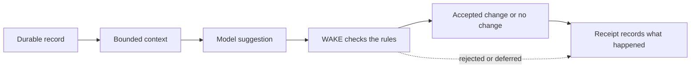
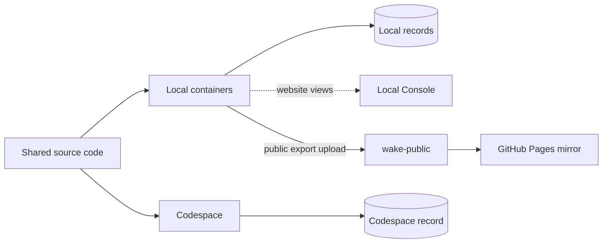

# WAKE✳︎

WAKE✳︎ is infrastructure for durable, accountable work across interchangeable
models, runtimes, and people. A model can suggest a change, but WAKE's rules decide
whether to accept it. The record keeps the evidence, decisions, and history so work
can continue when the model or machine changes.

The local Docker installation presents one complete WAKE website and shared blog,
with three parents and nine children working internally. Its Console adds an
installation overview above the normal panels and lets you inspect each node.
Every launch leaves research stopped for inspection. Native initialization and
every reset enable a continuity campaign automatically; its probes share research
requests.

Research is WAKE's first application. It is a useful way to exercise the record and
governance system; it is not the definition of the WAKE kernel.

The public site is a dated, read-only mirror uploaded from the local installation.
Research executes in the container; the GitHub research executor is retired.
Use [publication instructions](docs/cloud.md#publish-the-local-installation-mirror)
to upload the current unified website and available node views.
Enabled mirror delivery uploads changed exports every 30 minutes by default and
after accepted Bob articles, independently of other nodes' availability. Reader
pages load a small overview first and fetch exact details on demand; full history
remains exported. See [browser views](docs/retrieval.md#browser-views-and-exact-detail).
See [operational resilience](docs/resilience.md) for bounded coordination retries,
explicit worker recovery, failure evidence and reproducible disturbance checks.

Use the [private continuity workflow](docs/continuity/README.md) to preserve human
research notes and engineering handoffs between conversations.

[Ask Bob](docs/ask-bob.md) answers questions about published articles on the public
mirror without sign-in, an API key or a running installation. Readers type a message and send; the chat automatically downloads and prepares
a small model on their device (about 491 MB), with progress and bounded waits.
Questions and replies stay in that browser. The optional local Gemini preview remains separate. Neither
reader surface has research authority or starts automated research.

The [static inspection interface](docs/inspection.md) gives unfamiliar readers and
AI systems plain-text explanations, exact evidence and a reproducible kernel example.

[Open the public site](https://sudofx.github.io/wake/) · [View source and releases](https://github.com/sudofx/wake) · [GitHub Actions](https://github.com/sudofx/wake/actions)

## The basic idea



The model never writes directly to the record. A receipt is kept whether a proposal
is accepted, rejected, deferred, or fails. This makes the work inspectable and
correctable; it does not prove that a research claim is true or that a model is
conscious.

WAKE uses **progressive abstraction with recoverable provenance**. In plain terms,
it shortens material for everyday use while keeping evidence links back to the
exact receipts. Working abstractions keep evidence pointers; a short summary does
not pretend it can restore details that it left out.

The name adds an image to this architecture: **a wave describes possibilities;
a wake carries the consequences of what has occurred.** A wake is both evidence
of the past and an influence on the future. WAKE's durable record carries those
consequences into later work, even when the model that produced them is replaced.
**Quantum Wake Function** names this philosophical metaphor, not a physical
theory, quantum computation, or an implemented function. Read
[why WAKE](docs/why-wake.md) for the full explanation and its limits.

## Choose a guide

| If you want to… | Start here |
| --- | --- |
| Understand the name and its metaphor | [Why WAKE](docs/why-wake.md) |
| Understand the design and its limits | [Architecture](docs/architecture.md) |
| Try the kernel without a model or API key | [Kernel example](docs/kernel.md#executable-non-research-proof) |
| Run one local Docker installation | [Standalone setup](docs/standalone.md) |
| Inspect three parents and nine children inside one container | [Installation setup](docs/standalone.md#run-one-installation-container) |
| Publish container data to GitHub Pages | [Public mirror](docs/cloud.md) |
| Compare research runs or memory settings | [Experiment guide](docs/experiment.md) |
| Understand a project term | [Glossary](docs/glossary.md) |
| Change code and verify the right installation | [Maintainer map](docs/development.md) |

## Set your research topics

Every research installation needs `research-topics.toml`. This repository includes
a default file. If it is missing, make a copy from the example and edit it before
starting the installation:

```sh
cp example.research-topics.toml research-topics.toml
```

If the file is missing, WAKE shows this command and stops before research begins.
In this repository, `research-topics.toml` is tracked. Editing it changes your
checkout; it does not publish anything until you commit and push. Container workers use the topic file in their selected workspace.
A source push does not restart them or upload their data. See [local group topics](docs/standalone.md#repository-convenience-launcher)
for a different topic file per parent.

## Quick local paths

### Offline kernel example

Install the project with Python 3.11 or later, then run the non-research example in
a fresh directory. It uses deterministic fixtures and makes no API calls:

```sh
python3 -m pip install -e .
python -m examples.task_list.run --data /tmp/wake-task-example
```

The example shows an accepted change, a rejected change, and an audit. It is a
small proof of the record-and-rules boundary, not a research run.

### One Docker container

The current local setup runs one `wake` container with twelve internal worker
processes: three parents and nine children. One web server serves the whole
installation and each node's Console. Every launch starts research stopped.
The shared provider queue confirms slot reservations before a model call and
recovers lost handshakes without repeating inference. Research being enabled is
separate from accepted progress; see the [queue and recovery contract](docs/standalone.md#collect-quickly-through-one-shared-api-queue).

```sh
cp .env.example .env
# Configure your provider and edit research-topics.toml.
./scripts/wake_installation build
./scripts/wake_installation start
./scripts/wake_installation shell
wake-research status
# Inside this installation, wake status returns the same controller status.
# Inspect first. Enable research separately when ready:
# wake-research start
```

Open `http://localhost/console.html` (host port 80 by default). Attach VS Code to
`wake` for the writable `/workspace` and existing terminal prompt. The Console's
selector opens an individual node's record. [Standalone setup](docs/standalone.md#run-one-installation-container)
explains controls, destructive `RESET`, manual archives, serial API scheduling,
LAN access, and the optional public mirror.

### Compatibility launchers

The older Compose, `scripts/wake_runner`, numbered container groups, and hosted
executor remain compatibility paths. Their existing operating history is retained;
they are not the default launch path for the one-container installation.

## How installations stay separate



Local containers and Codespaces can run the same code while keeping
separate records and controls. A code push does not copy or reset research data.
The current installation uses fixed worker code until an explicit restart;
`wake-research restart` also enables research, while a container restart returns
to stopped inspection. Its public mirror is a locally prepared read-only export. See
[installation operation](docs/standalone.md#run-one-installation-container).
GitHub Pages serves only the uploaded public snapshot. The old hosted executor
is retired; its records and branches remain historical artifacts.

Legacy multi-container group status lights refresh every five seconds. Their colors follow the same
order as the gateway key: red means operator or agent action is required; yellow
means paused or waiting; green means research is running; blue means idle; purple
means a provider reported quota pressure. WAKE retries on schedule and can recover
when a provider becomes available. Gray means status could not be confirmed. See
the [glossary](docs/glossary.md) and [public mirror guide](docs/cloud.md).

## What else is included

- The mandatory `continuity@1` research campaign adds a structured probe to a normal model
  response; it does not make an extra provider call. See [campaign operation](docs/standalone.md#continuity-matrix-campaign).
- Routine memory and source retrieval are bounded views of the full record. Exact
  history remains available for audit. See [retrieval](docs/retrieval.md).
- Bob is a plain-language byline for selected summaries of already-recorded work.
  Bob does not choose topics or accept research.
- WAKE preserves uncertainty, failure, rejection, and correction instead of
  rewriting them as success. See the [experiment protocol](docs/experiment.md)
  before interpreting results.

## Maintainer and project references

- [Architecture and known limits](docs/architecture.md)
- [Reusable kernel contract](docs/kernel.md)
- [Development and verification map](docs/development.md)
- [Independent installations and optional gateway](docs/installations.md)

For exact behavior, current code and tests are authoritative when they disagree
with prose. Update the relevant guide when behavior changes.

## License

WAKE✳︎ is licensed under the **GNU Affero General Public License v3.0 only
(AGPL-3.0-only)**. Modified versions used to provide network interaction must meet
the license's corresponding-source requirements. A separate commercial license may
be requested from the copyright holder. Earlier versions published under MIT remain
available under the rights already granted for those versions.

## Verify

With the project dependencies installed, run the offline test suite:

```sh
python3 -m unittest discover -s tests -v
```

These checks use fixtures. They do not make live-model calls or certify a hosted
installation. Follow the [maintainer map](docs/development.md) for checks matched
to a specific deployment.

Worker groups synthesize one model-written WAKE01 introduction from every parent and
child and publish identical text on all members before ordinary research requests begin.
The introductory checkpoint does not increment accepted research progress. Later
articles explain group progress in plain language, with attributed references and
a particularly simple Summary. Three posts are scheduled per 100 accepted wakes
across the group (at totals 34, 67, 100, and so on); overdue work stays due without blocking research. Language is
editorial guidance, while supplied references and research evidence rules remain
required independently. New articles supply structured paragraphs and reference
numbers; deterministic rendering adds citations and the Summary heading, retaining
the exact provider response and a replay-verified rendering receipt. Existing dated
node exports remain usable while a worker is unavailable.
See the [editorial contract](docs/development.md#first-run-publication-and-passenger).
`./scripts/wake_publish --watch` delivers later accepted articles from immutable
exports while preserving research controls.
The homepage brings readers into an open question and Bob's latest story;
`blog.xml` lets them follow new articles through RSS. Later articles receive
bounded prior-publication context so they can revisit earlier questions without
treating Bob's prose as scientific evidence. See
[reader experience and editorial continuity](docs/development.md#reader-experience-and-editorial-continuity).
Compatible completed node pages are reused; incompatible pages rebuild from the
captured snapshots. Local Console views defer hidden charts and share lightweight
read-only status updates. See [website observation](docs/development.md#lightweight-website-observation)
and [mirror capture](docs/cloud.md#publish-the-local-installation-mirror).
Container installations also have **Passenger**, a private, installation-wide
Markdown workspace for Bob's operational assessments and proposed changes.
The current installation shares its private Passenger storage root; compatibility
named groups share the project-root `.passenger.md`. First publication adds a
factual receipt without another model call. Passenger cannot execute changes or govern research. See
[first-run publication and Passenger](docs/development.md#first-run-publication-and-passenger)
for persistence, privacy, shared storage and operator reset.

### Retained hosted reset

Hosted Reset verifies the old authority and retains its exact checkpoint on a
`wake-archive-*` branch before initializing a small new database. The native
initialization receipt records the archive branch, commit and prior domain head.
Active research cycles, provider accounting and continuity results start at zero;
the fresh continuity campaign is enabled without a provider call. Historical
records stay in the archive rather than accumulating inside the new database.
Compatibility local in-place resets retain history. The current uppercase
`wake-research RESET` instead destroys active records without a backup and leaves
research stopped; existing manual exports survive.

Bob’s public articles use plain prose, including the built-in welcome. Markdown
is confined to Passenger. Public display removes legacy heading markers without
rewriting historical receipts.

Lossless storage compression preserves exact records, hashes and replay. Version 13
shares repeated long strings within stored JSON values when that saves space.
See [storage compatibility](docs/kernel.md#physical-storage-and-compatibility).

Compatibility zero-cycle resets can enable an empty continuity campaign. For the
current destructive reset contract, see [installation controls](docs/standalone.md#control-research-from-the-shell).

Research jobs can succeed without advancing the journal: rejected proposals and provider deferrals remain visible. The proposal contract copies the current version exactly and limits measured-result references to operator-recorded reproductions; accepted journal cycles remain the progress signal.

Under forward quality policy, notebook proposals supply structured claims and omit the duplicate `findings` field. WAKE renders findings from those exact statements and support IDs before validation. Historical proposals with supplied findings remain valid only when they match the claims exactly; conflicting prose is never repaired. Source support and accepted-cycle accounting retain their existing checks.

Source delivery compacts the parsed source packet rather than cutting serialized JSON. Bounded views preserve source classification and select exact substantive prose ahead of titles, authors and PDF front matter. Escaped JSON stays within the provider budget, and successive shortening retains a quotation surface. These are incomplete derived views; full source records, IDs, provenance and exact-passage validation remain authoritative.
