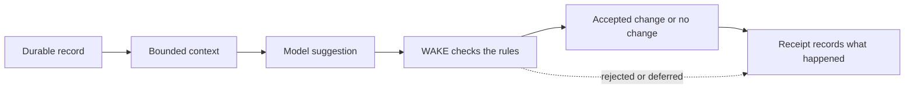
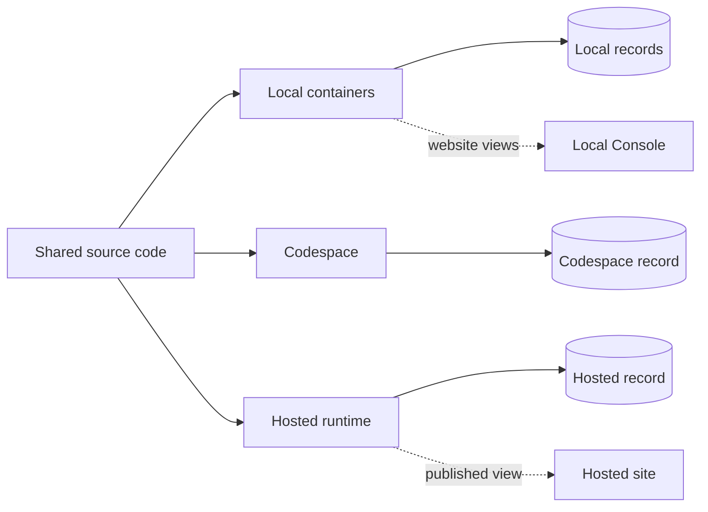

# WAKE✳︎

WAKE✳︎ is infrastructure for durable, accountable work across interchangeable
models, runtimes, and people. A model can suggest a change, but WAKE's rules decide
whether to accept it. The record keeps the evidence, decisions, and history so work
can continue when the model or machine changes.

Research is WAKE's first application. It is a useful way to exercise the record and
governance system; it is not the definition of the WAKE kernel.

[Open the public site](https://sudofx.github.io/wake/) · [View source and releases](https://github.com/sudofx/wake) · [GitHub Actions](https://github.com/sudofx/wake/actions)

## The basic idea



The model never writes directly to the record. A receipt is kept whether a proposal
is accepted, rejected, deferred, or fails. This makes the work inspectable and
correctable; it does not prove that a research claim is true or that a model is
conscious.

WAKE uses **progressive abstraction with recoverable provenance**. In plain terms,
it shortens material for everyday use while keeping evidence links back to the
exact receipts. Working abstractions keep evidence pointers; a short summary does
not pretend it can restore details that it left out.

## Choose a guide

| If you want to… | Start here |
| --- | --- |
| Understand the design and its limits | [Architecture](docs/architecture.md) |
| Try the kernel without a model or API key | [Kernel example](docs/kernel.md#executable-non-research-proof) |
| Run one local Docker installation | [Standalone setup](docs/standalone.md) |
| Create a local group with separate parent and child researchers | [Group setup](docs/standalone.md#repository-convenience-launcher) |
| Operate the GitHub-hosted research instance | [Hosted operation](docs/cloud.md) |
| Compare research runs or memory settings | [Experiment guide](docs/experiment.md) |
| Understand a project term | [Glossary](docs/glossary.md) |
| Change code and verify the right installation | [Maintainer map](docs/development.md) |

## Set your research topics

Every research installation needs `research-topics.toml`. This repository includes
a default file. If it is missing, make a copy from the example and edit it before
starting the installation:

```sh
cp example.research-topics.toml research-topics.toml
```

If the file is missing, WAKE shows this command and stops before research begins.
In this repository, `research-topics.toml` is tracked. Editing it changes your
checkout; it does not publish anything until you commit and push. Hosted research
uses the file in its promoted commit, and the Restart workflow checks that it is
present before promotion. See [local group topics](docs/standalone.md#repository-convenience-launcher)
for a different topic file per parent.

## Quick local paths

### Offline kernel example

Install the project with Python 3.11 or later, then run the non-research example in
a fresh directory. It uses deterministic fixtures and makes no API calls:

```sh
python3 -m pip install -e .
python -m examples.task_list.run --data /tmp/wake-task-example
```

The example shows an accepted change, a rejected change, and an audit. It is a
small proof of the record-and-rules boundary, not a research run.

### One Docker container

With Docker Compose installed, set `GEMINI_API_KEY` in a local `.env` file if you
want live research. Then create topics and start WAKE:

```sh
cp .env.example .env
# Add GEMINI_API_KEY for live research, or set WAKE_PROVIDER=fixture for an offline rehearsal.
cp example.research-topics.toml research-topics.toml
# Edit research-topics.toml
docker compose up --build -d
```

Open [http://localhost:8080](http://localhost:8080). For an inspection-only
installation, set `WAKE_PAUSED=true`. Each installation has its own data volume. Ordinary
`docker compose down` preserves that data. The [standalone guide](docs/standalone.md)
covers backups, LAN access, updates, and the repository runner.

### Local research group

The repository runner creates a numbered group and its child researchers. Give the
group a shared topic file first, then run:

```sh
cp example.research-topics.toml research-topics.toml
# Edit research-topics.toml
./scripts/wake_runner wake --count 3
```

This creates `000.wake` as the gateway, three independent parent containers,
and three child containers under each parent. Parents use 100-step names such as
`100.wake`; children use `101.wake`, `102.wake`, and `103.wake` under that
parent. The next parent group is `200.wake` with children `201.wake` through
`203.wake`, then `300.wake` with children `301.wake` through `303.wake`. Each
node keeps its own record. These local hostnames use plain HTTP; the iPhone can
use the gateway's LAN address and each node's published port.
Parents and their children can exchange bounded research material on the local
Docker network; an unreachable peer does not stop another node. To give each parent
different topics, prepare `.wake-runner-topics/100.wake.toml` and the
matching files for the other parents before creating the group. The [group guide](docs/standalone.md#repository-convenience-launcher)
explains addresses, node page links, child visibility, live terminal status, and lifecycle commands.

## How installations stay separate



Local containers, Codespaces, and hosted WAKE can run the same code while keeping
separate records and controls. A code push does not copy or reset research data.
Editable local containers reload saved code after completing the current attempt;
their websites are regenerated from their own retained records. See
[code changes and timed research pauses](docs/standalone.md#code-and-website-changes).
The hosted research runtime uses the explicitly promoted `wake-runtime` branch;
GitHub Pages is a separate read-only view.

Local group status lights refresh every five seconds. Their colors follow the same
order as the gateway key: red means operator or agent action is required; yellow
means paused or waiting; green means research is running; blue means idle; purple
means a provider reported quota pressure. WAKE retries on schedule and can recover
when a provider becomes available. Gray means status could not be confirmed. See
the [glossary](docs/glossary.md) and [hosted status details](docs/cloud.md#read-or-wake-it).

## What else is included

- The optional `continuity@1` campaign adds a structured probe to a normal model
  response; it does not make an extra provider call. See [campaign operation](docs/standalone.md#continuity-matrix-campaign).
- Routine memory and source retrieval are bounded views of the full record. Exact
  history remains available for audit. See [retrieval](docs/retrieval.md).
- Bob is a plain-language byline for selected summaries of already-recorded work.
  Bob does not choose topics or accept research.
- WAKE preserves uncertainty, failure, rejection, and correction instead of
  rewriting them as success. See the [experiment protocol](docs/experiment.md)
  before interpreting results.

## Maintainer and project references

- [Architecture and known limits](docs/architecture.md)
- [Reusable kernel contract](docs/kernel.md)
- [Development and verification map](docs/development.md)
- [Independent installations and optional gateway](docs/installations.md)
- [Private development workbench](docs/workbench.md)

For exact behavior, current code and tests are authoritative when they disagree
with prose. Update the relevant guide when behavior changes.

## License

WAKE✳︎ is licensed under the **GNU Affero General Public License v3.0 only
(AGPL-3.0-only)**. Modified versions used to provide network interaction must meet
the license's corresponding-source requirements. A separate commercial license may
be requested from the copyright holder. Earlier versions published under MIT remain
available under the rights already granted for those versions.

## Verify

With the project dependencies installed, run the offline test suite:

```sh
python3 -m unittest discover -s tests -v
```

These checks use fixtures. They do not make live-model calls or certify a hosted
installation. Follow the [maintainer map](docs/development.md) for checks matched
to a specific deployment.

Worker groups synthesize one model-written WAKE01 introduction from every parent and
child and publish identical text on all members before ordinary research requests begin.
The introductory checkpoint does not increment accepted research progress.
Container installations also have **Passenger**, a private, installation-wide
Markdown workspace for Bob's operational assessments and proposed changes.
Named groups share the actual project-root `.passenger.md`; first publication adds a
factual receipt without another model call. Passenger cannot execute changes or govern research. See
[first-run publication and Passenger](docs/development.md#first-run-publication-and-passenger)
for persistence, privacy, shared storage and operator reset.

### Fresh hosted reset

Hosted Reset verifies the old authority and retains its exact checkpoint on a
`wake-archive-*` branch before initializing a small new database. The native
initialization receipt records the archive branch, commit and prior domain head.
Active research cycles, provider accounting and continuity results start at zero;
the fresh continuity campaign is enabled without a provider call. Historical
records stay in the archive rather than accumulating inside the new database.
Local in-place resets retain their history and are a separate operation.

Bob’s public articles use plain prose, including the built-in welcome. Markdown
is confined to Passenger. Public display removes legacy heading markers without
rewriting historical receipts.

Lossless storage compression preserves exact records, hashes and replay. Version 13
shares repeated long strings within stored JSON values when that saves space.
See [storage compatibility](docs/kernel.md#physical-storage-and-compatibility).
