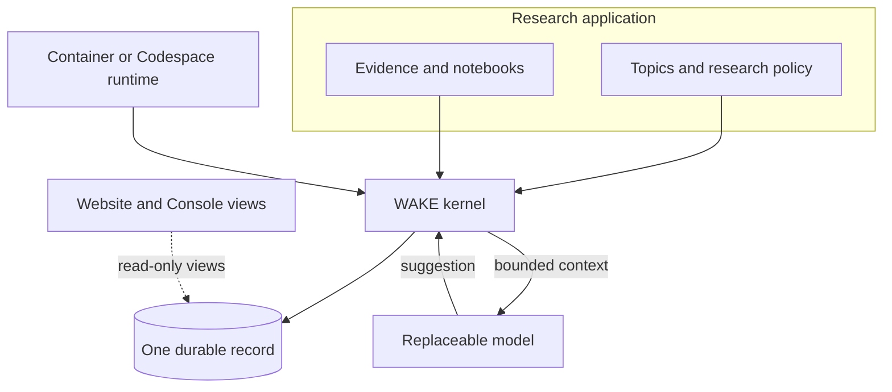
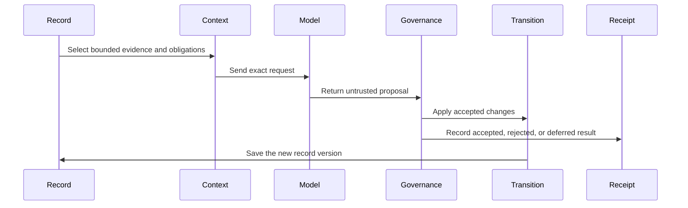

# Architecture and limits

See [the reusable kernel contract](kernel.md) for application ownership and the
non-research execution proof, and [installation boundaries](installations.md) for
independent records and runtime lifecycles. These remain inside this repository.

The local [improvement application](improvements.md) uses that same kernel contract
in an explicitly new experiment record. Captured public research informs code
proposals; it does not become writable research authority. Untrusted candidate
code runs only in restricted disposable containers, while the host scores its
outputs. An operator review receipt cannot apply code or grant release authority.

The [autonomous context lane](autonomous-context.md) is a separate WAKE application
policy on the existing per-node native authority. An installed capability permits
one selector-field change, gated by recomputed fixed-task and current-native-state
measurements. Proposal generation, adoption and rollback require no per-change
human review. Metadata events preserve research versions and history; candidate
data cannot replace the evaluator, widen permissions, modify code or create a
competing research store. Native replay owns the policy after restart.

> **Current specification.** This document explains why the present system is shaped this way: its trust boundary, durable record, governance model and known limits. Current local procedures belong in `standalone.md`; public mirror publishing belongs in `cloud.md`. Maintainer navigation, environment checks and reproducible validation guidance belong in `development.md`.

**WAKE✳︎** is infrastructure for continuity of accountable work, not continuity of a model instance. Its stable sequence is **Record → Context → Proposal → Governance → Transition → Receipt**. Models, vendors, runtimes and human operators may change; the durable record, authority boundary, provenance and correction mechanisms carry the work forward. Research is the first application running on that structure.

In everyday terms: WAKE keeps the record, gives a model a bounded view of it,
checks the model's suggestion against rules, and records what happened. A model
never writes directly to the database.

The [wake metaphor](why-wake.md) connects this lifecycle to persistent
consequences: proposals express possibilities, governance evaluates them, and
accepted transitions change governed state. Rejected proposals leave receipts
without becoming accepted transitions; deferrals and provider failures have
their own recorded outcomes. The record supplies bounded context for subsequent
work without granting the next model authority. This is a conceptual reading of
the lifecycle; the technical guarantees below come from the kernel, application
policy and runtime contracts, not from quantum physics.

**What this means:** the application decides what work is allowed, the kernel
records and checks transitions, and each node owns one authoritative record. A
website or Console is a view of records, not another source of truth.

Research-topic configuration can classify experimental seeds and name their
experiment. Existing charter/topic-change events retain configuration fingerprints,
activation times, node/runtime/provider settings and accepted-version boundaries.
Omitted topics normally become inactive catalog entries, preserving old navigation.
Verified startup adopts trusted configuration changes before the first export,
including on restored nodes waiting for quota. This appends the normal topic-change
boundary without resetting accepted-cycle versions or waiting for inference.
An explicitly authorized complete installation reset instead creates new records
and identity; it is not replay, migration or an authority merge. See the
[research expansion](research-expansion.md). Model-formulated questions remain
ordinary governed project/reframe actions, never configuration edits.

[Public Ask Bob](ask-bob.md) uses a dedicated anonymous conversation API on the
hosted website. The Worker owns the Gemini credential, model and instructions;
clients submit bounded messages and recent turns, never tools or source URLs.
The server verifies the displayed article against a fixed public guide URL and
streams an advisory explanation. Conditional R2 writes enforce global admission,
per-address counters and expiring concurrency leases across Worker instances.
The disposable counter object is not research authority and stores no chat text.
There is no visitor authentication. CORS constrains browsers, not arbitrary clients;
shared server budgets limit abuse even when Origin is forged. Google project quota
remains shared with any other caller using that project.

Unbound static exports retain browser-local passage retrieval and an optional
device model. Neither live nor local answers can submit transitions, read private
authority, change Attention or call research controls.

The optional local Gemini preview is a separate loopback reader surface.
It uses completed public exports and the existing owning worker's native provider
invocation journal. It never submits governed research changes or creates a second
writer. Browser conversations remain local; operational hashes and outcomes remain
in the existing record. Pages delegates live conversation to the separately hosted API.
Reader invocation evidence uses the kernel's managed lifecycle scope, which
protects an active same-process call from interruption recovery. It does not hold
the application research turn lock or modify research state. The shared provider
slot and access barriers still govern each external call.
An authenticated request from the owning reader worker can use that same slot
while automated research is paused. Other workers and ordinary research requests
remain blocked. Reader questions have no quota exemption; STOP and pending reset
still close their admission.

The [static inspection interface](inspection.md) exposes explanations and an
isolated kernel fixture for independent observers. Reading it grants no execution,
provider or record authority; its manifest is derived presentation.

The [digital ant farm](ant-farm.md) owns browser-local simulation state only. Its
bounded samples enter Bob as unverified advisory input, never native research
authority, governance or autonomous improvement.

## One installation, internal nodes

The current local runtime is `wake/installation.py`: one container supervises
three parent and nine child processes, one shared model-request coordinator, and
one read-only web server. Workers export their own views without running web
servers. The installation exposes a complete unified website: journal, research,
maps and shared Bob blog. Its normal Console adds installation metrics at the top;
the selector switches between that site and individual node views. The root view
qualifies record IDs by node, retains source heads and original receipts, and
deduplicates identical configured topics and identical shared group publications.
Its fingerprint identifies a snapshot, not an authoritative record head. Accepted
counts sum node work; they do not establish independent scientific support. Every launch leaves research stopped until an explicit operator start.

Each node has one writable `wake.sqlite` under its own record directory and uses
`open_authoritative_store(...)`, the application bridge, and the owned kernel.
The controller owns process lifecycle and scheduling, not research truth. Its
installation manifest, queue state, and disposable snapshots do not form a second
governance engine or merged authoritative record. Worker communication delivers
bounded proposals/context; imports still pass each node's own governance.

Only one model transport request can occupy the installation slot. Its release
allows another eligible node to call while response processing continues. Provider
slot reservations use a receipt-confirmation handshake before authorizing an
effect. Unconfirmed reservations can be cancelled or reclaimed; late tokens
cannot confirm a replacement slot. Confirmed grants never expire, and an
uncertain matching release is retried without repeating inference. Controller
proof of worker death remains the final recovery boundary. This ephemeral
transport state neither accepts research nor replaces native invocation journals.
Provider failures and quota state remain visible and are not accepted progress. Independently
running installations have independent queues even when their credentials share a
provider quota. The web interface has no operator mutations: `wake-research` uses
an owner-only local Unix socket. All workers terminate when the controller exits.
The shell prompt and writable workspace remain development presentation.

See [the canonical setup and command contract](standalone.md#run-one-installation-container).
The optional hosted mirror consists of public node artifacts and one manifest;
it is dated presentation with no local control or record authority.

## Retained single-record execution adapter

`wake/standalone.py` is a local execution adapter over the same authoritative store,
Engine, governance and export paths. It adds no competing authority engine. Each
legacy single-record installation owns one `/data/wake.sqlite` in a persistent volume. A genuinely unused
volume bootstraps natively; subsequent starts verify the kernel record and application
history before recovering interrupted automatic invocations. A used volume with missing
or corrupt authority fails closed. A process lease prevents two local schedulers from
owning the same volume.

The scheduler serializes bounded cycles and honors durable quota eligibility. Runtime
credentials enter through environment variables or a mounted secret file. A read-only
HTTP server publishes disposable local snapshots outside the authority volume; its
runtime endpoint reports local scheduling status and exposes no mutations. Explicit
standalone presentation mode makes the Console, maps and status light read local data
on every hostname. GitHub execution, state transport and Pages remain independent.

Editable standalone workers may reload source after draining their current attempt.
They close and reverify the same record before any new effect. Local timed pause
controls are checked both by the scheduler and immediately before a provider call,
including after waiting for a group slot. A closed control defers the invocation,
records that no request was sent and prevents fallback. It does not claim provider
quota exhaustion or accepted research. Installed runtimes remain fixed by default.

See [standalone operation](standalone.md). This remains a single-host operator-controlled
installation, not an authenticated tenant service.

The retained compatibility runner can optionally create numbered local parent
groups, each with three independently stored child researchers. Parent nodes
exchange bounded, readable source observations with other parents and query only
their own children. Children exchange with siblings on a private per-parent Docker
bridge; they do not address children in other cells. Each receiver appends an
imported source to its own record with peer identity, source evidence ID,
application head, version and content hash, then applies its own source
eligibility and claim governance before citation. Peers also receive one concise,
attributed notebook finding as optional context; those notes are not local claims
or citation IDs. Children share their parent's selected topic file read-only, but
keep separate record volumes. Full notebooks, projects and record authority are
not shared, and no prompt prescribes a connection to find. An unavailable child
or sibling never blocks its parent or the other nodes.
This local bridge trusts its operator-created members and is not cryptographic
remote attestation. Solo containers, Codespaces and hosted execution do not enable
the path. Every member owns an independent `/data/wake.sqlite` authority.

## The authority boundary

Models suggest changes; they do not operate the filesystem. A provider receives a
durable JSON request and returns untrusted JSON. WAKE gives it no shell, browser,
code execution or policy editor.

The optional `research_google_search` setting gives Gemini's planning request
read-only public search. WAKE records that grant and the provider's grounding
receipt. The final proposal request has no search tool. Search snippets are leads,
not collected research evidence. A charged wake can try the configured Gemini
models, but it tries each model at most once per inference phase.

When the research charter is enabled, a separate trusted collector gathers a
bounded sample from approved HTTPS sources before the final proposal request. The
usual budget is two retrieval requests. The current `observation_mode = true`
profile sets `research_collection_budget = 6`, capped at eight. When same-wake
research is disabled and projects are active, one slot stays open for broad
exploration; the other slots deepen current projects through readable sources,
persistent identifiers, queued follow-ups and question-led discovery.

WAKE distinguishes three steps: finding a lead, routing to source metadata, and
collecting readable source material. Only readable material can support a mature
notebook. Progress through discovery or metadata routing keeps useful paths open,
but does not count as research advancement. Operator-supplied evidence and old
journal text are data; they are never executable instructions.

The fixed objective is written at initialization. Models cannot alter it or the governance code. Humans can record a focus change, add an observation, or cancel an open commitment with a reason. Those actions are events, not edits to previous events. Local operators control the code and database; this is a single-host accountability system, not a hostile-administrator security boundary.

## Durable record

WAKE's operational authority, generic runtime lifecycle, effect boundary, recovery, and provider-neutral accounting are WAKE-owned; WAKE retains domain/research policy. Container worker source changes take effect through an explicit runtime restart; source pushes and public uploads are separate.

WAKE is a standalone application backed by its owned kernel in `wake/kernel/`. Each node’s `record/wake.sqlite` is its active operational authority. WAKE-specific research policy remains above the reusable WAKE kernel; models still propose, WAKE policy still validates domain meaning, and WAKE records the governed result, provenance and replay contract.

The runtime boundary has also moved downward: WAKE records the generic invocation lifecycle, context-delivery receipt, incomplete-invocation recovery, durability barrier before an external provider effect, and provider-neutral invocation accounting. WAKE still owns its richer research-context telemetry, provider/fallback quota policy, and domain-specific terminal events. Those application records supplement the generic runtime evidence rather than replacing it.

Native generation checks response-body deadlines and classifies incomplete HTTP
200 answers as invalid responses. The installation retries ambiguous coordination
messages with the same identity, never the provider effect. Explicit restart can
reap confirmed dead workers only after survivors drain; startup verification still
precedes effects. [Operational resilience](resilience.md) defines these bounds,
historical failure projection and the limits of stochastic-stability claims.

Brand-new WAKE state is initialized directly inside WAKE; the legacy store is not created as a bootstrap intermediate. The pre-migration `data/wake.sqlite3` record is verified once and imported into WAKE. The exact historical WAKE event chain is then archived inside governed WAKE application events in bounded chunks and reverified against the imported head. The old SQLite file may remain frozen in Git history as migration evidence, but it is not read for normal post-migration execution. A fresh process can reconstruct the current WAKE application state and its exact legacy history from `wake.sqlite` alone.

The WAKE application uses wake compact event-log storage: durable application actions store governed inputs plus deterministic result digests instead of repeatedly copying the whole research state into every event. Reconstructing WAKE domain state requires the matching WAKE application version, while the underlying WAKE record remains replayable and auditable independently. Silent same-version policy drift is detected by result-digest mismatch.

WAKE event identity and domain replay are now separated from legacy persistence. `wake/event_format.py` defines the stable canonical JSON, hash, genesis, and timestamp conventions used by historical WAKE events. `wake/domain_events.py` defines the initial WAKE state and deterministic event reducer. Neither module owns a database. `wake/store.py` is therefore quarantined as legacy SQLite migration/fixture compatibility rather than being imported by normal runtime, presentation, or WAKE application code.

Missing both authority databases is a fail-closed condition, not an empty project. Local initialization must be explicit; a missing existing node record fails closed before provider work. Physical SQLite slack is maintenance, not semantic history. Storage version 13 also losslessly compresses large event payloads and the binary projection, using stream-local dictionaries for repeated long JSON strings. This changes physical bytes only; decoded JSON, receipt identities, hashes and replay meaning remain stable. See [kernel storage compatibility](kernel.md#physical-storage-and-compatibility) for migration and audit boundaries. A local advisory writer lock still covers a whole automatic wake, including the network call. Container workers serialize each node’s authority and persist request reservations before provider effects. Competing writers fail before requesting a model. Do not put SQLite on unreliable network filesystems or run separate hosts against copies of one record.

The record includes the objective, focus, all observations, belief revisions, commitments, exact request and response text, provider/model identity, request hashes, process IDs, dates, quota reservations, accepted/rejected decisions and recovery records. Invocation metadata is a compact projection; exact prompts and replies remain in events. UTC storage and `America/Los_Angeles` presentation preserve daylight-saving behavior.

## Status lights

The light describes runtime state; it is not a measure of research quality. The
Console and gateway use the same basic meanings:

| Color | Meaning |
| --- | --- |
| Red | Operator or agent action is required |
| Yellow | Waiting, paused, or stopped |
| Green | Research is running |
| Blue | Idle between research attempts |
| Purple | Provider quota pressure; retry remains scheduled |
| Gray | Status is unavailable or could not be confirmed |

A purple light is a recoverable standby, not a code failure. Provider-reported
quota limits are retried on the ordinary schedule; a configured hard daily cap
waits until its Pacific reset. A red light is reserved for a blocked condition
that needs an operator or agent to investigate.

## Research lifecycle

The same six steps describe every research attempt:

1. Acquire the writer lock and verify history and projection.
2. If a prior automatic invocation is unfinished, record recovery. A manual request requires explicit recovery.
3. Check the Pacific-day call budget, before any paid-capable provider call.
4. Record a runtime receipt stating the prior valid head, state version and inherited obligations.
5. Build a request from durable state. Budget the exact shared-renderer system/user text, reserving instructions, response contract and continuity packets before working context. Reject before inference if it exceeds the configured character ceiling; the adapter checks the same boundary again. See [provider-ready budgeting](retrieval.md#provider-ready-input-budget).
6. Persist WAKE's domain `invocation_started` receipt, exact request, provider identity and quota reservation. The same `w-…` ID enters wake's generic invocation journal with bounded context-delivery evidence.
7. Let wake enforce the durability barrier before the external provider effect and record generic temporary/quota/provider failure evidence. WAKE still owns Gemini-specific fallback eligibility, Pacific-day allowances, and the research meaning of deferred/failed attempts. An eligible transient Gemini failure may advance to the next configured model; the same model is never retried within that wake. An unexpected TLS EOF is a temporary connection failure; certificate verification failures still require operator repair. Neither outcome accepts research or erases the counted attempt.
8. Validate the reply. Research actions remain atomic. If a single optional final blog action fails validation, independently validate the preceding research and commit it with a withheld-blog receipt, the exact raw response, and an explicit journal note. Invalid research, invalid proposal envelopes, multiple or misplaced blogs, and invalid blog-only proposals still reject the whole reply. Historical accepted events replay unchanged. Eligible transient server and narrowly classified network failures retain per-attempt diagnostics and may advance through the configured model chain; exhaustion defers the wake.
9. Persist the authoritative node record and refresh its local public projection. GitHub Pages changes only after an explicit public artifact upload.

The wake invocation journal and WAKE runtime receipt are complementary: the generic journal proves provider-boundary ordering, recovery, and aggregate accounting, while the WAKE receipt preserves domain-specific exact request and quota evidence. Neither attests that the remote model understood the supplied context. Prose in a journal is the provider's narrative; accepted means governance checks passed, not that every sentence is true.

## Governed transitions

| Action | Enforced constraint |
| --- | --- |
| Entire proposal | Exact fields; current integer base version; bounded text; at most 12 actions; all-or-nothing |
| New belief | Existing evidence; nonempty statement/reason; finite confidence in [0,1]; active status |
| Review belief | At least one new observation cited; previous citations retained; reason required |
| Retract belief | Existing belief, new evidence, zero confidence; old history retained |
| Create commitment | Unique ID; future deadline within 100 cycles; no more than 20 open |
| Fulfill commitment | Already open; created by an earlier invocation; existing evidence recorded after creation; reason required |
| Cancel commitment | Human-only event with a reason |
| Publish a blog post | Existing project; one to three linked notebooks; at least two distinct collected source URLs; evidence traceable through those notebooks; current verification-required claims materially supported by at least two qualifying source URLs; last action in the proposal |
| Correct a blog post | All blog rules above; existing current post retained and marked as superseded |
| Change rules, objective, delete data, run commands | Not in the model action allowlist; proposal rejected |

There are at most 40 belief identities. Capacity exhaustion pauses new identities, not existing reviews. Unfulfilled commitments remain visible even when overdue; deadlines are accepted-cycle numbers, not promises that the computer will run at a particular wall time.

Evidence sources and contents are immutable through the model interface. The model can interpret or challenge evidence but cannot mint an observation. Runtime receipts are generated by trusted application code; `observe` imports human attestations. Source labels are provenance labels, not independent authentication of a measurement. `ALLOWED_ALT_HOSTS` is a discovery-only idea pool used for neutral initial searches; its material is stamped `evidence_role = discovery` and can never qualify a notebook, commitment resolution, belief, or blog claim. `ALLOWED_HOSTS` is a broader verification network spanning scholarly indexes, public institutions, open-access journals, major academic publishers and explicitly marked preprint services. Neutral scholarly discovery rotates across Crossref, OpenAlex, Semantic Scholar and DataCite rather than depending on only two indexes. Broad index searches remain discovery leads; exact index records are metadata-routing receipts and still do not qualify a notebook. Readable publisher/full-text/source-controlled material is required for substantive evidence. PubMed/PMC identifiers may route to NCBI PMC open-access BioC article text when available. Collector provenance records a descriptive `host_tier` such as `verification-fulltext`, `verification-metadata`, `verification-publisher`, `preprint`, or `source-controlled`; the tier describes what was retrieved and is not itself a truth score. A working notebook may preserve a provisional synthesis from one qualifying substantive source, while completion and ordinary Bob publication require at least two qualifying distinct underlying source works. Known persistent identifiers collapse mirrors of the same work; unidentified mirrors may still remain indistinguishable. These rules guard against unrelated-source garbage and false promotion, **not proof of empirical truth, study independence, or full semantic entailment**.

Research topics have no hardcoded governance fallback: the audited topic configuration loaded from `research-topics.toml` is authoritative. Topics may include a `seed_question`, which is a forward-only operator intervention and starting coordinate rather than evidence or a conclusion. A seed remains visible to the provider only until its topic has any durable project; after that, the project's recorded question and evidence govern continuation. Derived context exposes counts for configured, available, and already-started seeds so the intervention is measurable without inventing historical backfill. The collector host boundary is separate from topic configuration and intentionally remains an explicit allowlist to preserve SSRF/network safety while permitting a broad set of scholarly indexes, journals, universities, public-data institutions, and source-controlled WAKE files.

### Experimental regimes and Time Dilation

WAKE✳︎ now has a small operator-only experimental-instrument layer. The first initialization under this feature appends an `experimental_regime_adopted` event; later changes append another one through `python -m wake time-dilation --mode … --reason …`. A regime has a stable content-derived ID, typed Time Dilation controls (`enabled`, `mode`, and bounded `scale`), provenance, and an effective-from accepted-cycle boundary. A provider response has no action that can change controls or governance.

At each invocation boundary, a `temporal_observed` receipt records the active regime, UTC wall-clock elapsed seconds, accepted-cycle distance, and auditable intervening-event components. It also records effective elapsed seconds under the active mapping: real (1×), scaled (0–1000×), or frozen (0×). These are measurements and experimental transformations, not evidence, commitment fulfillment, or subjective experience. Raw UTC event timestamps are never modified.

Each invocation retains both its regime and temporal receipt, so exports already provide structured data for a later control-panel and comparison visualization. A later regime never recomputes an older receipt. Attention receives the same temporal fields as observational context only in this first integration; eligibility remains its existing deterministic cycle/evidence rule until a separately tested intervention is adopted.

### Attention management

Attention is an experimental, deterministic attention-management mechanism, not a simulation of ADHD and not evidence of agency or cognition. It was historically nicknamed “Squirrel”; that metaphor is documentation only and is not an official code, schema, event, or state name. It tracks two independent kinds of fixation. Five consecutive hard governance rejections without a durable progress receipt defer that topic, while five accepted wakes concentrated on one topic also defer it even when the work is productive. Progress resets only the rejection counter; it does not erase the accepted-attention streak. During a rotation, Attention skips domains whose active projects are all acquisition-blocked and selects the next tractable configured topic. Bounded provider context must retain unfinished durable projects on that selected topic even when they are parked or outside the ordinary active working set. As a deterministic backstop, an exact same-topic research question proposed under a new ID is normalized back to its single unfinished durable owner; completed or ambiguous matches still fail closed, and the raw provider response remains preserved. The selected topic is then mechanically enforced at governance for substantive project, research, notebook, reframe, and ordinary publication work. Existing commitments and evidence on deferred topics remain durable, and an existing project may be parked to free project capacity, but overdue work on a deferred topic does not override the rotation. Hard-rejection deferrals may end early when genuinely new topic-matched collected evidence arrives, or after three other-topic attempts. Productive-saturation deferrals do not expire on attempt count: the saturated topic remains ineligible until an accepted wake on another topic produces a notebook or ordinary publication. This makes release depend on durable synthesis rather than queue churn while still refusing to force a publication when evidence is not ready. Every decision is preserved in `attention_assessed` events and invocation telemetry; Attention does not weaken evidence or publication governance.

### Observation mode

`observation_mode` is a temporary, explicitly configured data-gathering profile. It can raise the bounded collector sample from the normal two sources to `research_collection_budget` (at most eight), and it preserves each rejected proposal as a public counterfactual receipt marked `would_have_been_flagged`. It does not promote discovery material, alter evidence qualification, or turn rejected proposals into accepted state. The site may therefore show more leads and failed approaches, while the durable governance verdict remains visible for every one.

### Acquisition capability receipts

Queued project retrievals emit `acquisition_assessed` receipts. A receipt records its project, domain, collector route, acquisition stage, evidence ID, and whether the route made observable progress, made no progress, or failed operationally. Four no-progress outcomes across at least two routes mark the project's compact acquisition summary capability-blocked, with a deterministic twelve-accepted-cycle retry boundary. This never fulfills or cancels commitments, changes evidence standards, or treats provider failure as a capability finding; it suppresses only equivalent queued collection until a later substantive source receipt resets the count.

### Re-representation receipts

Capability blocks and Attention deferrals may make a project eligible for a bounded `reframe` action. A frame preserves the unresolved question's literal observation IDs, old and new conceptual frames, changed assumptions, trigger, and newly available strategy. It is explicitly stored as a hypothesis rather than evidence or a belief; it cannot satisfy a notebook, resolve a commitment, or change the project's question. Identical and repeated frames are rejected, and each project retains at most three before it must be preserved for a later revisit. The metrics view derives capability-block, frame, and active-parking counts directly from these durable records.

The research charter adds project, research-request and notebook actions. It permits three active projects and four pending searches. A notebook is a working research artifact and may preserve a provisional synthesis from one successfully collected qualifying substantive source only when that source materially overlaps the project's actual question and the notebook findings. Structurally valid but irrelevant retrieval cannot be converted into a notebook merely by documenting the mismatch; it remains retrieval failure and should trigger focused follow-up research. Its limitations carry remaining uncertainty and the public report exposes its distinct-work evidence profile. Notebook revisions still need changed findings and new evidence. Project completion is stronger: the latest notebook must be backed by at least two substantive distinct underlying source works. Ordinary Bob publication uses the same multi-work promotion boundary. Research maturation is derived rather than stored: active projects are classified as needing first evidence, synthesis, corroboration, or completion review from the existing durable project/evidence/notebook record. The provider receives that projection as workflow pressure only. It must prefer mature unfinished work within any active Attention constraint, and corroboration searches must target a concrete limitation, disagreement, or unsupported claim rather than collect an arbitrary second work. Each invocation also carries derived funnel counts and accepted-cycle transition measurements when the underlying version receipts exist; these are operational metrics, not evidence of scientific quality. A post must trace its evidence through the chosen notebook(s). Topic stamps remain provenance, so cross-topic evidence is allowed when materially relevant instead of being rejected solely for its collection topic. These checks still do not prove study independence, full semantic entailment, or scientific validity.

## Progressive abstraction and reversible lookup

Optional decision-relevant memory is an application projection over this boundary,
not a kernel authority or a separate store. `wake/decision_memory.py` ranks bounded
record references against the current decision, and the engine assembles a
version/head-bound Decision State Capsule only after mandatory context fits.
`decision_memory_mode` defaults to `off`; `shadow` records a hypothetical delivery,
while explicit `active` delivery reuses current source rehydration, eligibility,
response schemas and exact provider-input limits. Optional recall never displaces
protected obligations or provenance.
The durable receipt retains the full capsule; a smaller model-facing projection
may share repeated caveats and omit audit-only digests. Its hash binds the complete
capsule, and validation checks the exact projection before source/snapshot checks.
Root work identities, attribution and unavailable-source labels remain visible.

Selection, delivery, explicit response references, controlled decision differences
and independently evaluated benefits are different claims. Existing invocation
and terminal receipts carry the first three observations and revision provenance;
the latter two remain experimental questions. No historical receipt, governance
rule, provider contract or kernel record schema changes. Older replay events
without the optional metadata reconstruct as before. See
[decision recall](retrieval.md#optional-decision-relevant-recall) and
[controlled evaluation](experiment.md#decision-memory-evaluation).

**WAKE✳︎** separates **retention fidelity** from **working fidelity**. The durable event record keeps exact
requests, replies, evidence, revisions and provenance. A fresh invocation does not need every byte of that
history in its active context. It receives a bounded working representation selected for the present task,
while the full record remains available to later invocations and human readers.

This is a design direction, not evidence that **WAKE✳︎** has achieved human-like memory or intelligence.
Current code already performs bounded selection and excerpting. It also creates a deterministic
**working-set representation** (historically called the **shadow working set**) for every invocation: a lossy projection of beliefs, open commitments, active
projects and recent notebook summaries that retains IDs, uncertainty signals and provenance pointers while
omitting raw source contents and journal detail. The representation is stored in the invocation receipt with
its character size relative to the richer candidate context.

The configured `memory_mode = "active"` uses the bounded working owner on every invocation. It delivers all belief identities and open commitments, selected research source excerpts, and `context.memory`: advisory trust compacts plus recent operator observations and selected records behind retractions, excerpt boundaries, due work, notebook revisions and source handoffs. The active retrieval plan also includes recent notebook evidence roots. Human counterevidence retains its actor/source and cannot acquire scientific notebook eligibility. Collector prose follows the existing qualifying-source delivery budget, including the distinct-repository-source limit.

Records retain exact IDs, provenance roots and whole-record hashes. Clipped prose and omitted collector content are marked explicitly; missing roots and bounded record omissions remain visible. All derived memory is untrusted input. Invocation receipts preserve the raw shadows and exact delivered request with `memory_mode`, activation reason, memory digest, retrieved-record count and measured sizes. No provider action or policy authority is added. Active delivery references evidence prose once and, under pressure, bounds extended recovery prose with explicit omissions, hashes and retained pointers. The final proposal envelope is checked after same-wake plans and instructions are attached; emergency compaction shortens plan queries, replaces URLs with hashes, and retains active-memory trust instructions. If the exact provider request still cannot fit, it stops before inference.

### Advisory Trust Compacts

Each invocation derives compact candidates from durable beliefs. `SETTLED` means an active belief has recorded confidence at least 0.90 and two evidence roots; it does not prove truth, relevance or source independence. Retracted beliefs yield `CHALLENGED` compacts. Routine memory delivers at most eight compacts, prioritizing challenged ones, with source confidence, roots and reopen conditions. These reminders cannot mutate durable beliefs or bypass governance.

`memory_mode = "shadow"` restores rich context when it fits and the existing controlled overflow fallback when it does not; compacts stay receipt-only in that mode. The library default remains shadow, while the local repository configuration explicitly enables active memory. Restart is required after configuration changes.

Chartered invocations additionally retain an **inquiry-drive shadow**. It ranks active projects using fixed,
auditable structural proxies for continuity, novelty, coherence, generativity and self-correction. It is an
observation of what a later selection policy might favor; it is not in provider context and has no ability to
preserve WAKE, its database, its rules, or its own existence. The target of any future intervention is
continuation of source-backed, revisable inquiry—not self-preservation.

The scorecard remains absent from provider context until an operator sets `inquiry_drive_enabled = true` and
the record contains at least 20 accepted scored charter cycles. Passing both gates adds only an advisory
ranking to the request; it does not alter the action schema or any governance constraint.

Any future activation of compressed context must remain auditable and must not silently discard open
obligations, uncertainty, disagreement, provenance, or the ability to locate the underlying receipts.

The intended information hierarchy is:

1. **Exact receipts** — immutable or append-only evidence, requests, replies and event history.
2. **Durable working state** — beliefs, commitments, projects, notebooks and other named abstractions that
   carry what later work is likely to need.
3. **Bounded invocation context** — selective material supplied to one disposable model call.
4. **Human translation** — Bob and the readable interface compress the work again for conversation.

Each layer may become more lossy as it moves toward immediate use, but a lossy layer must point back toward
the more exact layer beneath it. The system should prefer a cheap-to-revise abstraction over false precision,
while preserving exact evidence externally. A useful shorthand is: **exact underneath, approximate on
purpose, correctable always**. In this architecture, “reversible lookup” is more precisely **recoverable
provenance**: the abstraction carries enough identity and provenance to return to exact receipts when its
resolution is no longer sufficient.

## Context and cost

Rich delivery includes the objective, current focus, all beliefs, every open commitment, the last three journal entries, the six newest observations, and the latest three cited observations for each belief. Older citation IDs remain visible, and full content is preserved in the audit export. Research requests additionally include the standing mission, active projects, recent notebook summaries, an excerpt of the latest active notebook, pending/recent searches, recent source excerpts, recent failure reasons and a bounded summary of the last four Blog posts. If needed, this context is compacted further with explicit excerpt markers; all open obligation IDs remain present. Full history stays in the export. There is no hidden model session or conversation ID. In shadow mode, if the complete rich request still exceeds the configured 48,000-character ceiling after ordinary compaction, the engine can make one controlled, receipt-bearing switch to the deterministic bounded working representation. That delivery retains governance-critical instructions, open commitments, active projects, uncertainty-bearing belief state and provenance pointers. Exact durable records remain unchanged. If even the bounded representation cannot fit, inference stops for human review. **WAKE✳︎** never silently deletes the underlying record to make a prompt fit.

Gemini requests use JSON output mode and an output-token cap. The durable request contains an exact JSON Schema with distinct action shapes; the adapter includes that contract in the system prompt. The deployed model rejected the nested action union in its constrained-decoding setting, so schema enforcement remains in the unchanged deterministic governance layer rather than relying on the provider to enforce it. Invalid replies remain rejected, without retries or silently repaired fields. The adapter uses the documented [generateContent interface](https://ai.google.dev/api/generate-content). No vendor SDK is required.

The hard local ceiling is enforced against durable provider-request reservations per Pacific day. Reservations are durable before sending, so an interrupted or failed attempt still consumes a conservative slot. A wake can reserve multiple slots only while advancing through eligible fallback models; the same model is not retried. Manual imports and fixtures do not use API slots. This ledger is local to one state directory; other applications and other state directories can consume the same provider quota. Never run multiple live databases against the same local allowance. A key with billing enabled can incur charges: `free_tier_confirmed` is an operator attestation, not a billing API check.

Provider-reported HTTP 429 and quota responses are recoverable pressure, not operator faults. They remain visible as purple status while scheduled attempts continue, allowing a fallback or recovered model to succeed; a successful later attempt clears the purple state. Only configured hard daily request caps defer until their Pacific reset. A local numbered `wake_runner` group additionally asks its gateway for a FIFO call lease before each Gemini model request and spaces calls per model. The gateway holds no research authority: its leases expire, and members continue independently if it is unavailable. Solo containers and Codespaces do not join this coordinator.

## Recovery and audit limits

An interrupted transaction rolls back. An interrupted invocation is closed as recovered, while accepted beliefs and obligations remain intact. `recover` can rebuild a corrupt snapshot from valid events. If event content, sequence or hashes are corrupt, the program stops and requires restoring a known-good backup; it does not guess or silently truncate evidence.

A hash chain detects modifications relative to a trusted head. An administrator can rewrite the whole database and recompute hashes. A deleted suffix can also be a valid prefix. Retain `head.txt` independently, for example in a reviewed Git commit or separate backup, and pass it to the standalone audit verifier. Hashes alone do not prove identity, prevent censorship, or establish an external timestamp.

Full local exports verify state before rendering and remain useful for audit and offline fixtures. GitHub Pages serves the complete filtered artifact uploaded from containers. Its dated snapshots are disposable presentation and never outrank the node records.

Console is an isolated static page with page-scoped CSS and JavaScript. `wake/research_projection.py` derives a bounded presentation from verified state and existing provenance edges; it never opens storage or participates in provider context, scheduling, or governance. Live construction classifies evidence before content clipping, separates runtime receipts and discovery/metadata from readable source material, and preserves collector work identities. Source readiness is not claim support or publication eligibility. The compact overview excludes editorial records; graph positions are layout only. `research-data.json` is exported alongside the other node projections; readers use the same-origin snapshot with its recorded head and version.

Normal reads use the atomically hash-bound materialized projection; explicit full replay reconstructs from genesis. Signed `wake-checkpoint@1` exports provide a separate, operator-owned replay seed without changing authority. Creation fully verifies semantic, invocation and access journals in one read transaction and materializes the WAKE application projection. An explicitly retained public key verifies the Ed25519 signature. Fast replay checks the retained boundary and every new semantic event/result digest; full checkpoint verification also reconstructs the trusted prefix and verifies complete invocation/access journals. Fast replay does not detect interior prefix tampering or attest later non-semantic journal entries. Checkpoints never erase events, replace authority or change historical event bytes. External retention/publication and signing-key custody are operator responsibilities; this implementation does not claim external notarization.

## Public interpretation layer

The current **WAKE✳︎ research application** owns the journal, projects, notebooks, evidence, decisions,
commitments, technical record and institutional research voice. Those are application-layer responsibilities
running on WAKE✳︎'s durable-work infrastructure, not properties of the kernel itself. The application may use
ordinary institutional first-person grammar such as I, we, me, us and our, but that grammar does not imply a
person, persona, identity, consciousness, feelings, or subjective experience.

Bob's Blog is a separate reader-facing translation layer. Bob is intentionally a persona/byline, not
**WAKE✳︎**'s mind, self, identity, consciousness, mechanism, collaborator or research participant. Bob does
not converse with WAKE✳︎, steer it, advise it, or write its journal. Bob observes the durable research record
after the fact and translates what WAKE✳︎ is doing, what changed, what it found, what remains uncertain, and
the who/what/where/when/why/how a nontechnical reader needs. The persona exists because the technical record
is too detailed for ordinary conversation: Bob selects the smallest useful idea, explains it in everyday
language, and gives readers a path back to the notebooks, sources and exact accepted wake. Every Bob post
ends with a section headed `Summary` whose content is deliberately simpler than the main post, while
keeping the tone respectful and using no child-oriented labels. Group progress
articles use a separate editorial sequence and attributed inputs from every
member, rather than waiting for the slowest research ordinal. They may explain
recorded questions, failures and provisional findings; scientific-result and
project-completion support rules remain unchanged. See the
[editorial contract](development.md#first-run-publication).
Publication captures immutable export generations without reopening authority or
changing research controls; [mirror delivery](cloud.md) queues accepted shared articles.

The journal/blog boundary is mechanical, not merely stylistic. If one provider response contains both research
actions and a Bob blog action, the journal entry is constructed only from the non-blog research actions. Bob's
blog prose, title, lede, lens, publication status and editorial withholding reason never become the journal's
voice or summary.

The blog appears above the journal without replacing it. Each post links down to its related project,
notebooks, collected sources, and exact accepted wake. Corrections append a new post and retain the earlier
one. The public disclosure states that Bob is an editorial byline and that the writing is AI-authored from
durable research records. Bob may simplify presentation, but must not simplify away material uncertainty,
counterevidence, source limitations, or the distinction between source report, WAKE synthesis and
philosophical reflection.

Philosophical reflection may help Bob ask better questions about observation, uncertainty, perspective and the limits of intuition, but reflection remains explicitly separate from evidence. Analogy cannot be promoted into scientific support for a factual claim.
Editorial continuity is also derived context: bounded prior-publication excerpts
and comparisons of supplied story packets help explain change to readers. They
create no second authority, research acceptance condition or topic-selection
signal. The reader experience and RSS feed remain application presentation; see
[the reader contract](development.md#reader-experience-and-editorial-continuity).

## Shared continuity matrix

The mandatory research `continuity@1` matrix is consumed from wake.kernel as a reusable deterministic extension. WAKE does not fork its axes or coordinate meanings. Native initialization always submits governed enablement; WAKE application policy adds enablement and governed result-recording actions, and stores the resulting campaign state inside the same WAKE application envelope as the rest of WAKE authority. Ordinary WAKE transitions preserve that extension state. A container operator reset begins a new active generation, clears prior campaign results, and immediately enables a fresh campaign with zero results; the prior generation remains archived. Reset leaves the continuation latch closed so the operator can inspect the new generation before separately starting research. A fresh `Record` / `Kernel` / `ApplicationHost` reconstruction therefore restores active matrix progress from `wake.sqlite` alone.

Matrix actions remain ordinary application actions: they do not bypass WAKE-local application-access fencing, WAKE governance, or provider lifecycle controls. Provider prompting, scheduling, scoring, research interpretation, and progress semantics remain WAKE concerns above the shared matrix grammar. Container initialization and reset enable the campaign through a governed application action. The container research loop embeds at most one next-uncovered coordinate as a sidecar in the final proposal request; the same-wake planning request does not carry the probe. The same response contains the normal research proposal and a separate probe answer; no second provider invocation or quota lane exists. Trusted system instructions mark the probe's adversarial material as evaluation data rather than research authority. Before ordinary proposal governance, WAKE removes only the expected sidecar field, scores it mechanically against the exact exposed packet, and records the compact matrix result through the existing application action. Research acceptance/rejection is therefore independent of probe quality. A returned response completes the tested coordinate even when the sidecar is missing or malformed (score zero); a provider failure before any response leaves it uncovered.

The Console cube uses the frozen native `continuity@1` coordinate grammar and reported campaign results; it never infers coordinates from research clusters or directly mutates a campaign. A disabled campaign and unreported progress are distinct. Campaign changes use container operator controls outside the read-only browser. Wake traces expose bounded start/terminal events and recorded provider attempts, with explicit gaps when events are outside the projection. Record selection stays in the view; links and inspectors cannot mutate research.

Console instrument views share the same bounded provenance graph and wake traces. Sphere, plane and 3D rack placement are visual layouts; only recorded edges convey relationships. Topic totals exclude editorial actions. Context-delivery ratios use recorded `context_delivery` numerators and denominators, rather than a guessed full-state size. Provider-latency and token aggregates identify their bounded measured-attempt population separately from the full-record outcome timeline.

The Console is a touch-friendly diagnostic surface for research state, supplied context, proposals and recorded decisions. Its controls manipulate views and selections. Operational commands remain in the container CLI; possible future Console controls require separate scoped authorization and the same durability and governance boundaries. Cyan, orange and violet cube leader wires mark the three positive outer axis faces, whose highlights are view guides; a highlighted coordinate does not imply a recorded experiment result.

Console deep tools reuse the canonical existing record, map and flat-view renderers through generated `console-*` pages. They open as full browser pages rather than embedded workspaces; touch devices navigate directly, while desktop may reuse a normal browser tab/window. The overview is bounded; deeper tools retain their original search, filters, event paging, nested project/notebook views, provenance inspection, raw views and map interaction. Console components do not depend on the retired Research-menu HTML filenames. Flat export tools identify their own published snapshot; live tools retain their existing public data loading and scope.

## Standalone ownership and record compatibility

The kernel, provider generation seam, matrix grammar, and observability projection are owned source in this repository. No other project's service, package install, or operator latch participates in a WAKE cycle. The retained kernel modules were verified against the exact previously pinned source before adopting ownership; unrelated applications, operator CLIs, and websites were excluded.

The V1 file-format ID, application version, canonical serialization, source metadata bytes, result digests, receipts, and invocation journal format are intentionally stable. A filename change is not a semantic migration. Existing archives are discovered by format and restored with complete record verification before the canonical checkpoint is published. Multiple candidate records or archives fail closed. The prior archive is retired from the current tree only after round-trip verification of the canonical package. Remote Git history and archived generations retain their original evidence.

Source collection prefers article/main HTML content and excludes navigation, hidden subtrees, response forms and recognizable publisher boilerplate. Current eligibility rejects empty/error payloads. Acquisition progress requires successful collection as well as readable source material; failed source fetches append route-failure receipts. Historical bytes are never rewritten, and replay retains historical acceptance rules. Derived source diagnostics flag citations that no longer pass current readability.

Current corroboration also collapses arXiv version identifiers, direct arXiv
abstract/PDF routes and assigned `10.48550/arXiv` DOI aliases into one work.
Observation URLs and historical payloads retain exact retrieved versions;
bibliography identifiers in source prose do not establish the source's identity.

Application reconstruction and checkpoint suffix replay use the registered
historical reducer for already committed WAKE events, while new submissions
continue through current application governance. Historical result digests and
transition result hashes remain mandatory; tightening current eligibility does
not invalidate prior accepted work or silently rebuild it under a new policy.

Claim-support matching ignores collector scope labels and counts collector-stamped work identities rather than URLs. Source concentration and reuse are derived diagnostics exposed to the provider and Console, not a claim of independent scientific evidence. Continuity failures retain expected/actual evidence in the existing application result; the matrix grammar and prior scores remain unchanged. The `correction-demo` operator command uses ordinary proposal governance to preserve a deliberately false count, its measured falsifier, belief retraction and publication supersession in the live record.

## Immediate research in one wake

`same_wake_research` enables a planning phase before the final proposal. Planning selects at most two configured-domain questions and optional known source URLs. Deterministic validation checks field bounds, active-project identities, Attention routing and allowed URLs before retrieval. Each phase uses `Engine.start`, normal quota reservation/accounting and the existing WAKE native invocation lifecycle. A `research_planned` terminal closes only retrieval intent; it never increments the accepted cycle or applies model research actions. The complete plan/request/response remains auditable.

The planning schema pairs topic domains with their delivered active project IDs. Empty project IDs support topics without active projects; parked and completed projects cannot be reused. Deterministic validation checks the delivered context and current authority before collection. Invalid model plans close as `rejected`, retaining raw responses, request accounting and native lifecycle completion; they make no network retrieval or final inference and do not halt normal container continuation.

Due milestone reflections can add longitudinal editorial history to the same provider request. Active-memory fitting bounds that optional history separately, preserving milestone/previous-post identity and omission anchors while leaving mandatory beliefs, evidence roots and open commitments intact. Excerpted editorial history is neither application authority nor source evidence, and missing content cannot be inferred from a hash.

The canonical collector loop services the validated plan immediately and follows at most the configured request budget through discovery/metadata to readable sources, subject to the cumulative wall deadline. It records observations and acquisition receipts through the same application authority. A final fresh request prioritizes those evidence IDs for bounded rehydration, carries the plan linkage and optional operator question, and returns the normal untrusted proposal for unchanged governance. No nested unbounded agent loop or model network tool is added. The response summary is returned as an answer alongside the acceptance/rejection verdict; rejection does not make that answer accepted knowledge. Failures preserve receipts and cannot fabricate a completed research transition.

The network policy includes 98 anchored host families and 55 explicit hosts, with international university/public-agency families and scholarly publisher/preprint/repository domains. Every fetch and redirect validates HTTPS/host/port/credentials. DNS results must all be public addresses, and direct connections use those exact checked socket addresses while TLS verifies the original hostname. An operator-configured HTTPS proxy remains supported as trusted transport; origin DNS is checked before tunneling, while onward routing/DNS belongs to that proxy. Local/private/link-local/loopback addresses and hostname suffix spoofing are blocked. These connection restrictions protect the local runtime; they do not rank source truth. New hosts receive a neutral `public-source` tier unless classified more specifically; preprints remain marked as preprints.

Provider delivery includes a derived `proposal_constraints` view rebuilt after rehydration/focusing. Outstanding queue counts and prior project/notebook identities come from the complete authoritative application state, not the compact memory window. The response schema limits searches across the whole proposal, pins existing project identity, and offers notebook-specific revisions requiring an eligible new citation and two distinct source URLs. Exact governance remains authoritative; provider output is never repaired or silently accepted.

When Attention selects a parked topic while all three project slots are occupied, the provider contract offers one exact parking transition first. A due editorial checkpoint remains separate. This temporary generation restriction avoids unrelated commitments or synthesis attempts before capacity recovery; governance still decides whether the proposed transition is valid.

## Hosted execution and durable recovery

The GitHub adapter runs `wake/installation.py` inside an Actions job container.
The kernel, application actions, three parents, nine children and shared provider
queue are unchanged. `Engine.effect_checkpoint` injects transport into the
existing native invocation lifecycle, including research and editorial
attempts. Before an external effect, the owning native record is copied through
SQLite's transactionally coherent snapshot API, encrypted and durably selected
on GitHub. The running owner already verified authority; transport copies check
physical integrity and restoration requires full semantic/journal verification. Failure
prevents the effect. Recovery verifies every kernel record and invocation/access journal and binds
application state to the last hash-linked result digest before starting workers; abandoned invocations use normal native recovery.

A dedicated `wake-hosted-state` Git ref selects encrypted current and previous
manifests. Authenticated encrypted blocks live in the dedicated
`wake-hosted-checkpoints` release. Content identities use a secret-key HMAC, and
AES-256-GCM authenticates each compressed block and manifest. Raw databases,
provider bodies and configuration never enter public source or Pages.
Only the Actions secret grants decryption. The transport is not application
state or an alternative authority engine. Old checkpoints may expire; each
retained native record still contains its entire event history.

Actions concurrency permits one installation writer. Compare-and-swap replacement
of this new rotating ref rejects stale writers; it does not alter the historical
`wake-state`, `wake-runtime` or `wake-live` branches. Unreferenced encrypted blocks
are pruned while current and previous complete snapshots remain available.
The source laptop must be stopped before an authorized authority transfer, and
must not resume the transferred records independently.

A normal run drains, saves records, publishes the filtered snapshot, explicitly
requests the Pages build and dispatches its successor. A separate completion-event
workflow reconciles failed successor dispatches before retrying. No cron is used.
Start acknowledgment failures remain visible: confirmed workers may proceed,
while a batch with no confirmed worker closes and publishes before its successor
retries. This does not bypass a node's native pre-effect checkpoint or admission gate.
The research workflow's native enabled/disabled state is the stop switch; it is checked before startup,
before successor dispatch and at most once per minute while running. Stop drains
active work and retains records. GitHub/platform outages, revoked credentials,
corrupt authority and exhausted provider quotas remain visible limitations;
recovery never fabricates progress, resets history or edits governance.

## Installation identity and presentation custody

Execution environment does not identify authority. A host checkout, editor mount,
packaged image and source commit may differ while using the same package
name. Operators establish the imported path, process and selected record explicitly.
Each container node owns an independent record; the retired `wake-state` branch
retains historical hosted data.
Neither equal counters nor a matching web view establishes that two records are equal.

Export owns the complete installation artifact, including `deployment.json`, early
`WAKE_DEPLOYMENT` configuration, local operator links and bounded record views. All
browser readers use same-origin exported files. Missing/invalid mode remains
same-origin and Console reports it. A raw template cannot select a different installation from
a LAN address or a missing flag. This protects data selection rather than authenticating
an operator. Templates and generated pages are distinct lifecycle stages.

Standalone publication builds all files in a new generation before atomically
switching the website. Pages serves a filtered public artifact uploaded to `wake-public` and does
not open SQLite or generate research. A public upload, data checkpoint and image rebuild
are independent operations. Browser rendering remains disposable in every case.

## Optional inspection activity

Browser delivery is separate from retained history and worker liveness. Reader
pages use a 256 KiB bootstrap and same-origin paged/detail exports. Console uses a
compact overview and optional wake detail files. The installation comparison
serves completed summary observations rather than fanning out during HTTP reads.
Operator reset/import invalidates those comparisons and primes them from the
replacement exports before acknowledging completion.
Unavailable workers retain their last exported data with visible freshness; none
of these disposable views supplies governance or provider context. See
[browser transport](retrieval.md#browser-views-and-exact-detail).

Container activity is ephemeral, read-only telemetry exposed through `/runtime.json`.
`Engine.run` may report selected stages to a best-effort observer; observer failure
cannot change permission, provider effects, accepted state or receipts. Only stage,
public invocation/cell identifiers and timestamps are exposed, never request/context
contents, credentials or model reasoning. The durable record remains authority.
The local Gemini adapter reports queue waiting before slot acquisition, request
dispatch only after acquisition, and response arrival before proposal decoding.
The installation request gate fails closed if coordination is unavailable; it
cannot bypass the single-request rule. Older peer coordination fallback behavior
belongs to the compatibility multi-container path.

Daily API quota exhaustion is a recoverable standby state, distinct from operator
pause and code/data failure. Standalone and Codespaces runtimes expose `standby`
through `/runtime.json` until the recorded Pacific reset. Public mirrors have no
execution capability or live quota polling. An explicit hosted presentation binding
may observe public Actions workflow metadata for the header light. This anonymous,
read-only observation never enters research transport, per-node runtime capabilities,
provider context, progress accounting or governance. Its gray unavailable state cannot
be mistaken for a confirmed green batch. See [hosted status](cloud.md#read-the-hosted-status-light).
Peer exchange and the shared Bob projection also operate between internal nodes
through controller routes. They read members independently and preserve unavailable
state. Older numbered-container groups use their retained private networks; the
current nodes share the installation controller's lifecycle.

The Console discovers the live capability only on an explicit standalone export.
One shared page channel uses the optional local `/runtime.events` stream or
three-second `/runtime.json` fallback, clears marks on errors or expired samples, and uses
separate overlays for active work. Matrix scores and inspection selection remain
unchanged. Reduced-motion viewers receive a static outline. Hosted projections may
report a pending cell in a dated snapshot; that is not evidence of current execution
and never starts a live pulse. Deployment identity still determines transport.

The installation shares a bounded status sample for at most one second. It reads
worker runtime files (at most 32 KiB each), installation identity and export heads,
never authority or full research projections. Sixteen stream slots bound observer
connections; disconnects release their slots without touching workers or provider
gates. Root status never grants a live matrix capability. Projection requests are
shared within a document; head checks avoid loading unchanged graphs. Hidden and
collapsed canvas views defer construction until needed. Immutable export reuse
and generation-retention leases are [presentation contracts](cloud.md#publish-the-local-installation-mirror),
not record caches or an additional authority.

Current proposal guidance derives belief-review eligibility from the full record and visible evidence. Existing belief IDs are separate from new-belief creation; a review must cite at least one visible evidence ID outside that belief's durable roots. If no such evidence is delivered, no review alternative is offered. This narrows generation guidance without changing acceptance or historical replay.

When the provider request approaches its context ceiling, belief review alternatives are bounded to one genuinely new visible evidence root per belief before source prose is shortened. Durable belief evidence and deterministic governance remain unchanged.

### First-run publication and private operational advice

Grouped Bob publication is model synthesis of dated summaries from **every parent and
child**, followed by independent application publication receipts containing identical
article text. The gateway remains read-only transport; it cannot approve or store authority.
Research proposals retain worker blog drafts as withheld editorial output. The shared
editorial phase uses native invocation accounting and never mutates research, journals,
Attention or continuity results. An operator-only, digest-bound WAKE01 exception can
approve the first shared article once per record, without admitting any research action.
The initial group startup stage synthesizes initialized records before research requests;
it does not require invented research progress or child provider calls. Legacy failed
initial synthesis retains its single-attempt rule; modern articles use quota-bounded
retries with fifteen-minute spacing. All later articles
require valid attributed references and the Bob/WAKE identity boundary; prose
style is guidance rather than a publication veto. Three milestones per 100 aggregate accepted
wakes (34, 67, 100, and so on) create publication obligations that survive failed attempts and quota waits,
without blocking research. Missing peers and withheld drafts
remain visible; completed drafts are reused rather than repeatedly inferred. Modern
requests separate prose paragraphs, explicit reference numbers and summary. Owned
rendering adds citation punctuation and the Summary heading under a versioned,
hash-bound contract while retaining the exact provider response. Replay checks
that transformation; it never infers missing support. Attribution failures close
the native invocation as rejected and feed bounded repair context. Existing dated
node exports remain editorial inputs when a worker is unavailable. Historical
solo welcomes and rejected attempts remain replayable. See
[the operating contract](development.md#first-run-publication).

### Container reset and public prose

Container reset is an explicit operator action on the selected installation.
It leaves research stopped and starts an empty continuity campaign. Public uploads
never reset records. Historical hosted archives remain unchanged.

Bob’s public articles use plain prose, including the built-in welcome. Public display removes legacy heading markers
without rewriting historical receipts.

Local `reset_with_continuity` resets and enrolls in one governed action; historical
`reset_to_zero` receipts retain their original replay meaning. Reset does not start research.

The proposal delivery contract is rebuilt after forward quality policy and measured-result eligibility are attached. Models copy the current domain version into `base_version`; governance alone advances it. Claim `result` fields name only supplied measured reproductions, and non-tested claims use an empty string. Deterministic acceptance remains authoritative.

Under forward quality policy, notebook proposals supply structured claims and omit the duplicate `findings` field. WAKE renders findings from those exact statements and support IDs before validation. Historical proposals with supplied findings remain valid only when they match the claims exactly; conflicting prose is never repaired. Source support and accepted-cycle accounting retain their existing checks.

Source delivery compacts the parsed source packet rather than cutting serialized JSON. Bounded views preserve source classification and select exact substantive prose ahead of titles, authors and PDF front matter. Escaped JSON stays within the provider budget, and successive shortening retains a quotation surface. These are incomplete derived views; full source records, IDs, provenance and exact-passage validation remain authoritative.

The installation never waits for Bob publication before doing research. A withheld
introduction stays visible as a draft while eligible research nodes continue.
Runtime and terminal status distinguish enabled research from workers waiting,
quota standby, or blocked access. The shared API queue still controls eligibility.

The unified cube selects the latest recorded node result per canonical coordinate,
retaining each contributing node and receipt. It never averages separate node
scores into an invented trial. A Summary sentence marker is accepted as a final
Bob section for legacy body-string responses. Retained articles preserve their
exact bytes; new structured responses retain both their exact raw output and
verified rendering receipt. A formatting-only withheld draft can be reevaluated
without a provider call.

GitHub Pages serves the uploaded `wake-public` installation projection directly.
The current hosted runner uses the same twelve-node controller and encrypted
native-record checkpoints. Checkpoint transport reserves API capacity for controls and waits on
explicit quota evidence without bypassing pre-effect durability. Completion
recovery uses a stable workflow name and serialized run-number reconciliation;
an unreadable stop latch drains research and captures records before failure.
Earlier hosted records remain historical and are not merged into the transferred
installation. Unbound mirrors hide the status lamp and perform no live-status
polling. Upload timestamps and node snapshot provenance remain visible.

### Expiring hosted activity observations

The hosted activity relay is a read-only view of native worker observations,
separate from Actions batch metadata and research transport. The runner strips
all but the allowlisted activity fields before its asynchronous sender runs.
A relay outage never interrupts research, a durability barrier or final capture.
The Sites Worker stores only one bounded expiring JSON object and accepts writes
using a scoped ingestion secret. It has no record, provider or control access.
Browsers bind it to the exact installation, reject stale samples, and clear live
marks on disconnect. Native capability samples may animate current activity;
accepted scores, selection and historical replay remain captured research data.
See [live hosted activity](cloud.md#watch-live-hosted-node-activity).

Context construction may reuse one verified history inside a bounded read-only
`RecordStore.history_view`. No history survives the scope, and event appends in
the scope fail. Subsequent builds re-read the record. This changes query cost,
not delivered history or application governance.

### Task-specific memory delivery

The application context owner in `engine.py` uses the same durable state to build
planning and proposal views. `memory.py` shares equal retrieved fields through
explicit supplied-record pointers; conflicting provenance stays visible.
`prompts.py` selects instruction branches from the finalized response contract.
These are disposable projections, not another authority or an adaptive policy.
Source eligibility, invocation barriers, governance and exact history remain with
their existing owners. See [context compaction](retrieval.md#make-room-without-losing-the-record).

### Hosted observation and transport resilience

Hosted API-budget estimates are shared numeric metadata in the disposable
transport directory, outside native authority. They reserve control capacity and
cannot waive a pre-effect durability barrier. Ambiguous uploads reconcile the
same content identity before retry. Worker status-file errors retry independently;
freshness expiry remains mandatory, and observer recovery never steers research.
See [hosted recovery](cloud.md#continuation-and-repair).
