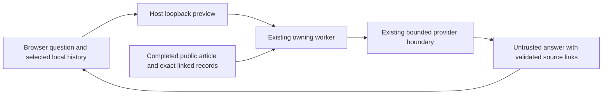

# Ask Bob about published WAKE work

## Use it on the public website

Select **Ask Bob** beside a research finding, project, notebook, journal entry,
evidence record or page overview. The selected published record becomes the
conversation context. In Bob’s Blog, the chat-bubble button remains below the
story title. It opens a separate chat window with that item selected. The
window uses message bubbles and a fixed composer: Enter sends; Shift+Enter adds a
line. The window follows the visible screen as the phone keyboard opens and
closes; only the message history scrolls. On phones, the browser may open a full-screen tab. Reopening the same story’s
chat focuses the existing window. There are no preset question buttons.

Or open [Talk with Bob](https://wake-ask-bob.coolgrove68.chatgpt.site/) for a stable
chat entry point independent of research snapshot publication. Select a published
article as context; changing it clears the tab’s conversation. This standalone
page keeps recent turns in memory rather than saving them across reloads.
On the hosted WAKE website, Bob answers live through a dedicated WAKE API and
streams his reply as Gemini generates it. Ask follow-up questions naturally, ask
for a different explanation, challenge a claim, or discuss a broader idea. No
account, login, visitor API key, or model download is required.

Your question and up to six recent turns go to the WAKE answer service and Google
Gemini. Chat history is saved in this browser. The service retains temporary
request counters rather than conversations; Google processes the submitted text
under the owning Gemini project's terms. Do not submit sensitive information.
Bob can make mistakes. His explanations are advisory and never become research
records, governed decisions, or accepted scientific progress.

The server, rather than the visitor, owns the model, system instructions, source
URLs and provider credential. It loads the exact article's already public guide,
checks its displayed hash and snapshot head, and supplies up to 18,000 characters
of passages. For other records it fetches a fixed public detail shard and checks
the displayed snapshot head and record identity. Journal context uses the
invocation ID, so equal cycle numbers in different nodes cannot swap entries.
Page overviews use the bounded reader bootstrap; a chat never downloads the full
research archive. The server chooses source paths, allows only known record kinds
and optional enrolled node IDs, and supplies bounded excerpts with source links. Recent conversation is untrusted context. Broader reasoning is
allowed, with an explicit distinction between published WAKE claims and general
knowledge or interpretation. Linked citations identify sources, not independent
verification. Bob cannot inspect private records or control the installation.

**Stop** cancels the connection; **Clear chat** removes local history. Quota,
busy, changed-article and provider errors are visible and retain your message for
retry. The standalone chat creates no empty reply for a failed request and reuses
the pending question bubble when you retry. After ten seconds, an inline waiting
message appears beside the question. Timeouts and failures stay there too, so a
phone reader can see what happened without finding a separate status line.
**Check availability** makes no model call; availability recovery never sends
the question without your action. A known provider
limit disables Send and shows the next retry time. Daily provider limits use
Pacific midnight, independently of Bob's UTC admission counters.

A confirmed, positive, model-specific daily free-tier limit may use a configured
compatible Gemini fallback before any answer text is streamed. Minute, project,
unknown and zero quotas stop further provider attempts temporarily. There is no
fallback after partial text or a transport failure, and no silent switch to a
different answer mode. An explicit transient HTTP 500, 502, 503 or 504 may retry
the same model once, after a short delay, before any answer is streamed. Both
attempts share the 45-second provider deadline and count against the same
admission budget. Network failures and partial streams are not retried. The
browser ends a stalled request after 55 seconds, distinguishes this from Stop,
and keeps the question for an explicit retry.
See the [service setup](../deploy/ask-bob/README.md) for the bounded model pool. The live service defaults to 100 attempts per UTC day across all visitors,
20 per network address per day, four per minute, and two simultaneous requests.
Failed attempts count too. Limits are enforced with conditional writes to a
shared server-side object, rather than browser storage or per-process counters.
Application counters keep network addresses only as daily salted hashes; the
hosting provider may retain ordinary request metadata. The same Gemini project
may also serve research, so Google's quota is shared; these limits bound Bob's
calls, not reserve research capacity or guarantee free billing.

## Passage mode on unbound static exports

Exports without the hosted Bob API binding retain a browser-local passage mode.
This mode makes no model call and does not transmit questions. It is distinct
from the live hosted conversation described above.

Publication prepares an article-specific search guide from already filtered public
article, notebook, evidence and project records. The guide is at most 96 KiB,
with up to 180 literal passages and at most twenty-four directly linked records. The browser
loads one guide on the first question and caches up to four guides in memory.
It checks the displayed article hash and source snapshot heads. Search uses term
coverage and rarity; short follow-ups may reuse the previous question, never its
answer. Text is quoted, not synthesized. This improves latency and prevents the
default path from inventing facts, but lexical search can miss paraphrases and
quoting a published claim does not independently verify it. Passage and source
budgets are disclosed; full records remain reachable through source links.

Questions and replies stay in this browser. **Clear chat** removes saved turns;
**Stop** cancels a pending read. A failed guide stays visible as an error, without
automatically falling back to a model download. Normal reading and opening Ask Bob
never initialize an inference engine. No research record or controls are accessed.

A limitations question reads the explicit limitations and uncertainty
fields before general keyword search. These fields are retained before longer
findings, and shared articles include every linked node notebook before using the
remaining source budget for raw evidence. When a guide has no explicit material,
Bob says what is missing from that guide rather than claiming the research has no
limitations. Source questions likewise distinguish missing public
records from absence of evidence.

## If Send does not answer

Live Ask Bob uses the server’s Gemini project quota. If Gemini is exhausted, Bob
reports the known retry time and keeps the message for retry. Availability checks
do not consume Gemini quota. Browser-local passage mode remains
independent of Gemini.

When Pages updates during navigation, the reader refetches its small overview
and adopts the requested detail only if both belong to the same snapshot. If the
site is still updating or a fetch fails, a visible retry message replaces the old
article. A stale chat reports that its article changed and keeps the typed message;
it must never silently discard Send. No cache clearing or model download is needed
for this recovery.

## Optional device model on unbound static exports

Under **About this chat**, explicitly enable **Experimental AI answer on this
device** to use the older generative mode. It is slower and can be inaccurate;
valid citation IDs do not prove that an answer is supported. It is off by default.
This mode downloads about 491 MB, shows **Download → Prepare → Reply**, and can
take minutes on a phone. Stop/retry and the existing model cache remain available.

The optional device mode uses Qwen2.5-0.5B-Instruct, an open model running in a browser
worker through the vendored MIT-licensed wllama runtime. It does not use Gemini
or consume Gemini API quota. The first model download is 491,400,032 bytes
(about 491 MB decimal); browser storage may cache it. Browser/device memory and
speed determine whether it can load and how long an answer takes. Inference
uses single-thread WebAssembly so GitHub Pages needs no special isolation
headers or GPU. Keep the tab open; a slower device may need several minutes.
A failed load remains visible and never prevents reading the article.
Pages uses a CPU-only, single-thread, private-memory build of wllama 3.8.1.
The upstream 3.8.1 unified binaries allocate shared memory even with one execution
thread; Safari restricts that memory without cross-origin isolation. The upstream
engine remains available for isolated pages, with its compatibility build when
needed. This selection changes the inference engine, not the pinned model URL
or model-cache key. Existing completed downloads remain reusable. Vendored bytes,
licenses, versions and reproducible build inputs are recorded in
`wake/assets/ask-bob-engine.json`. No service worker or site-wide isolation policy
is installed. Startup uses bounded processing batches and skips unnecessary
inference warm-up where supported.
Startup reports whether it is opening the saved model, starting the browser
engine, or loading the model into memory. Browser worker errors end startup
immediately; a stalled stage reports its name and elapsed time. Closing or reloading the
page terminates its model worker to avoid retaining WASM memory across reloads.
**Stop** cancels preparation and stops its worker. If loading makes no progress for 90 seconds,
it terminates with a retry message instead of waiting indefinitely. Preparation also has an absolute ten-minute limit, including download time; resuming a suspended tab checks that original deadline. Retry does
not clear downloaded model files or private conversation history. A browser can
still evict its cache or lack sufficient memory/storage; do not clear site data
when trying to reuse a completed download.

The runtime ships with the website. Model weights come from the public,
immutable revision recorded in `wake/assets/ask-bob-engine.json`. Downloading
them contacts Hugging Face and its delivery network, which receive ordinary
download metadata such as the requesting IP. Questions, answers and selected
conversation history are processed on the device and are not sent to a model
provider, server or research installation. Browser cache and private conversation
history are separate: clearing the conversation does not remove downloaded weights.
Use browser site-storage controls to remove the model cache.

The small model can be less reliable than cloud models. It receives an explicitly
short-answer instruction: address the question directly in two to four sentences,
at most 100 words, rather than repeating the whole article. It receives question-relevant passages from the same publication-time guide instead
of the old fixed article prefix and first two links. The normal focused input is
bounded to 6,000 UTF-8 bytes (8,000 hard limit for unusually long questions),
including the system instruction. Prior generated answers are excluded from model
evidence. A missing passage uses the ordinary source-guide response.
It never recursively browses or retrieves private
data. The displayed article hash must match the fetched public article, and linked
records must share its snapshot head. Missing/excerpted sources remain visible;
all returned source IDs must come from that supplied set. These checks establish
attribution and version identity, not scientific truth or semantic entailment.

Public input is capped at 14,000 UTF-8 bytes for the JSON context plus a fixed
system instruction; the question is at most 2,000 characters. The public chat automatically uses the compact same-article history policy
(condition C). Internal A/B/C request support remains available to offline
experiments, without visitor-facing selectors. These browser excerpts are a separate policy from the local
provider experiment below; they are not an A/B/C answer-quality finding.
Optional model output is bounded and structurally validated before it enters browser history.
If the model reaches its reply limit or returns incomplete JSON, the reply is
withheld with a plain-language suggestion to ask a narrower question. Partial
text and invented source references are never used to repair a failed reply.
Navigation, clearing history and the answer timeout cancel a pending answer.
During an answer, elapsed time and generated-character counts show activity
without displaying unvalidated draft text. **Stop** ends the answer and stops the browser
worker. A five-minute deadline, or 90 seconds without model progress, also ends
the wait even if native cancellation does not return. Send again to retry automatically
after a stopped worker; the completed model download and earlier replies remain.
No answer changes accepted research, Attention, commitments or project selection.

## Optional Gemini preview on a Mac

The Gemini preview is an opt-in local reader experiment. It answers questions about completed
publications and their linked evidence. It cannot start research, accept findings,
move Attention or change a project. It is not required by the public browser-only version.

## Open the local preview

Use the managed `wake` container with this checkout mounted at `/workspace` and
this installation at `/data`. Its current worker source must include the reader
service. Preserve the existing research controls and records when adopting source;
see [development setup](development.md). The prototype uses the existing shared
provider gate: quota-limited or unavailable workers may decline a question.
Pausing automated research leaves explicitly submitted Ask Bob questions usable;
stopping the installation or requesting a reset closes reader admission too.
Reader answers share the owning worker's invocation journal
without taking the research turn lock, so a long research turn does not itself
block a question. Only one reader question runs at a time; provider calls still
wait for the shared installation slot. Opening the preview never resumes research.
The native journal also waits for an in-flight record write to commit before
crossing its provider-effect barrier. A bounded wait can still expire under
heavy load; the worker logs only the exception class, never the question or
provider response, when that outer boundary cannot complete.

From the checkout root:

```sh
./scripts/wake_reader
```

Open the printed `http://127.0.0.1:8766/blog.html` address and select an article.
Keep this host process open while using the prototype; stop it with Ctrl-C.
`--port` selects another loopback port. `--data` selects the host installation
directory and `--container` selects its managed container; their mounts must match
this source and installation. This is for the unified blog, not individual node
pages. Ordinary LAN and public snapshot pages retain their existing reading flow.

Questions and answers are untrusted conversation, not scientific authority. Ask
for a simpler explanation, a complete explanation, supporting sources, a follow-up
or uncertainty. Follow the supplied evidence links and verify substantial claims.
Publication evidence can support a recorded observation without proving its truth
or establishing a cause.

## What the experiment retains

Browser-local history is anonymous and limited to this browser origin and
installation. Use **About this chat → Clear chat** to remove saved messages. Clearing browser data,
changing origins or using another device loses access to that local history.
Retention is capped at 20 articles, 10 turns per article and 32 KiB total, with
oldest turns/articles evicted deterministically. Encounter timestamps and up to
three earlier content hashes per article retain bounded version pointers; they
do not retain the full old publication text.
Storage can be unavailable; reading and transient questions must still work.
Do not enter secrets or unnecessary personal information. Selected questions and
history are sent to the configured provider to obtain an answer.

Opening an article records exposure only. A question and answer record an
interaction. The chat does not infer comprehension from opening an article or asking a
question. Previously retained explicit self-reports remain version-bound data;
the simplified chat does not collect new self-reports.

The host proxy keeps requests in memory and sends bounded JSON over Docker stdin
to a private worker socket. It does not save transcripts or log URLs/questions.
The existing node record retains native operational invocation evidence, including
context hashes, byte counts and outcome metadata. Those fingerprints are not raw
conversation, but they are persistent; this is not a promise that interaction
leaves no trace. Provider retention follows the configured provider's policies.
Browser history and private human continuity notes never become public exports.

## How context stays bounded



The reader uses the existing exact-record export paths, not the complete archive
or live authority as a search index. It begins with the current article and
retrieves a bounded set of directly linked records. Missing and shortened sources
remain visible. It cannot recursively browse the whole historical record.
At most four linked records accompany the current article. Each source read is
capped at 512 KiB; the exact system text plus question context stays within
24,000 UTF-8 bytes and 18,000 characters. Up to ten recent browser turns are sent
by the interface; the server accepts at most forty within a 64 KiB history limit.
Article content hashes distinguish visible versions; a changed export head alone
does not prove an article changed. When prior publication bytes are unavailable,
the system can report a hash change but cannot invent a detailed comparison.
Explicit supersession links can supply the published predecessor for comparison.

The configured model receives one bounded request, without browsing tools or
automatic fallback. Native invocation evidence and the existing shared provider
gate remain responsible for effect sequencing and quota visibility. The reader
never submits a research proposal. A structural citation check constrains source
links; it does not prove the answer is factually entailed by those sources.

## Compare context conditions

Run the synthetic, provider-free comparison:

```sh
python3 -m wake.reader_experiment
```

This constructs the same question, publication and conversation for each condition:

- **A:** no previous conversation, with the necessary publication context.
- **B:** rich relevant conversation within the controlled input budget.
- **C:** deterministic compressed continuity with original turn identifiers and
  hashes, so omitted material has a recovery pointer in retained browser history.

The command reports actual input bytes, retrieval metrics and context hashes.
It prints no private questions or answers. For a private bounded JSON request,
use `--site /path/to/completed/export --request /path/to/private/request.json`.
Keep such inputs and any results in private storage, not public export folders.

For provider-backed quality evaluation, ask the identical question in A/B/C with
the same published article and history. Record each input hash, available provider
token counts, output bytes and latency. Review the responses without their
condition labels against a fixed evidence rubric: supported claims, uncertainty,
use of prior context, repeated explanation, unsupported understanding assumptions,
missing-context recovery, and handling of a published correction. Keep the full
private history available when checking compressed-turn pointers. Repeat on a
first question, a context-dependent follow-up and a corrected publication.

Input reduction alone is not evidence of better answers, lower monetary cost or
energy savings. Scripted fixtures establish software behavior; real-provider
answers need human evidence review. There is no additional summarizing model call.
The fixed synthetic fixture currently produces 2,990 / 17,487 / 15,078 input bytes
for A/B/C, with three source records in each condition. These are reproducible
input measurements, not a response-quality result. Local native record checks and
provider execution have their own costs beyond these measured request bytes.

## Boundaries and next measurement

Run the deterministic checks without providers:

```sh
python3 -m unittest tests.test_reader_context tests.test_reader_experiment tests.test_reader_questions tests.test_reader_preview tests.test_ask_bob_export
```

The opt-in `tests.test_reader_browser_integration` test additionally uses actual
generated pages, the loopback HTTP boundary and native invocation journal with
an isolated record and fixture model. Set `PLAYWRIGHT_MODULE` to an installed
Playwright module and optionally `CHROME_EXECUTABLE` to the local Chrome binary,
then run `python3 -m unittest tests.test_reader_browser_integration -v`.
`node tests/browser/ask-bob.cjs` uses the same browser environment to exercise
privacy controls, storage failures, version changes and navigation. These tests
make no live provider call and do not establish live runtime adoption.

The preview is deliberately single-user and temporary: no accounts, cross-device
sync, fingerprinting, analytics or centralized visitor profile. Exact Host,
Origin and in-memory browser capability checks protect its loopback endpoint.
The host allows one active question, at least five seconds between attempts and
24 attempts per preview process. Restarting a preview is not a provider quota
override. All ordinary research controls and provider limits still apply.

This prototype does not certify scientific correctness or psychological
understanding. The next useful increment is a blinded, repeatable A/B/C response
study using fixed public source versions and a private review rubric, before
changing retrieval policy or claiming contextual superiority.

## Chat appearance and reply formatting

The live chat uses the main site’s shared light/dark color tokens. Opening it from
a story carries the current theme; direct visits follow the system until the reader
chooses a theme. The chat’s theme switch retains that choice on its own origin.
Headings, bold, italics, lists, quoted paragraphs and fenced code render as safe
DOM elements during streaming and after completion. Raw text is retained for model
context. Source HTML, image tags and non-HTTP links stay inert text. The formatter
is a deliberately bounded Markdown subset, not a general HTML renderer.
