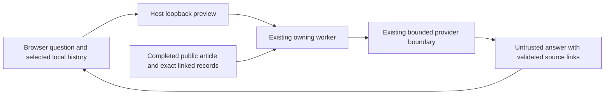

# Ask Bob locally

Public anonymous Bob chat has been retired with its ChatGPT Sites hosting.
The public website does not show live chat controls. Bob's published summaries,
research citations and historical articles remain available from GitHub Pages.

A secret-bearing anonymous model server cannot run on static GitHub Pages.
WAKE does not replace it with a new external hosting service or expose an API key
in a visitor's browser. An optional local loopback reader can still use Google
Gemini; its server holds the credential and reads only completed public exports.
It has no authority to change research. The implementation is `wake/ask_bob.py`;
start it only through its existing explicit local preview setup.

The retired public service source is retained in Git history. No active workflow
publishes it, and no public deployment binding points to it. Existing browser
conversation history is left untouched.

## Optional Gemini preview on a Mac

The Gemini preview is an opt-in local reader experiment. It answers questions about completed
publications and their linked evidence. It cannot start research, accept findings,
move Attention or change a project. It is not part of the public static website.

## Open the local preview

Use the managed `wake` container with this checkout mounted at `/workspace` and
this installation at `/data`. Its current worker source must include the reader
service. Preserve the existing research controls and records when adopting source;
see [development setup](development.md). The prototype uses the existing shared
provider gate: quota-limited or unavailable workers may decline a question.
Pausing automated research leaves explicitly submitted Ask Bob questions usable;
stopping the installation or requesting a reset closes reader admission too.
Reader answers share the owning worker's invocation journal
without taking the research turn lock, so a long research turn does not itself
block a question. Only one reader question runs at a time; provider calls still
wait for the shared installation slot. Opening the preview never resumes research.
The native journal also waits for an in-flight record write to commit before
crossing its provider-effect barrier. A bounded wait can still expire under
heavy load; the worker logs only the exception class, never the question or
provider response, when that outer boundary cannot complete.

From the checkout root:

```sh
./scripts/wake_reader
```

Open the printed `http://127.0.0.1:8766/blog.html` address and select an article.
Keep this host process open while using the prototype; stop it with Ctrl-C.
`--port` selects another loopback port. `--data` selects the host installation
directory and `--container` selects its managed container; their mounts must match
this source and installation. This is for the unified blog, not individual node
pages. Ordinary LAN and public snapshot pages retain their existing reading flow.

Questions and answers are untrusted conversation, not scientific authority. Ask
for a simpler explanation, a complete explanation, supporting sources, a follow-up
or uncertainty. Follow the supplied evidence links and verify substantial claims.
Publication evidence can support a recorded observation without proving its truth
or establishing a cause.

## What the experiment retains

Browser-local history is anonymous and limited to this browser origin and
installation. Use **About this chat → Clear chat** to remove saved messages. Clearing browser data,
changing origins or using another device loses access to that local history.
Retention is capped at 20 articles, 10 turns per article and 32 KiB total, with
oldest turns/articles evicted deterministically. Encounter timestamps and up to
three earlier content hashes per article retain bounded version pointers; they
do not retain the full old publication text.
Storage can be unavailable; reading and transient questions must still work.
Do not enter secrets or unnecessary personal information. Selected questions and
history are sent to the configured provider to obtain an answer.

Opening an article records exposure only. A question and answer record an
interaction. The chat does not infer comprehension from opening an article or asking a
question. Previously retained explicit self-reports remain version-bound data;
the simplified chat does not collect new self-reports.

The host proxy keeps requests in memory and sends bounded JSON over Docker stdin
to a private worker socket. It does not save transcripts or log URLs/questions.
The existing node record retains native operational invocation evidence, including
context hashes, byte counts and outcome metadata. Those fingerprints are not raw
conversation, but they are persistent; this is not a promise that interaction
leaves no trace. Provider retention follows the configured provider's policies.
Browser history and private human continuity notes never become public exports.

## How context stays bounded



The reader uses the existing exact-record export paths, not the complete archive
or live authority as a search index. It begins with the current article and
retrieves a bounded set of directly linked records. Missing and shortened sources
remain visible. It cannot recursively browse the whole historical record.
At most four linked records accompany the current article. Each source read is
capped at 512 KiB; the exact system text plus question context stays within
24,000 UTF-8 bytes and 18,000 characters. Up to ten recent browser turns are sent
by the interface; the server accepts at most forty within a 64 KiB history limit.
Article content hashes distinguish visible versions; a changed export head alone
does not prove an article changed. When prior publication bytes are unavailable,
the system can report a hash change but cannot invent a detailed comparison.
Explicit supersession links can supply the published predecessor for comparison.

The configured model receives one bounded request, without browsing tools or
automatic fallback. Native invocation evidence and the existing shared provider
gate remain responsible for effect sequencing and quota visibility. The reader
never submits a research proposal. A structural citation check constrains source
links; it does not prove the answer is factually entailed by those sources.

## Compare context conditions

Run the synthetic, provider-free comparison:

```sh
python3 -m wake.reader_experiment
```

This constructs the same question, publication and conversation for each condition:

- **A:** no previous conversation, with the necessary publication context.
- **B:** rich relevant conversation within the controlled input budget.
- **C:** deterministic compressed continuity with original turn identifiers and
  hashes, so omitted material has a recovery pointer in retained browser history.

The command reports actual input bytes, retrieval metrics and context hashes.
It prints no private questions or answers. For a private bounded JSON request,
use `--site /path/to/completed/export --request /path/to/private/request.json`.
Keep such inputs and any results in private storage, not public export folders.

For provider-backed quality evaluation, ask the identical question in A/B/C with
the same published article and history. Record each input hash, available provider
token counts, output bytes and latency. Review the responses without their
condition labels against a fixed evidence rubric: supported claims, uncertainty,
use of prior context, repeated explanation, unsupported understanding assumptions,
missing-context recovery, and handling of a published correction. Keep the full
private history available when checking compressed-turn pointers. Repeat on a
first question, a context-dependent follow-up and a corrected publication.

Input reduction alone is not evidence of better answers, lower monetary cost or
energy savings. Scripted fixtures establish software behavior; real-provider
answers need human evidence review. There is no additional summarizing model call.
The fixed synthetic fixture currently produces 2,990 / 17,487 / 15,078 input bytes
for A/B/C, with three source records in each condition. These are reproducible
input measurements, not a response-quality result. Local native record checks and
provider execution have their own costs beyond these measured request bytes.

## Boundaries and next measurement

Run the deterministic checks without providers:

```sh
python3 -m unittest tests.test_reader_context tests.test_reader_experiment tests.test_reader_questions tests.test_reader_preview tests.test_ask_bob_export
```

The opt-in `tests.test_reader_browser_integration` test additionally uses actual
generated pages, the loopback HTTP boundary and native invocation journal with
an isolated record and fixture model. Set `PLAYWRIGHT_MODULE` to an installed
Playwright module and optionally `CHROME_EXECUTABLE` to the local Chrome binary,
then run `python3 -m unittest tests.test_reader_browser_integration -v`.
`node tests/browser/ask-bob.cjs` uses the same browser environment to exercise
privacy controls, storage failures, version changes and navigation. These tests
make no live provider call and do not establish live runtime adoption.

The preview is deliberately single-user and temporary: no accounts, cross-device
sync, fingerprinting, analytics or centralized visitor profile. Exact Host,
Origin and in-memory browser capability checks protect its loopback endpoint.
The host allows one active question, at least five seconds between attempts and
24 attempts per preview process. Restarting a preview is not a provider quota
override. All ordinary research controls and provider limits still apply.

This prototype does not certify scientific correctness or psychological
understanding. The next useful increment is a blinded, repeatable A/B/C response
study using fixed public source versions and a private review rubric, before
changing retrieval policy or claiming contextual superiority.
