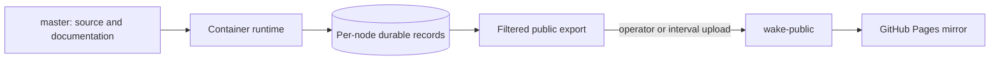

# Publish the container website mirror

## Publish the local installation mirror

Research runs in containers. Each node owns its durable SQLite record; the website
is a dated, read-only copy of the public data exported from those records. GitHub
Pages executes no research and has no research controls or execution status light.



Pages serves the root of `wake-public`, with `.nojekyll`, using branch publishing.
GitHub performs its normal Pages build and deployment. There is no custom Pages
workflow, research workflow, runtime promotion, continuation switch, or scheduled
GitHub research job. Code CI and offline container acceptance remain available.

On the host, configure the publishing destination in `.env`:

```bash
WAKE_PUBLISH_REPOSITORY=https://github.com/sudofx/wake
WAKE_PUBLISH_BRANCH=wake-public
# Changed exported heads upload every 30 minutes while the host worker runs.
WAKE_MIRROR_INTERVAL_SECONDS=1800
```

Then publish:

```bash
./scripts/wake_publish
```

The command prints its capture, page-building, copy and upload stages. Capturing a
node pins its last complete page export while the next generation renders. It
checks for running GitHub Actions before capture and again before upload, and
returns without uploading when Actions is busy. After delivery, it exits without
waiting for Pages to rebuild.
An upload verifies delivery of dated exports; it does not demonstrate adoption or
live [recovery behavior](resilience.md) in the resident container processes.

The command pins each available completed export generation and builds the filtered
artifact in a fresh container process using the mounted source. It uploads with
the host's existing Git credentials. Research keeps its current running, paused
or stopped setting. Export capture never opens or copies the authority databases.
The manifest identifies the captured heads and versions, rather than later live
records. The node menu shows colored status dots: current observations on the local
site, and explicitly dated uploaded observations on the public mirror. A missing
observation is gray; a disconnected local site clears its current status colors.
These observations do not establish accepted research. An unavailable worker keeps
its last completed export; a member with no completed export is marked `missing`
in the manifest and has no node view in that upload. No empty record is invented.
Different members may have exported different accepted Bob article versions;
mirror delivery does not wait for their availability or editorial agreement.

Capture holds a short generation-retention lock while pinning immutable files,
using hardlinks on the installation filesystem with a copy fallback. Retirement
of an old generation cannot remove the pinned bytes. Export rendering uses a
separate lock and does not block capture. A renderer fingerprint covering Python
code and website assets permits reuse of compatible completed node pages;
missing, damaged or incompatible fingerprints cause a rebuild from the captured
packet. The unified website is rebuilt from the twelve captured snapshots.
Both paths apply the public allowlist and private-field filter and retain full
attributed `events.jsonl` history with the exact captured heads.

To keep the mirror current automatically, run:

```bash
./scripts/wake_publish --watch
```

This uploads once, then runs one host delivery worker per checkout. Keep that
process and the container available. The worker checks completed export heads
every minute and uploads changed heads every 30 minutes by default, even if Bob
has no new accepted article or a node is unavailable. A new accepted article in
the leader's completed export triggers an earlier upload. Unchanged heads skip
scheduled upload. Set `WAKE_MIRROR_INTERVAL_SECONDS` in the host environment or
`.env` to change the cadence (minimum 60 seconds); the interval starts after each
successful upload. Withheld drafts remain governed editorial outcomes and never
hold the mirror delivery queue.

One installation file lease covers capture and upload for both host and direct
container publishers, including manual commands. An already running publisher
excludes another attempt. The worker waits for publication to finish, including
complete-history builds exceeding ten minutes. Failures appear in worker output
and delivery status and retry after a minute. Running GitHub Actions defer the
upload through the same retry path. `wake-research status` shows the delivered
captured-head digest, Bob article digest and upload date separately from research
state. A receipt confirms the exact immutable artifact uploaded; exports advancing
during upload remain eligible for the next interval. Old Bob-only acknowledgments
remain readable but never claim delivery of uncaptured heads.

Stop delivery with `wake-research mirror-disable` or stop the host worker.
Re-running `--watch` resumes without changing records or research controls.
Updating source does not replace an existing host Python worker: restart that
worker to adopt a changed scheduler. Host capture and scheduling load the mounted
source in fresh processes, so they work independently of the resident controller
version. Current controllers merge the host's separate delivery receipt for status.

Inside an installation configured with Git credentials and the two publication
variables, `wake-research publish` uploads directly and enables controller delivery
on the same changed-head cadence and accepted-article trigger. Failed direct uploads retain a visible status and
retry after five minutes. Credentials never enter the website. GitHub deployment
is a separate step; a delivered branch is not yet proof that Pages serves it.

To prepare an artifact without uploading, use `wake-research publish --output DIR`
inside the container. Serve the resulting directory with a plain static server to
inspect it. Publishing replaces the dedicated public branch with that complete
artifact; do not use a source or record branch as the destination.

The public allowlist includes `blog.xml`, Bob's RSS feed of accepted articles.
The homepage and blog link to this same-origin file; items use the canonical
public reading URLs for the root or selected node. A feed is a dated publication
view, with no research controls, email collection or provider request bodies.

The unified website and all available node views retain the same interface. The node
selector works from every page. Each view shows the upload date and reads only its
own uploaded JSON, including maps and their shards. Reader pages begin with a
bounded overview and fetch exact details or older entries on demand. The separate
`wake-data.json` archive carries the latest 400 events; History tools retain the full public event export as
`events.jsonl` or its lossless gzip archive described below. Node records, accepted counts, and full-history metrics are unchanged. Provider bodies, Passenger,
databases, logs, and control sockets are excluded. Manual import archives are
separate and never uploaded as the public website.

Public event streams over 50 MiB are packaged losslessly as `events.jsonl.gz` to
remain below GitHub's individual-file limit. Generated History pages read and
decompress the same-origin file; download links name the compressed archive.
Decompression restores every byte of the filtered event stream, including node
attribution and historical receipts. Smaller public streams and operational node
exports retain `events.jsonl`. Upload preflight rejects any remaining file over
100 MiB before Git or network work; it never trims history to fit.

## Development and release

Edit and verify source on `master`; push only when publication is authorized.
Pushing source runs code CI but does not change the public snapshot or container
workers. Build or restart the selected container separately, preserving its volume;
workers start stopped for inspection. Upload the website when its exported data and
presentation are ready. See [development](development.md) and
[container operation](standalone.md#control-research-from-the-shell).

## Historical hosted records

`wake-state`, `wake-runtime`, `wake-live`, and existing archive branches are retained
historical artifacts of the retired GitHub executor. Their databases and historical
receipts are preserved; they are not current publication inputs or container
records. No current workflow writes them, and no website loader polls them. Do not
merge or restore them into an installation merely to match counters.

Old workflow runs remain GitHub history. The old runtime ref can contain old
workflow definitions, so its executor workflows must remain disabled in repository
Actions settings. New research uses container controls only. Recovering historical
records is a separately scoped, verified operation.
