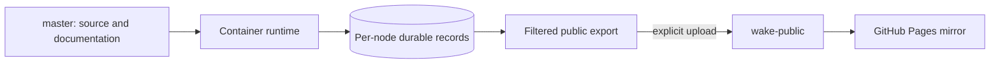

# Publish the container website mirror

## Publish the local installation mirror

Research runs in containers. Each node owns its durable SQLite record; the website
is a dated, read-only copy of the public data exported from those records. GitHub
Pages executes no research and has no research controls or execution status light.



Pages serves the root of `wake-public`, with `.nojekyll`, using branch publishing.
GitHub performs its normal Pages build and deployment. There is no custom Pages
workflow, research workflow, runtime promotion, continuation switch, or scheduled
GitHub research job. Code CI and offline container acceptance remain available.

On the host, configure the publishing destination in `.env`:

```bash
WAKE_PUBLISH_REPOSITORY=https://github.com/sudofx/wake
WAKE_PUBLISH_BRANCH=wake-public
```

Then publish:

```bash
./scripts/wake_publish
```

The command drains local research and builds the filtered artifact in a fresh
container process using the current mounted source,
and uploads it with the host's existing Git credentials. Research remains stopped;
inspect `wake-research status` inside the container before explicitly starting again.
Inside an installation with working Git credentials, `wake-research publish`
performs the upload directly. Credentials are never part of the website.

To prepare an artifact without uploading, use `wake-research publish --output DIR`
inside the container. Serve the resulting directory with a plain static server to
inspect it. Publishing replaces the dedicated public branch with that complete
artifact; do not use a source or record branch as the destination.

The unified website and all twelve node views retain the same interface. The node
selector works from every page. Each view shows the upload date and reads only its
own uploaded JSON, including maps and their shards. The homepage carries the
latest 400 events; the full public event export remains in `events.jsonl` and the
History tools. Node records, accepted counts, and full-history metrics are unchanged. Provider bodies, Passenger,
databases, logs, and control sockets are excluded. Manual import archives are
separate and never uploaded as the public website.

## Development and release

Edit and verify source on `master`; push only when publication is authorized.
Pushing source runs code CI but does not change the public snapshot or container
workers. Build or restart the selected container separately, preserving its volume;
workers start stopped for inspection. Upload the website when its exported data and
presentation are ready. See [development](development.md) and
[container operation](standalone.md#control-research-from-the-shell).

## Historical hosted records

`wake-state`, `wake-runtime`, `wake-live`, and existing archive branches are retained
historical artifacts of the retired GitHub executor. Their databases and historical
receipts are preserved; they are not current publication inputs or container
records. No current workflow writes them, and no website loader polls them. Do not
merge or restore them into an installation merely to match counters.

Old workflow runs remain GitHub history. The old runtime ref can contain old
workflow definitions, so its executor workflows must remain disabled in repository
Actions settings. New research uses container controls only. Recovering historical
records is a separately scoped, verified operation.
