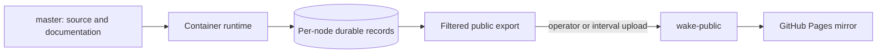
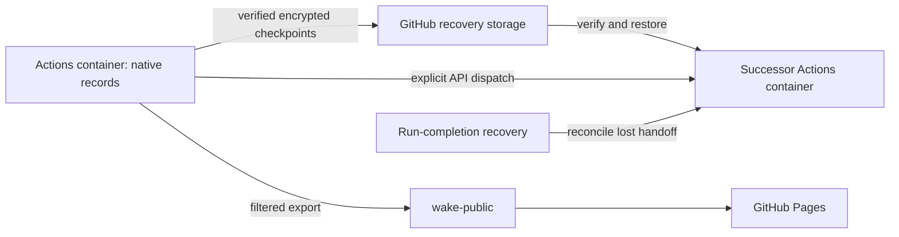

# GitHub Pages and hosted research

For a first public website, follow [GitHub Pages setup](setup.md#2-github-pages-website).
Pages displays exported snapshots. The separate Actions runtime described below
runs research and requires verified encrypted records before it can start.

The [improvement workflow](improvements.md) is currently local and operator-run.
Hosted research and Pages publication do not invoke candidate Python, apply its
patches or consume its review receipts as deployment permission. A compatible
promoted runtime may separately receive `autonomous_context_improvement: true`
and active decision memory through its immutable hosted runtime policy. This
grants only the [bounded context selector](autonomous-context.md), with no model
call or generated-code execution. An absent grant writes false into restored
configuration. Source, runtime promotion, installation grant and observed adoption
remain separate facts; this option alone does not update a pinned runtime.

The optional [decision-memory feature](retrieval.md#optional-decision-relevant-recall)
defaults to off. A hypothetical shadow capsule is invocation telemetry, never a
public snapshot or a source of research authority. Enabling active delivery is
an explicit runtime configuration choice, separate from publishing source or Pages.
Model-facing compact capsule views remain bound to the full private native receipt;
neither format is added to public exports. A presentation-only refresh also copies
the Console chart assets: each line chart fits its complete captured history to
the panel width, without changing the captured research or inspection packets.

The [ant farm](ant-farm.md) ships with filtered website exports. Its Bob mode
also requires the matching `deploy/ask-bob/` service update; publishing source,
website assets and the answer service remain separate operations.

## Publish the local installation mirror

Research runs in containers. Each node owns its durable SQLite record; the website
is a dated, read-only copy of the public data exported from those records. GitHub
Pages executes no research and has no research controls. An explicitly bound hosted
status light observes the GitHub Actions executor; ordinary mirrors have no execution light.

[Ask Bob](ask-bob.md) on the hosted mirror calls a dedicated public Worker API
owned in `deploy/ask-bob/`. Sites hosts this server component; GitHub Pages stays
static. The Gemini key and address-hashing salt are runtime secrets, never browser
assets. No visitor authentication or third-party identity service is used. Shared
conditional counters bound provider admission; chat text is not persisted by the
Worker. Opening a page does not call Gemini. Unbound exports retain local passage
search. Public guide generation never calls providers or writes authority.

The unified export also generates [static inspection resources](inspection.md)
under `inspect/`. They require no JavaScript, authentication or live model; their
manifest identifies dated export evidence rather than operational authority.



Pages serves the root of `wake-public`, with `.nojekyll`, using branch publishing.
GitHub performs its normal Pages build and deployment. The hosted adapter explicitly requests the native Pages build after its upload:
GitHub does not start branch-based Pages builds for pushes made with GITHUB_TOKEN.
Code CI and offline container acceptance remain separate from live research.

Checkpoint pruning refuses a stale rotating-ref checkout or an incomplete set of
current/previous release blocks. A missing asset is a recovery failure, not
permission to initialize or roll back a node. Inspect recoverable copies or obtain
an explicit destructive reset decision. A separately authorized fresh hosted
installation uses new native records, installation identity and cycle-zero exports;
it must never be presented as continuity of the discarded history. See
[research configuration and operator controls](research-expansion.md).

On the host, configure the publishing destination in `.env`:

```bash
WAKE_PUBLISH_REPOSITORY=https://github.com/sudofx/wake
WAKE_PUBLISH_BRANCH=wake-public
# Changed exported heads upload every 30 minutes while the host worker runs.
WAKE_MIRROR_INTERVAL_SECONDS=1800
```

Then publish:

```bash
./scripts/wake_publish
```

The command prints its capture, page-building, copy and upload stages. Capturing a
node pins its last complete page export while the next generation renders. It
checks for running GitHub Actions before capture and again before upload, and
returns without uploading when Actions is busy. After delivery, it exits without
waiting for Pages to rebuild.
An upload verifies delivery of dated exports; it does not demonstrate adoption or
live [recovery behavior](resilience.md) in the resident container processes.

The command pins each available completed export generation and builds the filtered
artifact in a fresh container process using the mounted source. It uploads with
the host's existing Git credentials. Research keeps its current running, paused
or stopped setting. Export capture never opens or copies the authority databases.
The manifest identifies the captured heads and versions, rather than later live
records. The node menu shows colored status dots: current observations on the local
site, and explicitly dated uploaded observations on the public mirror. A missing
observation is gray; a disconnected local site clears its current status colors.
These observations do not establish accepted research. An unavailable worker keeps
its last completed export; a member with no completed export is marked `missing`
in the manifest and has no node view in that upload. No empty record is invented.
Different members may have exported different accepted Bob article versions;
mirror delivery does not wait for their availability or editorial agreement.

Capture holds a short generation-retention lock while pinning immutable files,
using hardlinks on the installation filesystem with a copy fallback. Retirement
of an old generation cannot remove the pinned bytes. Export rendering uses a
separate lock and does not block capture. A renderer fingerprint covering Python
code and website assets permits reuse of compatible completed node pages;
missing, damaged or incompatible fingerprints cause a rebuild from the captured
packet. The unified website is rebuilt from the twelve captured snapshots.
Both paths apply the public allowlist and private-field filter and retain full
attributed `events.jsonl` history with the exact captured heads.

To keep the mirror current automatically, run:

```bash
./scripts/wake_publish --watch
```

This uploads once, then runs one host delivery worker per checkout. Keep that
process and the container available. The worker checks completed export heads
every minute and uploads changed heads every 30 minutes by default, even if Bob
has no new accepted article or a node is unavailable. A new accepted article in
the leader's completed export triggers an earlier upload. Unchanged heads skip
scheduled upload. Set `WAKE_MIRROR_INTERVAL_SECONDS` in the host environment or
`.env` to change the cadence (minimum 60 seconds); the interval starts after each
successful upload. Withheld drafts remain governed editorial outcomes and never
hold the mirror delivery queue.

One installation file lease covers capture and upload for both host and direct
container publishers, including manual commands. An already running publisher
excludes another attempt. The worker waits for publication to finish, including
complete-history builds exceeding ten minutes. Failures appear in worker output
and delivery status and retry after a minute. Running GitHub Actions defer the
upload through the same retry path. `wake-research status` shows the delivered
captured-head digest, Bob article digest and upload date separately from research
state. A receipt confirms the exact immutable artifact uploaded; exports advancing
during upload remain eligible for the next interval. Old Bob-only acknowledgments
remain readable but never claim delivery of uncaptured heads.

Stop delivery with `wake-research mirror-disable` or stop the host worker.
Re-running `--watch` resumes without changing records or research controls.
Updating source does not replace an existing host Python worker: restart that
worker to adopt a changed scheduler. Host capture and scheduling load the mounted
source in fresh processes, so they work independently of the resident controller
version. Current controllers merge the host's separate delivery receipt for status.

Inside an installation configured with Git credentials and the two publication
variables, `wake-research publish` uploads directly and enables controller delivery
on the same changed-head cadence and accepted-article trigger. Failed direct uploads retain a visible status and
retry after five minutes. Credentials never enter the website. GitHub deployment
is a separate step; a delivered branch is not yet proof that Pages serves it.

To prepare an artifact without uploading, use `wake-research publish --output DIR`
inside the container. Serve the resulting directory with a plain static server to
inspect it. Publishing replaces the dedicated public branch with that complete
artifact; do not use a source or record branch as the destination.

The public allowlist includes `blog.xml`, Bob's RSS feed of accepted articles.
The homepage and blog link to this same-origin file; items use the canonical
public reading URLs for the root or selected node. A feed is a dated publication
view, with no research controls, email collection or provider request bodies.

The unified website and available node views share the same navigation. The node
selector appears on Console pages. Each view shows the upload date and reads only its
own uploaded JSON, including maps and their shards. Reader pages begin with a
bounded overview and fetch exact details or older entries on demand. The separate
`wake-data.json` archive carries the latest 400 events; History tools retain the full public event export as
`events.jsonl` or its lossless gzip archive described below. Node records, accepted counts, and full-history metrics are unchanged. Provider bodies,
databases, logs, and control sockets are excluded. Manual import archives are
separate and never uploaded as the public website.

Public event streams over 50 MiB are packaged losslessly as `events.jsonl.gz` to
remain below GitHub's individual-file limit. Generated History pages read and
decompress the same-origin file; download links name the compressed archive.
Decompression restores every byte of the filtered event stream, including node
attribution and historical receipts. Smaller public streams and operational node
exports retain `events.jsonl`. Upload preflight rejects any remaining file over
100 MiB before Git or network work; it never trims history to fit.

## Development and release

Edit and verify source on `master`; push only when publication is authorized.
Pushing source runs code CI but does not change the public snapshot or container
workers. Build or restart the selected container separately, preserving its volume;
workers start stopped for inspection. Upload the website when its exported data and
presentation are ready. See [development](development.md) and
[container operation](standalone.md#control-research-from-the-shell).

## Historical hosted records

`wake-state`, `wake-runtime`, `wake-live`, and existing archive branches are retained
historical artifacts of the retired GitHub executor. Their databases and historical
receipts are preserved; they are not current publication inputs or container
records. No current workflow writes them, and no website loader polls them. Do not
merge or restore them into an installation merely to match counters.

Old workflow runs remain GitHub history. The old runtime ref can contain old
workflow definitions, so its executor workflows must remain disabled in repository
Actions settings. The historical executor must not be reenabled. Current hosted research uses the
Actions-container adapter below, with separate state transport and controls. Recovering historical
records is a separately scoped, verified operation.

## Run research on GitHub without a laptop

GitHub Actions runs the same twelve-node installation in a disposable Linux
container. GitHub Pages serves the filtered public website. The laptop is not a
runner, scheduler, publisher or recovery dependency. Use a public repository and
standard `ubuntu-latest` runners; no larger runner, Codespace, paid artifact store
or external hosting is required. Provider credentials must remain on a project
with billing disabled; provider free quotas still limit research. No automation
can promise uninterrupted service or permanent access to an external platform.



### Start and stop

Open **Actions → WAKE — Start or stop hosted research → Run workflow** on
`master`. Choose `start` to continue the existing records or `stop` to prevent
successors and drain the active run. The active controller checks stop intent
at least once per minute. This never resets records. The enabled/disabled state of **WAKE — Hosted research** is the native
continuation switch. Disabled or missing means stopped; the built-in Actions
token can operate it without an expiring personal credential.
Manual cancellation alone is recoverable failure, not the durable stop switch.

The first setup requires `GEMINI_API_KEY`, a random 32-byte hex
`WAKE_HOSTED_STATE_KEY` repository secret, a verified encrypted initial checkpoint,
and successful code CI. Keep an offline copy of the encryption key: losing it
makes the private recovery data unreadable. Existing records are transferred
only with operator authorization, after stopping all original writers. The
installation identity, twelve historical heads, topic files
and shared quota state are preserved. Historical executor branches are untouched.
Never seed a missing checkpoint automatically or import public website data as
an authoritative record. See [authority and recovery](architecture.md#hosted-execution-and-durable-recovery).

### Publish source without upgrading records

Source publication and runtime promotion are separate. `hosted-runtime.json`
binds settings to an installation identity and can include `source_revision` to
hold that installation on a verified commit. Omitting that optional pin explicitly
selects successful master CI, while retaining the installation identity check.

Before changing a binding, test the candidate against disposable copies of all
records, preserve their history and accepted counts, and verify any required
migration. Never clear the binding merely to force an upgrade. A runtime source
commit must also have successful `master` CI. The binding's installation ID must
match the restored checkpoint before a new controller can start.
Run **Actions → WAKE — Verify hosted runtime upgrade** with the candidate's full
commit hash. It restores disposable encrypted recovery copies and compares full
baseline and candidate audits for all twelve nodes without provider calls or
remote record writes. Each node runs both complete audits in its own bounded
job; the final gate requires exactly twelve successful node reports with the same
candidate, baseline, installation, checkpoint generation and manifest digest.
Missing, duplicate or inconsistent reports fail the gate; partial artifacts never
authorize promotion. Research must stay stopped while this frozen checkpoint is
verified and promoted. Download its `upgrade-verification` artifact and check the
candidate, baseline, installation identity and matching node histories before
changing the binding.

An older pinned runner can replace newly published website assets during its
next export. For a release that changes those assets, gracefully stop and drain
the old runner, promote the verified runtime, then start it again. If presentation
needs restoring during the upgrade, refresh the latest captured public parent;
never republish an older research snapshot. Check the final public export after
the old runner exits, because its final publication can also replace the assets.

In Actions, admission and successor selection read this binding from the immutable
workflow commit (`GITHUB_SHA`), separately from the candidate runtime checkout.
That permits a later binding commit to name a previously checked candidate without
requiring a self-referencing source hash. An unreadable or malformed policy stops
admission before opening hosted authority; it never falls back to an older pin.

### Continuation and repair

`hosted-research.yml` restores every native record, verifies the full kernel and
provider/access journals, checks application state against the result digest in
the verified event chain, and starts the
existing controller, runs for a bounded two-hour research window, drains and saves
all records, builds the existing filtered artifact, pushes `wake-public` and
requests the Pages build. Its final job explicitly dispatches a successor through
`workflow_dispatch`, using a source revision with successful code CI.
`hosted-runtime.json` can bind a repository and installation identity to a verified
runtime commit. A source-pinned installation stays on that commit even when newer source
passes CI; a missing successful check fails closed. Unbound repositories select
the newest checked `master` revision. A fork does not inherit another repository’s
runtime binding. `hosted-recovery.yml` handles failed or cancelled run-completion events
and repairs a lost successor dispatch with the same identity. Duplicate handoffs
are reconciled and installation execution is serialized. Neither uses cron.

The operator may set `decision_memory_mode` to `off`, `shadow`, or `active` in that
installation's policy. Before starting workers, the hosted runner applies this
root setting to the restored private configuration, preserving topics and other
settings. The setting is checkpointed with that configuration. The repository
and application defaults remain off. This installation explicitly uses active
decision memory. Old advisory terminal receipts have read-only replay support;
new advisory events are rejected and no retired execution feature is restored.
The optional boolean `research_candidate_catalog_enabled` extends an enabled
research expansion to its thirteen additional questions. False or absent selects
only the original themes; false retains previously adopted catalog topics as
inactive history. Both flags are validated before hosted restore. See the
[catalog assignments and rollback](research-expansion.md#operator-controls).
Active working-context compaction changes future provider requests only. Before
promoting a runtime, compare disposable native copies across all twelve nodes,
verify pending-invocation recovery and preserve installation identity, complete
history and accepted counts. The public mirror remains a filtered export; private
request bodies and memory-use observations do not become public evaluation data.
Encrypted recovery also retains the existing retired private sidecars as opaque
files; they are neither interpreted nor included in public exports or research.

The existing kernel invocation lifecycle calls the injected remote checkpoint
before provider effects and at terminal boundaries. Each callback snapshots the
owning node, preserves native replay/provenance and installation configuration, and
commits the encrypted checkpoint before continuing. A crash after a request starts
leaves an interrupted native invocation to recover, never a fabricated result.
Free quota waits survive runner handover; no automatic reset or quota bypass exists.
Worker failures are recovered from verified records in the next bounded run.
Missing Start acknowledgments are reported explicitly. Confirmed workers may
continue a partial batch; if none confirm, the batch closes and publishes its
completed exports before the successor retries. One unavailable worker cannot
withhold the other records or their public mirror.
The system does not write unreviewed source repairs or change its own research rules.

GitHub's workflow token has a shared repository API allowance. Checkpoint transfers
reserve 100 requests for controls and continuation, waiting for the service's reset
time before further transfers. Safe reads honor explicit primary-limit or
`Retry-After` headers, within a 61-minute wait budget per request; ordinary permission
denials still fail visibly. Ambiguous writes are reconciled by content identity,
never blindly replayed. Only numeric quota metadata is logged. A control-read
failure closes admission, drains and captures all twelve records before reporting
failure. It never treats unknown stop intent as permission to continue.

Research keeps a stable workflow name so its completion event can trigger the
independent recovery workflow. Both handoff paths serialize and compare workflow
run numbers: an existing newer run, even if already completed, owns continuation.
This prevents a delayed recovery from resurrecting an obsolete chain. Handoff jobs
allow 75 minutes for quota recovery; research jobs allow four hours including
checkpoint waits around the two-hour research window. Neither adds a cron trigger.
For a read-only check of enabled intent and numeric API allowance, dispatch
`hosted-control.yml` with `action=inspect`; it does not open records or providers.

The dedicated release stores authenticated encrypted blocks. Unchanged blocks
are reused and unreferenced ones are removed automatically. The dedicated
`wake-hosted-state` ref rotates atomically with current and previous encrypted
manifests; it does not accumulate a Git history of database ciphertext. These
are recovery snapshots of native SQLite, not a second writable research store.
Every retained database includes its complete event history. Transport growth
and GitHub service limits remain real constraints, not grounds to trim history.
No Actions artifacts or caches are used for authority or publication.

### Verify actual progress

Inspect **WAKE — Hosted research** runs and their summaries for source revision,
checkpoint generation, record heads and accepted versions. A successful run can
still contain rejected or deferred proposals. Confirm actual accepted progress
from successive record heads and versions. Check the Pages deployment separately,
then read the served `installation.json` and its twelve captured heads. Its
`hosted_execution` field identifies the source revision and capture run; dated
runtime observations never become a live execution capability. Source CI, record
checkpoint, provider outcome, website upload and Pages serving are separate claims.

### Read the hosted status light

The header light checks public GitHub Actions metadata without sign-in or a token.
Green means a hosted batch is active, including restoration, quota waits and publication;
it does not mean a provider call is in flight or research has been accepted. Yellow
means queued, stopped, draining or awaiting automatic recovery. Blue means between
successful batches; red means GitHub requires attention or a failed batch has had
no successor for fifteen minutes. Gray means
status could not be confirmed. Tap or focus the light for its explanation and check time;
its link opens the research workflow. Node dots and Console canvases remain dated snapshots.

Only exports explicitly bound by `wake.hosted_presentation.bind_hosted_status` enable
this observer. It makes two anonymous reads at most every three minutes while visible,
shares a short cache across pages, bounds each read to eight seconds, clears stale
or offline observations, and never reads private records or changes research controls.
GitHub rate limits can make the light unavailable without stopping research.

A presentation-only refresh can use an existing `wake-public` artifact without opening
authority. Capture its exact Git head, extract the generated artifact without `.git`,
then publish with the normal repository settings:

```sh
WAKE_PUBLISH_REPOSITORY=https://github.com/OWNER/REPO \
WAKE_PUBLISH_BRANCH=wake-public \
python scripts/publish_pages.py --artifact SITE \
  --refresh-hosted-status --expected-head CAPTURED_SHA
gh api --method POST repos/OWNER/REPO/pages/builds
```

A changed parent fails closed: capture the newer artifact and retry. Research data, captured heads,
`hosted_execution` and hashed inspection packets remain unchanged; `presentation`
records the UI source revision separately. The refresh also rebuilds the root
Ask Bob passage guides from that exact public archive and replaces reader assets,
including inline article navigation and the bounded reader transport;
it rejects mismatched archive/overview heads and leaves research and inspection
bytes unchanged. Normal hosted batches apply the same binding.

### Watch live hosted node activity

Console can show current node stages and confirmed shared-queue provider calls
while its research counts remain a dated export. The explicit `hosted_activity`
binding names the relay and owning installation. The browser polls it every three
seconds while visible, without credentials, and clears activity after a failed,
stale or mismatched response. It does not fetch hosted authority or controls.

The runner samples only its loopback `/runtime.json` in a bounded background task.
`wake/hosted_activity.py` allowlists stage, worker identity, timestamps, public
invocation/coordinate IDs and confirmed queue metadata before transmission. It
excludes prompts, responses, source bodies, provider errors and keys.
Observers never participate in checkpoint or provider-effect sequencing.

The relay source is owned in `deploy/activity-relay/`. Its Sites Worker stores one
expiring public JSON view in an R2 object; this is disposable presentation storage,
not research authority or a recovery source. It rejects another installation,
requires the runner's write credential for ingestion, and exposes no controls.
An observation expires after twelve seconds; browser overlays expire sooner.
The relay can disappear without changing research or record recovery.

The Sites environment requires secret `INGEST_TOKEN` and the public
`INSTALLATION_ID`. The corresponding GitHub Actions secret is
`WAKE_ACTIVITY_INGEST_TOKEN`. Visitors receive neither secret. Follow the Sites
source/build/publish workflow for the tracked Worker; a publication mirror is
not a second implementation owner. Verify anonymous `/activity.json`, then a
real worker sample and Console disconnect behavior before claiming live delivery.

Two-hour hosted batches use a three-hour job deadline, leaving time for drain,
final capture and publication. Required pre-effect saves remain in place. The
public mirror uploads pinned completed exports every thirty minutes during work
and again after final capture. Upload failures do not stop research, and a changed
public parent rejects a stale artifact. Live observations do not advance research counts.
