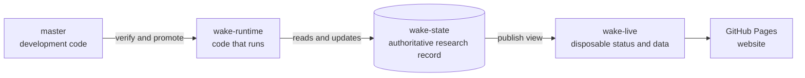

# WAKE✳︎ hosted operation

Independent container deployments are described in [multiple installations](installations.md).
They do not restore hosted checkpoints or use hosted public data. Hosted controls
in this guide retain their separate authority and release procedure.

The local numbered-group peer-note and source-evidence exchange and hostname
router are created only by `scripts/wake_runner` on a local Docker host. Hosted
workflows and Codespaces do not join those networks or receive peer material.

> **Current operating specification.** This is the authoritative guide to the GitHub-hosted **WAKE✳︎** runtime: `master` is development, `wake-runtime` is the explicitly promoted executable, and `wake-state` carries the separate authoritative WAKE SQLite record.

### The three hosted branches, in one picture



The branches have different jobs. Updating the website does not reset research;
publishing code does not copy a local record into the hosted installation.

### The short operating path

- **Start or resume research:** use **WAKE✳︎ - Start**.
- **Pause for maintenance:** use **WAKE✳︎ - Stop** and wait until research jobs have
  finished before changing or promoting code.
- **Publish a code change:** verify the candidate, then use **Stop → promote → Start**
  (or the **Restart** shortcut). Check the promoted commit and a new terminal receipt.
- **Reset for a fresh campaign:** use **Reset** to archive the current generation,
  begin at zero, and enable a new `continuity@1` campaign. Research remains stopped;
  use **Start** separately after inspecting the reset state.

These controls affect hosted WAKE only. Local containers and Codespaces keep their
own code paths and records.

WAKE✳︎ provides the durable record and governed transition boundary. The hosted research application uses that infrastructure to choose small, useful projects from `research-topics.toml`. Topics are replaceable workload inputs, not WAKE✳︎ identity or kernel policy. The deployment can continue research without daily assignments, while resets and topic changes remain explicit operator interventions.

## Read or wake it

The public interface is **https://sudofx.github.io/wake/** once GitHub Pages is enabled. Home explains the system and surfaces the latest published notebook and Bob post. Research and Read expose the reference workload. Console is the inspection workspace for calls, governance, provenance and record structure. The “since your last visit” counter is browser-local and is never part of the durable record.

The `WAKE✳︎ — Update website · automatic` workflow is the only Pages publisher. Do not add generic static or Jekyll publishing templates: they publish application source instead of the generated research home and can overwrite the correct site.

`WAKE✳︎ — Internal only: one research cycle` is the only research execution lane. It may execute only when the workflow dispatch ref is `wake-runtime`; each accepted/rejected cycle can dispatch its successor from that same runtime branch and carries the exact runtime commit forward. `WAKE✳︎ — Internal only: keep-running switch` is the durable on/off latch used by **WAKE✳︎ - Start** and **WAKE✳︎ - Stop**, with a scheduled lost-handoff check while enabled; running it manually does not start research.

The hosted site is read-only. Its masthead light opens GitHub Actions; it does not
start or stop research. The light summarizes the latest published runtime status,
not whether a job is running at this exact second:

| Light | Meaning |
| --- | --- |
| Red | An operator or agent needs to investigate and act |
| Yellow | Waiting, paused, or stopped |
| Green | Research is running |
| Blue | Research is idle between attempts |
| Purple | A provider reported quota pressure; scheduled retries continue |
| Gray | Status could not be confirmed |

The status light checks on a five-second loop while the page is visible. When the
keep-running switch is open, it refreshes the latest `wake-live` runtime/quota
projection on that loop. To limit GitHub API traffic, it rechecks the continuation
latch every three minutes, and forces a fresh latch check when a tab returns to the
foreground or the page is reloaded. A network or publication delay can make the
displayed result briefly stale; gray means the latest status could not be verified,
even if a previous state is shown in its description. Provider quota reports are
retried on the ordinary schedule; only a configured hard daily request cap waits for
its Pacific reset.

Use **WAKE✳︎ - Start** to open the keep-running switch and dispatch the first cycle.
Use **WAKE✳︎ - Stop** to close the switch and drain active work. A scheduled check
may restart a lost handoff only while the switch is open. The light is not a control
backend, and the site has no authentication.

Use **WAKE✳︎ - Reset** when you intend to start a fresh generation. It stops and
drains research, archives the prior governed generation, resets active research to
cycle zero, and enables a new provider-free `continuity@1` campaign with zero
recorded cells. It leaves the continuation latch closed and does not dispatch
research. Inspect the reset state, then use **WAKE✳︎ - Start** when you are ready to
continue. The archived generation retains its prior campaign results.

**WAKE✳︎ - Enable continuity campaign** is another provider-free opt-in. It drains
the active lane, records enablement through the serialized authority workflow, and
restores the prior running/stopped state. When enabled, each research request may
include one isolated matrix probe. The same model response contains both the
research proposal and probe answer, so the campaign adds no provider call. A
returned response completes that probe even if its answer is missing or malformed
(recorded as zero); a quota or transport deferral leaves it for a later attempt.

Runtime adoption is explicit. **WAKE✳︎ - promote** verifies a candidate, rechecks that no real `wake-runtime` cycle is queued or running, and only then moves the runtime branch to that exact verified commit. It refuses while research is active: **WAKE✳︎ - Stop → WAKE✳︎ - promote → WAKE✳︎ - Start**. CI on `master` is development feedback only; failures there never stop or redefine an already-running research chain.

The Pages shell loads the disposable `wake-live/live.json` projection with
`cache: "no-store"` and refreshes the research view independently of Pages
deployment. The masthead status light has a five-second refresh loop while visible.
New state is applied in place; live research does not wait for a Pages deployment.

## Authority maintenance

Prepare and test changes locally while hosted research runs. For an authorized code
release, use Stop and verify that real research jobs have fully drained **before
pushing**. A push may deploy the Pages shell immediately. Then use Restart for
candidate verification and promotion, check the exact promoted SHA and continuation,
and inspect a new attempt's terminal receipt. Restart success alone does not prove
accepted research. See the [maintainer map](development.md) for environment boundaries.

**WAKE✳︎ - Stop** keeps the continuation latch closed while waiting for cancellation to finish. GitHub's server-side cancellation can take five minutes; Stop allows at least six minutes of polling within a ten-minute job budget and retains its force-cancel fallback. A cancellation request alone is not proof that research has drained.

**WAKE✳︎ - Restart** is the normal maintenance shortcut for the current wake-backed runtime: stop, verify `master`, promote the verified commit, then start again.

Do not use migration/rehearsal workflows as substitutes for ordinary Start/Stop control.

## One-time repository setup

1. Keep `GEMINI_API_KEY` in repository **Settings → Secrets and variables → Actions**. Use an API project with billing disabled. `free_tier_confirmed` in `wake.toml` is an operator attestation; the application cannot inspect Google billing.
2. In **Settings → Pages**, select **GitHub Actions** as the build source. The workflow attempts automatic enablement; if repository permissions prevent that, this setting is required once.
3. Use **WAKE✳︎ - Start** when you want the promoted runtime to begin a continuous research chain. Use **WAKE✳︎ - Restart** for the normal stop/verify/promote/start maintenance sequence. Website publication is automatic after relevant source changes.

The workflow uses the existing public repository and GitHub Pages. No paid fallback, paid search, or subscription is introduced. The local Pacific-day budget is enforced against durable provider-request reservations. With same-wake research enabled, planning and final proposal reserve separate slots. Each phase may reserve additional slots when an eligible transient failure advances to the next configured Gemini model; interrupted unknown attempts remain conservatively reserved. Manual wakes share the same ledger.

The hosted Gemini quota fallback order is configured in `wake.toml`: 3.1 Flash-Lite,
3.8 Flash, 3.5 Flash-Lite, then 3.6 Flash. WAKE advances when Google reports
the exact per-model daily free-tier quota or an HTTP 429 rate limit. Other
transient failures follow the configured fallback policy. The configured daily ceilings
match those model buckets (500 requests for the Lite models and 20 for Flash models);
provider-reported exhaustion still handles quota already used outside WAKE. Any
provider-reported quota response is shown as purple and remains eligible for the
scheduled retry check, so a model that recovers or a fallback with remaining
capacity can be used. Purple does not itself mean research is waiting until
midnight; only an operator-configured hard daily request cap does that.

## A wake's work

A trusted collector gathers a bounded sample before the final proposal request.
The current collection settings are:

- Normal mode allows two collection requests.
- With `observation_mode = true`, `research_collection_budget = 6`.
- When same-wake research is off and projects are active, one request slot stays
  available for broad exploration. The others prioritize current projects through
  readable-source candidates, persistent identifiers, queued follow-ups and
  question-led discovery.

Search results are discovery leads, not notebook evidence. Crossref, OpenAlex,
Semantic Scholar and DataCite records route to metadata; they do not qualify as
research sources by themselves. A notebook needs readable publisher, full-text or
source-controlled material. When available, WAKE can route PubMed/PMC identifiers
to NCBI's open-access BioC article text.

Collection is separate from model authority. HTTPS host allowlists and redirect
checks limit where it can fetch. A normal response is capped at 1 MB. A PDF is
capped at 8 MB; extraction reads at most 24 pages and 50,000 characters. The
excerpt sent to a provider is capped at 10,000 characters and favors sections
that contain evidence.

## Changing research topics

The repository includes `research-topics.toml`. If it is missing, copy the starter
file and edit it:

```sh
cp example.research-topics.toml research-topics.toml
```

In this repository, the topic file is tracked. An edit changes your checkout but
does not reach hosted WAKE until it is committed, pushed, and promoted. The Restart
workflow checks that the candidate commit contains the file before it stops the
current runtime.

Each topic has a stable machine `id`, a public `label`, a neutral discovery `query`,
and an optional `seed_question`. Keep an existing ID when renaming a topic that
already owns projects. Removing a topic prevents new projects under it, but existing
projects remain available for review, completion, or parking. Once promoted, the
next cycle records the configuration change as an event; old cycles and projects
are not rewritten. Public pages show the configured label while the record keeps
the stable ID.

**WAKE✳︎** can start, update, park and complete projects; queue research; publish or revise notebooks; and use the existing belief/commitment system. At most three projects are active and four model-proposed searches are pending. A notebook may preserve a provisional synthesis from one qualifying substantive source, but project completion requires a notebook backed by at least two substantive distinct underlying source works. Known DOI/arXiv/OpenAlex identities collapse mirrors to one work. Revisions require changed findings and newly collected evidence. Previous revisions remain in the event history.

Bob may publish at most one selective Blog post inside that same Gemini response, but the blog is an editorial sidecar rather than part of WAKE✳︎'s research authority. Ordinary publication remains event-driven. On Bob's first accepted wake, and again after a deterministic 15–20 accepted-wake quiet window, the provider response schema requires one top-level Bob editorial checkpoint. WAKE✳︎ materializes that checkpoint as the final blog sidecar before governance. If the checkpoint fails publication governance, only the blog is withheld; valid research may still be accepted, no post becomes durable, and Bob remains due on the next wake. Bob cannot gate an accepted cycle, move Attention, count as research progress, or supply the journal title/summary. Ordinary publication likewise requires support traceable through notebooks from at least two qualifying distinct source works; current verification-required claims must materially overlap those sources. A one-source notebook can therefore remain useful provisional research without becoming completion-ready or automatically publishable. Routine status activity creates no ordinary post. Corrections preserve and supersede earlier writing; the exact wake remains linked.

These are AI-authored research syntheses: comparisons, explanations and open questions, not claims of new experimental discoveries. Discovery and metadata receipts may guide retrieval but do not qualify findings. Readable material can still be incomplete, preprint-only, or otherwise limited; scope and limitations remain visible. Two distinct works do not guarantee independent studies, strong evidence, or correct reasoning, and unidentified mirrors may still evade work-level deduplication. Governance checks provenance and structure, not scientific truth.

## Memory on GitHub

`master` holds development code and may move independently. `wake-runtime` holds the exact promoted executable used by live research. **`wake-state` holds the authoritative cloud `data/wake.sqlite` database and is separate from both code branches.** On the first migration run, the existing `data/wake.sqlite3` chain is verified and archived exactly inside WAKE before any provider call; that legacy file then becomes frozen migration evidence, not an operational store. Each later runtime cycle reconstructs WAKE through the WAKE application contract from `wake.sqlite` alone. A branch missing both database formats is an error, never a reason to silently start over. Missing both database files on an existing authority branch fails before provider access; only creation of the first-ever `wake-state` branch may initialize empty authority. A first-ever cloud bootstrap creates WAKE authority directly and never creates a temporary `wake.sqlite3`. Earlier local records and the offline example remain separate; they are not uploaded or relabeled as cloud research.

Before contacting Gemini, the workflow commits and pushes the request and quota reservation. Checkpointing also enforces the GitHub blob ceiling: when `data/wake.sqlite` reaches 90 MiB, the runner performs verified SQLite compaction before staging it. If the verified compressed checkpoint still reaches GitHub's 100 MiB single-blob limit after compaction, the checkpoint fails closed instead of spending another provider call against state that cannot be persisted. If that push fails, the model is not called. It checkpoints again after the response. A lost runner can waste an attempt, but the next runner recovers the unfinished invocation without refunding it. State publication uses an exact remote-head lease with a parentless checkpoint commit; a competing update fails rather than being overwritten. Workflow concurrency serializes automatic and manual runs.

Archived Lab Comics covers remain under `assets/covers/`. They are static assets; runtime research and Pages publication do not modify them.

Each completed cycle refreshes the disposable `wake-live` projection after the authoritative WAKE SQLite state is checkpointed. Governance rejection and handled provider deferral can therefore update the public record without advancing accepted research. GitHub Pages is independent: it republishes only when website code changes. If the live projection refresh fails, the durable record remains authoritative and the previous public projection stays in place. Eligible transient HTTP 500/502/503/504 and narrowly classified network failures may advance once to each next configured Gemini model; there are no sleeps or same-model retries. Every provider attempt is durably reserved and recorded. Exhausting the eligible model chain defers the wake without advancing research. Expected provider pressure leaves the workflow green; this means the outcome was handled, not that research was accepted. The homepage separately shows the last accepted wake, latest attempt, provider-request accounting, and any known quota reset time.

Console has its own static assets and compact `research-data.json`. Website export writes a local fallback; the runtime publishes the live dashboard JSON alongside the existing map projections. The projection producer changes only after explicit runtime promotion while research is stopped; the Pages shell may deploy independently from `master`. A newer Pages shell can therefore temporarily use its dated fallback until the promoted runtime supplies the new projection. The dashboard refreshes once per minute while visible and preserves the previous snapshot on errors; execution status is separately labeled GitHub Actions infrastructure and checked at most every three minutes. For a deliberate read-only preview of hosted data, build `site/` with `python scripts/publish_pages.py` and run `PYTHONPATH=. .venv/bin/python scripts/preview_research.py --directory site --port 8947`. This helper requires a hosted export and rejects standalone directories. This localhost server checks the public `wake-live/live.json` at most every 30 seconds, retains the last snapshot on transport failure, and never opens authority or invokes workflows. Until runtime promotion supplies native classification and matrix progress, newly received legacy public snapshots explicitly retain unknown classifications and unreported campaign status. External HTTP links in exported pages open separate tabs.

The state branch is public. It contains science-source snapshots, model requests, responses and runtime receipts. It does not contain API keys, environment files or earlier local private observations. Do not enter private material into this cloud record.

Do not run a second independent live loop against the same provider quota. Local CLI commands remain useful for testing and manual records, but the hosted runtime is GitHub Actions plus `wake-runtime`/`wake-state`.

Source qualification and acquisition outcomes are evaluated separately from workflow success. A failed publisher fetch appends a route-failure receipt; only successfully collected readable source material counts as acquisition progress. Current source qualification filters recognizable navigation and response forms. Existing receipts are retained unchanged when runtime policy becomes stricter.

## Maintenance

The replayable history deliberately favors inspectability over unlimited scale. Normal reads validate the hash-bound materialized projection; startup/adoption and explicit audits use full replay where required. Signed replay seeds provide a separate verified-prefix path with the limits described in `retrieval.md`. As years of raw prompts and source excerpts accumulate, storage and replay time will need maintenance; this initial system does not claim indefinite unattended operation. The model's context is bounded and explicitly excerpts old material while preserving the full record. No expertise score, consciousness claim or simulated research result is used as a growth metric.

## Deferred provider additions

The unattended cloud deployment remains Gemini-only and uses the explicit configured Gemini fallback order. Manual handoff to Claude, ChatGPT, or another desktop model remains available through `prepare` / `complete`; a chat subscription is not treated as API billing credit. Paid-provider scheduling and provider shuffling are not part of the current deployment.

The canonical Console address is `console.html`; `research.html` redirects while preserving query and fragment selections. Export emits Console-owned record/map/flat components and their shared routing assets alongside the overview. The old Research dropdown is removed from canonical navigation; Projects under Read opens Console. Compatibility URLs can remain without being Console dependencies. Deep tools are loaded only when opened and released when closed.

## Standalone checkpoint adoption

The runtime has no external product access check. WAKE Start/Stop, the continuation latch, serialized authority workflow, and the record's local access fence remain authoritative. Existing V1 `*.sqlite.gz` checkpoints are restored and fully replay-verified, then published as `data/wake.sqlite.gz`. The previous filename is removed only after the new package verifies. This preserves every receipt and historical research event; it does not reset the experiment. For rollout, use Restart after successful candidate CI, then verify a completed provider cycle and the public projection on the promoted commit.

## Optional independently retained witnesses

The local `checkpoint`, `verify-checkpoint` and `replay-checkpoint` commands create and verify signed replay seeds; they do not dispatch, disable or edit hosted workflows. Signing keys and independently controlled witness publication are operator responsibilities. Existing `wake-state` transport, runtime promotion, writer serialization and research-stop requirements remain authoritative. Keep private signing keys out of source/state branches and public reports. Retain the public key and signed checkpoint outside the database and through an independently controlled channel before asserting administrator rewrite detection.

## Routine memory configuration

`memory_mode = "active"` selects routine derived memory without additional inference calls. `shadow` restores rich delivery and its existing overflow fallback. The final proposal is rechecked after same-wake plan details and instructions are attached; emergency compaction keeps query excerpts and request hashes, and retains the active-memory trust boundary. If the exact provider envelope still cannot fit, the invocation stops before inference. Configuration is loaded at process startup, and invocation receipts attest the exact delivered memory and activation reason. Local activation does not promote hosted runtime code or dispatch any workflow; hosted adoption still requires the existing stopped-research promotion procedure.

## Same-wake retrieval and wider research access

The promoted configuration enables `same_wake_research = true`. Planning and final proposal are separate quota-accounted inferences within one scheduled wake; allow for roughly two successful API requests per wake, plus existing bounded fallback attempts. Both phases preserve native lifecycle receipts and stop on quota/provider failures. Invalid planning output is a governed rejection, not an operator-attention failure: no collection or final call occurs, and the next scheduled wake remains eligible. Hosted changes still require the stopped-research promotion procedure. Direct local questions use `wake --question` under the same writer lock. Set `same_wake_research = false` and restart to restore the earlier scheduled collection/proposal cadence.

The expanded anchored host families cover universities, public agencies, scholarly publishers, preprint servers and research repositories. Direct connections pin approved public addresses. Operator-configured proxies are supported as trusted transport after origin DNS checks; onward proxy routing remains a separate trust boundary. Source access limits, classification and claim-support policy still apply. This requires no additional API account, subscription or paid search provider.

Active-memory fitting includes due milestone editorial history so its optional longitudinal window cannot bypass ordinary compaction. The final request is fitted again after collection links are added. Editorial notebook titles are optional delivery prose: under pressure their index hash, eligible notebook IDs, revisions and evidence roots remain, while titles may be omitted. Source excerpts can be shortened further without dropping source identity or provenance. Overflow that remains after safe fitting still pauses before sending the final model call; inspect that recorded reason before restarting. Context fitting never rewrites the hosted authority.

A successful research workflow may contain a rejected or deferred attempt. Compare accepted-cycle progress and terminal reasons rather than the job conclusion alone. Routine requests retain recent rejection guidance and full-record queue capacity so compact memory cannot repeatedly offer mechanically unavailable work. These delivery constraints change neither the authoritative record nor promotion controls.

## Browser data routing

Pages export explicitly selects hosted mode through `wake.report._deployment_site`.
Generated HTML carries `WAKE_DEPLOYMENT` before readers execute and the artifact
includes `deployment.json`. Only explicit hosted identity enables GitHub projection
and Actions-status fetches. Standalone and unconfigured pages use their own origin;
Console warns about missing identity. This routing contract must remain common to
home, Console, maps and generated deep tools. Never use a public projection to
repair a standalone database or treat a successful page response as authority proof.

## Console activity versus published history

The hosted research projection includes `recorded_activity` with the pending
invocation/cell known at export time, a snapshot timestamp and `active: false`.
Console may display that dated pending report. It never treats it as a live
in-flight cell or calls a container endpoint on Pages. Exact live inspection is
shown only when the serving standalone runtime advertises the capability.
No additional hosted workflow dispatches or provider calls are introduced.

## Lost-continuation recovery

While the operator keep-running switch is enabled, its scheduled watchdog checks
roughly every fifteen minutes for a timed-out research run or failed successor
handoff. It dispatches only the currently promoted runtime and only when no actual
research job or operator maintenance is active. It does not use Pages or the public
projection as authority. New cycles perform normal checkpoint verification and
interrupted-invocation accounting. GitHub may delay scheduled checks.

The watchdog does not restart a failed application, governance/configuration block,
or manually cancelled run, and it never enables a closed switch. Use Stop for
intentional maintenance. Optional sidecars can be deferred under context pressure
through the same engine used by containers; receipts explain that omission without
recording an unperformed probe.

Current proposal guidance derives belief-review eligibility from the full record and visible evidence. Existing belief IDs are separate from new-belief creation; a review must cite at least one visible evidence ID outside that belief's durable roots. If no such evidence is delivered, no review alternative is offered. This narrows generation guidance without changing acceptance or historical replay.

When the provider request approaches its context ceiling, belief review alternatives are bounded to one genuinely new visible evidence root per belief before source prose is shortened. Durable belief evidence and deterministic governance remain unchanged. The ceiling now measures exact rendered system/user text shared with the provider adapter; instructions, response rules and enabled probes reserve space before working context. See [provider-ready budgeting](retrieval.md#provider-ready-input-budget) for receipt fields and historical measurement distinctions.

## Lossless storage upgrade

Storage version 13 reduces repeated long text through optional stream-local dictionaries
in event payloads and the replay cache. It retains the previous lossless zlib codecs. The first writable open performs a verified atomic upgrade
and one-time compaction before ordinary work. Prepare and test the candidate, use
canonical Stop and fully drain research, preserve an immutable `wake-state` backup,
then push and use canonical Restart. Verify the exact runtime, upgraded checkpoint,
and a terminal new attempt. Never manually rewrite the live record or its hashes.

The `.sqlite.gz` transport remains separately compressed and verified. A smaller
SQLite file does not guarantee a smaller gzip package: already compressed individual
payloads can reduce cross-event gzip savings. The existing 100 MiB blob guard still
applies; storage compression does not provide unlimited hosted capacity.

A prior runtime cannot read the newer format. After new work has been appended,
rollback requires a compatible executable or an explicit lossless reverse migration;
restoring the old backup would erase research. Kernel chain verification and
historical application-policy reevaluation are distinct checks. Preserve and report
any preexisting application replay discrepancy rather than weakening policy or
rewriting accepted events to make the upgrade appear clean.

Passenger is container-only private storage; the hosted Actions/Pages lanes do
not initialize, read, publish or deploy its document or factual initialization
receipt. The local group project-root file remains private. Fresh native hosted research
records still use the solo governed introductory publication contract. Local group
synthesis and its explicitly authorized WAKE01 exception do not alter hosted
publication or authorize a hosted reset, promotion or provider call. See
[first-run publication and Passenger](development.md#first-run-publication-and-passenger).

### Fresh hosted reset

Hosted Reset verifies the old authority and retains its exact checkpoint on a
`wake-archive-*` branch before initializing a small new database. The native
initialization receipt records the archive branch, commit and prior domain head.
Active research cycles, provider accounting and continuity results start at zero;
the fresh continuity campaign is enabled without a provider call. Historical
records stay in the archive rather than accumulating inside the new database.
Local in-place resets retain their history and are a separate operation.

Bob’s public articles use plain prose, including the built-in welcome. Markdown
is confined to Passenger. Public display removes legacy heading markers without
rewriting historical receipts.
