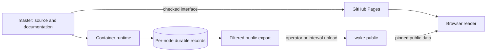
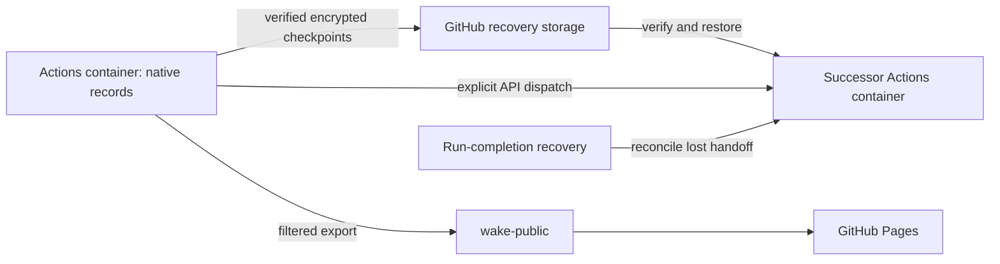

# GitHub Pages and hosted research

For a first public website, follow [GitHub Pages setup](setup.md#2-github-pages-website).
Pages displays exported snapshots. The separate Actions runtime described below
runs research and requires verified encrypted records before it can start.

The [improvement workflow](improvements.md) is currently local and operator-run.
Hosted research and Pages publication do not invoke candidate Python, apply its
patches or consume its review receipts as deployment permission. A compatible
promoted runtime may separately receive `autonomous_context_improvement: true`
and active decision memory through its immutable hosted runtime policy. This
grants only the [bounded context selector](autonomous-context.md), with no model
call or generated-code execution. An absent grant writes false into restored
configuration. Source, runtime promotion, installation grant and observed adoption
remain separate facts; this option alone does not update a pinned runtime.

The optional [decision-memory feature](retrieval.md#optional-decision-relevant-recall)
defaults to off. A hypothetical shadow capsule is invocation telemetry, never a
public snapshot or a source of research authority. Enabling active delivery is
an explicit runtime configuration choice, separate from publishing source or Pages.
Model-facing compact capsule views remain bound to the full private native receipt;
neither format is added to public exports. A presentation-only refresh also copies
the Console chart assets: each line chart fits its complete captured history to
the panel width, without changing the captured research or inspection packets.

The [ant farm](ant-farm.md) ships with filtered website exports. My farm runs
and saves in each visitor’s browser. [Bob’s shared farm](bob-ant-farm.md) has a
separate, bounded GitHub checkpoint maintained by a provider-free Actions job;
visitors only replay its dated observations. Its notebook is presentation and
never changes native research articles or records. Its former conversation panel
is removed.

The October 26 data-only demonstration used the already deployed `c4986cf`
interface, generated ten deterministic retrieval fixture results and published
only data commit `6b6965c`. A fresh browser displayed result
`publication-check-20261027T055140Z` after **13.9 seconds**. Pages run
`40457497721` remained the latest deployment before and after the update: **zero
new Pages builds**, no website source change during the demonstration, and zero
provider calls. This validates publication plumbing, not a knowledge benefit.

## Experimental execution measurements and reset

The active research workflow is **WAKE — Research worker** (`research-worker.yml`).
Its predecessor, `hosted-research.yml`, is permanently retired after GitHub left
zero-job runs queued while rejecting both cancellation endpoints. Before the
replacement starts, disable the predecessor. Its checked worker versions consult
that live workflow state before opening any record or provider; a delayed old run
therefore exits. The replacement uses fresh authority and handoff concurrency
names while retaining the same checked-runtime and installation binding. Never
re-enable the predecessor to clear its stale queue. GitHub may still list those
entries; that listing is not evidence of an executing worker.

The failed hosted run [40444574830](https://github.com/sudofx/wake/actions/runs/40444574830)
measured about 5 seconds in queue, 12 seconds creating its container, 4 seconds
installing dependencies and 41.5 seconds restoring state. It later spent the full
180-second Start acknowledgment limit with no confirmed worker. Its successor
job took 145 seconds, including an explicit 120-second failure backoff. These
measurements point to startup/control and remote state transfers before changing
hosting. Stage timings now report restore, startup, Start, drain, final state
transfer and data publication separately.

Continuation compares monotonic workflow run numbers. A newer run supersedes an
old handoff; an older stale queued entry cannot withhold the current run's
successor. The installation-wide workflow concurrency group serializes research
writers, and normal public pushes reject an advanced captured parent.

Standard GitHub runners remain the default: they need no always-on operator
computer and [standard public-repository usage is free](https://docs.github.com/en/billing/concepts/product-billing/github-actions).
An existing local container avoids workflow queues after launch but depends on
that host remaining available; a new persistent hosted service has not been
measured or approved. No new subscription is required.

For a deliberate hosted cycle-zero reset, dispatch `research-worker.yml` with the
checked pinned `runtime_ref` and `reset=true`. The installation writer is serialized.
Reset restores trusted setup and provider limits while skipping discarded native
databases, then bootstraps stopped fresh records. It verifies cycle zero before
research starts, replaces transferred state and records a dated
`experimental_reset` marker in operational/public installation metadata. It does
not archive the discarded experiment or retain its preceding encrypted snapshot.
Normal research dispatches omit reset. Local installations use `wake-research RESET`.

## Publish controlled evaluation results

The Lab page (`lab.html`) reads `latest.json` from the separate `wake-evaluations`
data branch when opened. This small experimental-output stream is independent
of the twelve-node research snapshot and the checked Pages interface. It never
changes native records or research counters. Local previews read `evaluation.json`
from their own server instead.

Publish an explicit JSON report using the existing GitHub CLI login:

```sh
python scripts/publish_evaluation.py /tmp/evaluation.json --repository sudofx/wake --initialize
```

`--initialize` permits creating a missing data branch once; later updates omit
it. The report uses `schema: "wake-evaluation@1"`, a unique `result_id`,
`generated_at`, `title`, `summary`, `metrics` (name/value rows), and `limitations`.
Label deterministic fixture results plainly. The publisher limits reports to
2 MiB, writes only `latest.json`, rejects competing non-fast-forward updates,
and dispatches no workflow or Pages build. No provider key enters the report.
This data branch is disposable experiment output, not a recovery archive.

## Publish the local installation mirror

Research runs in containers. Each node owns its durable SQLite record; the website
is a dated, read-only copy of the public data exported from those records. GitHub
Pages executes no research and has no research controls. An explicitly bound hosted
status light observes the GitHub Actions executor; ordinary mirrors have no execution light.

The public mirror serves the research pages, ant farm and self-correction status
from GitHub Pages. GitHub Actions executes research with Google Gemini. No ChatGPT subscription or
Sites hosting is required by these published features.

The unified export also generates [static inspection resources](inspection.md)
under `inspect/`. They require no JavaScript, authentication or live model; their
manifest identifies dated export evidence rather than operational authority.



Pages serves an independently checked interface and a bundled dated fallback.
Bound hosted readers discover the latest `wake-public` commit and fetch public
JSON directly from that immutable GitHub revision. Routine data uploads do not
need a Pages build. Code CI and offline container acceptance remain separate
from live research. See [website delivery](#independently-checked-website-delivery).

Checkpoint pruning refuses a stale rotating-ref checkout or an incomplete set of
current/previous release blocks. A missing asset is a recovery failure, not
permission to initialize or roll back a node. Inspect recoverable copies or obtain
an explicit destructive reset decision. A separately authorized fresh hosted
installation uses new native records, installation identity and cycle-zero exports;
it must never be presented as continuity of the discarded history. See
[research configuration and operator controls](research-expansion.md).

On the host, configure the publishing destination in `.env`:

```bash
WAKE_PUBLISH_REPOSITORY=https://github.com/sudofx/wake
WAKE_PUBLISH_BRANCH=wake-public
# Changed exported heads upload every 30 minutes while the host worker runs.
WAKE_MIRROR_INTERVAL_SECONDS=1800
```

Then publish:

```bash
./scripts/wake_publish
```

The command prints its capture, page-building, copy and upload stages. Capturing a
node pins its last complete page export while the next generation renders. It
checks for running GitHub Actions before capture and again before upload, and
returns without uploading when Actions is busy. After delivery, it exits without
waiting for Pages to rebuild.
An upload verifies delivery of dated exports; it does not demonstrate adoption or
live [recovery behavior](resilience.md) in the resident container processes.

The command pins each available completed export generation and builds the filtered
artifact in a fresh container process using the mounted source. It uploads with
the host's existing Git credentials. Research keeps its current running, paused
or stopped setting. Export capture never opens or copies the authority databases.
The manifest identifies the captured heads and versions, rather than later live
records. The node menu shows colored status dots: current observations on the local
site, and explicitly dated uploaded observations on the public mirror. A missing
observation is gray; a disconnected local site clears its current status colors.
These observations do not establish accepted research. An unavailable worker keeps
its last completed export; a member with no completed export is marked `missing`
in the manifest and has no node view in that upload. No empty record is invented.
Different members may have exported different accepted Bob article versions;
mirror delivery does not wait for their availability or editorial agreement.

Capture holds a short generation-retention lock while pinning immutable files,
using hardlinks on the installation filesystem with a copy fallback. Retirement
of an old generation cannot remove the pinned bytes. Export rendering uses a
separate lock and does not block capture. A renderer fingerprint covering Python
code and website assets permits reuse of compatible completed node pages;
missing, damaged or incompatible fingerprints cause a rebuild from the captured
packet. The unified website is rebuilt from the twelve captured snapshots.
Both paths apply the public allowlist and private-field filter and retain full
attributed `events.jsonl` history with the exact captured heads.

To keep the mirror current automatically, run:

```bash
./scripts/wake_publish --watch
```

This uploads once, then runs one host delivery worker per checkout. Keep that
process and the container available. The worker checks completed export heads
every minute and uploads changed heads every 30 minutes by default, even if Bob
has no new accepted article or a node is unavailable. A new accepted article in
the leader's completed export triggers an earlier upload. Unchanged heads skip
scheduled upload. Set `WAKE_MIRROR_INTERVAL_SECONDS` in the host environment or
`.env` to change the cadence (minimum 60 seconds); the interval starts after each
successful upload. Withheld drafts remain governed editorial outcomes and never
hold the mirror delivery queue.

One installation file lease covers capture and upload for both host and direct
container publishers, including manual commands. An already running publisher
excludes another attempt. The worker waits for publication to finish, including
complete-history builds exceeding ten minutes. Failures appear in worker output
and delivery status and retry after a minute. Running GitHub Actions defer the
upload through the same retry path. `wake-research status` shows the delivered
captured-head digest, Bob article digest and upload date separately from research
state. A receipt confirms the exact immutable artifact uploaded; exports advancing
during upload remain eligible for the next interval. Old Bob-only acknowledgments
remain readable but never claim delivery of uncaptured heads.

Stop delivery with `wake-research mirror-disable` or stop the host worker.
Re-running `--watch` resumes without changing records or research controls.
Updating source does not replace an existing host Python worker: restart that
worker to adopt a changed scheduler. Host capture and scheduling load the mounted
source in fresh processes, so they work independently of the resident controller
version. Current controllers merge the host's separate delivery receipt for status.

Inside an installation configured with Git credentials and the two publication
variables, `wake-research publish` uploads directly and enables controller delivery
on the same changed-head cadence and accepted-article trigger. Failed direct uploads retain a visible status and
retry after five minutes. Credentials never enter the website. GitHub deployment
is a separate step; a delivered branch is not yet proof that Pages serves it.

To prepare an artifact without uploading, use `wake-research publish --output DIR`
inside the container. Serve the resulting directory with a plain static server to
inspect it. Publishing replaces the dedicated public branch with that complete
artifact; do not use a source or record branch as the destination.

The public allowlist includes `blog.xml`, Bob's RSS feed of accepted articles.
The homepage and blog link to this same-origin file; items use the canonical
public reading URLs for the root or selected node. A feed is a dated publication
view, with no research controls, email collection or provider request bodies.

The unified website and available node views share the same navigation. The node
selector appears on Console pages. Each view shows the upload date and reads only its
own uploaded JSON, including maps and their shards. Reader pages begin with a
bounded overview and fetch exact details or older entries on demand. The separate
`wake-data.json` archive carries the latest 400 events; History tools retain the full public event export as
`events.jsonl` or its lossless gzip archive described below. Node records, accepted counts, and full-history metrics are unchanged. Provider bodies,
databases, logs, and control sockets are excluded. Manual import archives are
separate and never uploaded as the public website.

Public event streams over 50 MiB are packaged losslessly as `events.jsonl.gz` to
remain below GitHub's individual-file limit. Generated History pages read and
decompress the same-origin file; download links name the compressed archive.
Decompression restores every byte of the filtered event stream, including node
attribution and historical receipts. Smaller public streams and operational node
exports retain `events.jsonl`. Upload preflight rejects any remaining file over
100 MiB before Git or network work; it never trims history to fit.

## Development and release

Edit and verify source on `master`; push only when publication is authorized.
Pushing source runs code CI but does not change the public snapshot or container
workers. Build or restart the selected container separately, preserving its volume;
workers start stopped for inspection. Upload the website when its exported data and
presentation are ready. See [development](development.md) and
[container operation](standalone.md#control-research-from-the-shell).

## Historical hosted records

`wake-state`, `wake-runtime`, `wake-live`, and existing archive branches are retained
historical artifacts of the retired GitHub executor. Their databases and historical
receipts are preserved; they are not current publication inputs or container
records. No current workflow writes them, and no website loader polls them. Do not
merge or restore them into an installation merely to match counters.

Old workflow runs remain GitHub history. The old runtime ref can contain old
workflow definitions, so its executor workflows must remain disabled in repository
Actions settings. The historical executor must not be reenabled. Current hosted research uses the
Actions-container adapter below, with separate state transport and controls. Recovering historical
records is a separately scoped, verified operation.

## Run research on GitHub without a laptop

GitHub Actions runs the same twelve-node installation in a disposable Linux
container. GitHub Pages serves the filtered public website. The laptop is not a
runner, scheduler, publisher or recovery dependency. Use a public repository and
standard `ubuntu-latest` runners; no larger runner, Codespace, paid artifact store
or external hosting is required. Provider credentials must remain on a project
with billing disabled; provider free quotas still limit research. No automation
can promise uninterrupted service or permanent access to an external platform.



### Start and stop

Open **Actions → WAKE — Start or stop hosted research → Run workflow** on
`master`. Choose `start` to continue the existing records or `stop` to prevent
successors and drain the active run. The active controller checks stop intent
at least once per minute. This never resets records. The enabled/disabled state of **WAKE — Research worker** is the native
continuation switch. Disabled or missing means stopped; the built-in Actions
token can operate it without an expiring personal credential.
Manual cancellation alone is recoverable failure, not the durable stop switch.

The first setup requires `GEMINI_API_KEY`, a random 32-byte hex
`WAKE_HOSTED_STATE_KEY` repository secret, a verified encrypted initial checkpoint,
and successful code CI. Keep an offline copy of the encryption key: losing it
makes the private recovery data unreadable. Existing records are transferred
only with operator authorization, after stopping all original writers. The
installation identity, twelve historical heads, topic files
and shared quota state are preserved. Historical executor branches are untouched.
Never seed a missing checkpoint automatically or import public website data as
an authoritative record. See [authority and recovery](architecture.md#hosted-execution-and-durable-recovery).

### Publish source without upgrading records

Source publication and runtime promotion are separate. `hosted-runtime.json`
binds settings to an installation identity and can include `source_revision` to
hold that installation on a verified commit. Omitting that optional pin explicitly
selects successful master CI, while retaining the installation identity check.

Start runtime verification as soon as the candidate is ready, while the current
runtime continues research. Run **Actions → WAKE — Verify hosted runtime upgrade**
with the candidate's full commit hash. The first job retains one authenticated,
encrypted checkpoint as a short-lived Actions artifact. Audit jobs then work
entirely offline, so later checkpoint rotation or pruning cannot change their
inputs. No decrypted database, provider credential or record body is uploaded.
If capture races pruning, it fails without publishing a partial input artifact;
rerun capture against the current checkpoint rather than stopping research for
an entire audit.

Each of the twelve jobs restores and verifies only its assigned node, then
compares complete baseline and candidate audits. Previously each job restored
all twelve nodes: 144 record restorations for twelve comparisons. The final gate
still requires exactly twelve successful reports with one candidate, baseline,
installation, checkpoint generation and manifest digest. Missing, duplicate or
inconsistent reports fail closed. No provider calls or remote record writes occur.

Choose the release boundary from the actual diff:

- **Website:** verify their own boundaries independently.
  They do not require a research stop or a native replay merely to ship UI.
- **Presentation carried by an older pinned batch:** an explicitly requested
  `presentation_only: true` upgrade can bind the verified presentation source
  for the next normal batch without stopping or enabling research. Completion
  compares complete source trees and rejects changes outside presentation,
  tests, prose, the isolated improvement/recovery demonstration commands and
  the existing offline upgrade harness. Research executable
  bytes, dependency files and the research workflow must remain identical.
  The request names the exact candidate, baseline, verification run and latest
  operator control; its twelve-node background report and exact candidate CI
  must pass. The report supplies the shared captured generation; this special
  case does not claim a frozen current checkpoint. A newer operator control
  supersedes it. Current workers retain their immutable source until the normal
  serialized successor adopts the new binding.
  A request may also name a separate `presentation_revision`. It requires its
  own exact successful master CI and a second complete tree comparison against
  the audited candidate. Every runtime/record and development-module byte must
  match; only the explicitly allowlisted presentation/harness paths can differ.
  The full twelve-node report remains bound to its original candidate and
  checkpoint. This keeps a small HTML/control repair from restarting the same
  native-history replay while preserving the actual executable-code boundary.
- **Operational runtime changes with unchanged record interpretation:** complete
  the background comparison, then drain and roll over the runtime. Review the
  diff to establish that native formats, reducers, governance, migrations and
  dependencies are unchanged; unknown impact uses the stricter path below.
- **Record interpretation or migration changes:** prepare and test in the
  background first. At the final rollout boundary, drain research and verify the
  final checkpoint under both versions before changing the binding. An older
  snapshot alone does not certify records appended after it was captured.

Download the `upgrade-verification` artifact and check the candidate, baseline,
installation identity and all twelve matching histories before promotion. The
candidate must also have successful master CI, and the binding's installation
ID must match recovery. Never clear a pin, reset records or skip a failed gate to
speed up delivery. Stop only for the dependent rollout, not for unrelated page
work or while an early audit runs.

An explicitly approved upgrade can finish without an open chat. Add
`pending_upgrade` to that installation's binding with the exact `candidate`,
`baseline`, `verification_run`, frozen `checkpoint_ref`, `generation`, and the
latest completed operator `control_run`. **Complete requested hosted upgrade**
runs when verification completes successfully. It rechecks the full report,
code CI, unchanged checkpoint, stopped writer and current operator intent, then
changes only the runtime pin, requests the existing start control, and clears
the pending request. Installation settings and grants are preserved. A newer
operator control, changed checkpoint, missing node or failed check prevents
promotion. Removing the pending request cancels automatic completion; running
verification by itself never authorizes an upgrade.

For a gate that finished before its request was published, dispatch the completion
workflow with that exact verification run ID. Its restart request is a separate
boundary from actual worker adoption: check fresh runtime observations after
startup. A failed completion retains recoverable state; rerun it after resolving
the reported condition rather than restarting from scratch or blindly replaying
writes.

An older pinned runner can replace newly published website assets during its
next export. For a release that changes those assets, gracefully stop and drain
the old runner, promote the verified runtime, then start it again. If presentation
needs restoring during the upgrade, refresh the latest captured public parent;
never republish an older research snapshot. Check the final public export after
the old runner exits, because its final publication can also replace the assets.

In Actions, admission and successor selection read this binding from the immutable
workflow commit (`GITHUB_SHA`), separately from the candidate runtime checkout.
That permits a later binding commit to name a previously checked candidate without
requiring a self-referencing source hash. An unreadable or malformed policy stops
admission before opening hosted authority; it never falls back to an older pin.

### Continuation and repair

`research-worker.yml` restores every native record, verifies the full kernel and
provider/access journals, checks application state against the result digest in
the verified event chain, and starts the
existing controller, runs for a bounded two-hour research window, drains and saves
all records, builds the existing filtered artifact, pushes `wake-public` and
requests the Pages build. Its final job explicitly dispatches a successor through
`workflow_dispatch`, using a source revision with successful code CI.
`hosted-runtime.json` can bind a repository and installation identity to a verified
runtime commit. A source-pinned installation stays on that commit even when newer source
passes CI; a missing successful check fails closed. Unbound repositories select
the newest checked `master` revision. A fork does not inherit another repository’s
runtime binding. `hosted-recovery.yml` handles failed or cancelled run-completion events
and repairs a lost successor dispatch with the same identity. Duplicate handoffs
are reconciled and installation execution is serialized. Neither uses cron.

The operator may set `decision_memory_mode` to `off`, `shadow`, or `active` in that
installation's policy. Before starting workers, the hosted runner applies this
root setting to the restored private configuration, preserving topics and other
settings. The setting is checkpointed with that configuration. The repository
and application defaults remain off. This installation explicitly uses active
decision memory. Old advisory terminal receipts have read-only replay support;
new advisory events are rejected and no retired execution feature is restored.
The optional boolean `research_candidate_catalog_enabled` extends an enabled
research expansion to its thirteen additional questions. False or absent selects
only the original themes; false retains previously adopted catalog topics as
inactive history. Both flags are validated before hosted restore. See the
[catalog assignments and rollback](research-expansion.md#operator-controls).
Active working-context compaction changes future provider requests only. Before
promoting a runtime, compare disposable native copies across all twelve nodes,
verify pending-invocation recovery and preserve installation identity, complete
history and accepted counts. The public mirror remains a filtered export; private
request bodies and memory-use observations do not become public evaluation data.
Encrypted recovery also retains the existing retired private sidecars as opaque
files; they are neither interpreted nor included in public exports or research.

Experimental workers commit their native SQLite invocation state before provider
effects. Remote state transfer now occurs at the end of a bounded batch, rather
than before and after every model call or once again before Start. This removes
GitHub uploads from the per-call path. An abruptly lost runner may lose work
since its last completed batch transfer; that disposable work is not presented
as continuously preserved. Ordinary process recovery still uses native records.
Free quota waits survive runner handover; no automatic reset or quota bypass exists.
Worker failures are recovered from verified records in the next bounded run.
Start is acknowledged when the worker reads its command, before editorial or
provider preparation. Stop/reset acknowledgments still require drainage.
Missing Start acknowledgments are reported explicitly. Confirmed workers may
continue a partial batch; if none confirm, the batch closes and publishes its
completed exports before the successor retries. One unavailable worker cannot
withhold the other records or their public mirror.
The system does not write unreviewed source repairs or change its own research rules.

GitHub's workflow token has a shared repository API allowance. Checkpoint transfers
reserve 100 requests for controls and continuation, waiting for the service's reset
time before further transfers. Safe reads honor explicit primary-limit or
`Retry-After` headers, within a 61-minute wait budget per request; ordinary permission
denials still fail visibly. Ambiguous writes are reconciled by content identity,
never blindly replayed. Only numeric quota metadata is logged. A control-read
failure closes admission, drains and captures all twelve records before reporting
failure. It never treats unknown stop intent as permission to continue.

Research keeps a stable workflow name so its completion event can trigger the
independent recovery workflow. Both handoff paths serialize and compare workflow
run numbers: an existing newer run, even if already completed, owns continuation.
This prevents a delayed recovery from resurrecting an obsolete chain. Handoff jobs
allow 75 minutes for quota recovery; research jobs allow four hours including
checkpoint waits around the two-hour research window. Neither adds a cron trigger.
For a read-only check of enabled intent and numeric API allowance, dispatch
`hosted-control.yml` with `action=inspect`; it does not open records or providers.

The dedicated release stores authenticated encrypted blocks. Unchanged blocks
are reused and unreferenced ones are removed automatically. The dedicated
`wake-hosted-state` ref rotates atomically with current and previous encrypted
manifests; it does not accumulate a Git history of database ciphertext. These
are recovery snapshots of native SQLite, not a second writable research store.
Every retained database includes its complete event history. Transport growth
and GitHub service limits remain real constraints, not grounds to trim history.
Checkpoint workers, publication and control reads share a numeric rate-budget
ledger in the disposable transport directory. Missing upload headers retain the
known allowance; concurrent requests debit it conservatively. Data transfers
wait before spending the last 100 requests, leaving room for control checks.
The ledger contains no credentials or research data and resets with the quota
window. Permission denials are not treated as rate limits. A failed upload is
reconciled by its existing content identity before one retry; a complete remote
block is reused, and an unconfirmed block never satisfies the durability barrier.
No Actions artifacts or caches are used for authority or publication.

### Verify actual progress

The header and node picker use one aggregate of the same dated installation
snapshot. A blocked node makes the aggregate red; otherwise any running node
makes it green, including a mix of running and idle workers. With no running
nodes, the priority is waiting, provider standby, paused, stopped, then idle.
Gray means unavailable observations, not merely a mix of known states. The
header applies this aggregate while GitHub confirms an active batch, and an
explicitly disabled workflow remains stopped. Tooltips retain state counts and
observation times. The header dates uploaded node observations separately from
the current GitHub check and identifies observations from a previous batch.
These colors do not establish live provider calls or accepted
research progress.

Inspect **WAKE — Research worker** runs and their summaries for source revision,
checkpoint generation, record heads and accepted versions. A successful run can
still contain rejected or deferred proposals. Confirm actual accepted progress
from successive record heads and versions. Check the Pages deployment separately,
then read the served `installation.json` and its twelve captured heads. Its
`hosted_execution` field identifies the source revision and capture run; dated
runtime observations never become a live execution capability. Source CI, record
checkpoint, provider outcome, website upload and Pages serving are separate claims.

### Read the hosted status light

The header light checks public GitHub Actions metadata without sign-in or a token.
Green combines an active hosted batch with recorded node-running observations;
it does not mean a provider call is in flight or research has been accepted. Yellow
means queued, stopped, draining, awaiting automatic recovery, or an active batch
waiting for current node observations. Blue means between
successful batches; red means GitHub requires attention or a failed batch has had
no successor for fifteen minutes. A failed current-status check with an available
published node snapshot shows yellow, names the failure and dates that observation;
it never turns an old running snapshot green. Gray means neither the current
check nor a published node observation is available. Tap or focus the light for its explanation and check time;
its link opens the research workflow. Node dots and Console canvases remain dated snapshots.

Only exports explicitly bound by `wake.hosted_presentation.bind_hosted_status` enable
this observer. It makes two anonymous reads at most every three minutes while visible,
shares a short cache across pages, bounds each read to eight seconds, clears stale
or offline observations, and never reads private records or changes research controls.
GitHub rate limits can make the light unavailable without stopping research.

### Independently checked website delivery

GitHub Pages hosts the checked interface. `public-data.js` reads a single public
GitHub commit for each document, while local and unbound exports stay same-origin.
The explicit binding names the repository, `wake-public` branch and expected
installation identity. Discovery uses one anonymous GitHub commit lookup, shared
across pages for three minutes; the API lookup is bounded to three seconds and
discovery plus metadata validation share a six-second deadline with
size limits, leaving time for the bundled fallback inside normal reader budgets. Data reads omit credentials and referrers and have bounded timeouts.
All overview, detail, pagination, Console and map reads use that immutable commit.
Bob popups and Console tools inherit it. Opening a new page after the discovery
cache expires can adopt a newer export without rebuilding the interface.

The data branch supplies JSON and record packets, never executable website
assets. Download links resolve to that same selected commit; the external
inspection entry opens its self-contained Markdown packet. If API discovery fails,
the reader may reuse its last verified immutable revision after rechecking the
installation identity, unless the bundled snapshot is newer. The original cache
age is preserved, and failed discovery retries back off across navigation.
Remote identity mismatch or discovery failure without a usable cached revision selects the bundled
dated snapshot before any data loads, without inserting a site-wide banner. Once a remote commit
is adopted, a missing packet fails visibly rather than combining generations.
A popup with an explicit source revision fails if that revision is unavailable.
These are public observations, not native record access or live activity.

`publish-pages.yml` selects the latest successful master code-check revision and
uses `scripts/pages_delivery.py` to skip an already deployed interface or source
changes that do not affect presentation. Failed checks and research completion
do not trigger interface delivery. Older pinned runners may still dispatch the
workflow after an upload; no-input dispatches skip the job without allocating a
runner. New runner
source no longer dispatches Pages from data publication, so a Pages request cannot
turn a successful upload into a failed research batch.

When delivery is needed, the workflow captures `wake-public` and applies checked
presentation with `scripts/prepare_pages.py`. It verifies all twelve heads and
protected research/inspection bytes before compacting the disposable Pages copy.
The Pages payload keeps interface assets and bounded recent fallback views, with
an 8 MiB data budget per root/node. It prioritizes the reader overview, installation
identity, recent reader packets/guides and small first list pages. Full archives,
unbounded map shards and older record packets are omitted
from this interface bundle. Every retained data packet is hash-checked unchanged;
complete public data stays on `wake-public`, and native records are never opened.
Presentation metadata records the fallback's limited scope. In an outage the
reader displays its recent overview; missing full records/maps fail visibly rather
than substituting another snapshot. RSS links use the moving public GitHub feed,
so new subscriptions can receive data updates without a Pages deployment. To explicitly publish or repair the interface, even when its revision
is already recorded as deployed:

```sh
gh workflow run publish-pages.yml --ref master -f force=true
```

The public branch is a captured data input, not the served UI owner.
`hosted_execution` identifies the research source; `presentation` identifies the
separately checked interface. No native record is opened. Research can keep
exporting data while interface development and publishing proceed independently.
The presentation refresh uses the captured public archive and leaves hashed
inspection packets unchanged.

### Hosted execution observations

The header light reads GitHub Actions batch metadata directly. Public Console
counts and process/matrix views are dated snapshots. The former external live
activity relay, its ingestion secret and browser binding are retired. Local
installations retain their same-origin runtime observation channel; no relay is
required for local inspection. Missing live activity must not be drawn as current
execution or accepted research progress.

## Unattended operation boundaries

The existing successor dispatcher and independent completion-event recovery
reconcile newer runs before retrying, so a delayed event cannot create a second
writer. Website delivery does not gate their continuation. GitHub availability,
API capacity, Actions limits, credentials, provider availability and valid
checkpoints still matter; a configured model key alone cannot guarantee years of
uninterrupted operation. Public snapshot freshness and the status light expose
unavailable or stalled observations without inventing progress. Source correction
still produces tested draft changes for review; it does not autonomously merge or
upgrade the research runtime.

## Spread provider calls across the day

The shared installation queue can pace routine research across 24 hours while
retaining capacity for other work. The configured model ceilings total 1,040
calls per Pacific calendar day. `provider_pacing = { enabled = true,
target_hours = 24, reserve_calls = 208 }` reserves 208 for reader and experimental
requests, leaving 832 for routine planning, research proposals and editorial
calls. Routine requests start at least 103.85 seconds apart across all twelve
nodes. This is one installation-wide rate, not a separate rate per node.

The controller admits only one provider effect at a time. A reserved feature
request can pass a research request waiting for its pacing deadline, but cannot
pass an active effect or exceed its own reserve or the configured model ceiling.
Failed confirmed attempts consume allowance. A queue denial with no provider
call does not. An unavailable or depleted model can advance the configured
fallback chain without spending an API call.

`provider-schedule.json` retains counters and the next admission deadline across
worker batches. At controller startup, native invocation receipts conservatively
backfill any known current-day usage missing from that scheduling cache. Idle
time never earns a burst of catch-up calls. Pacific midnight renews calendar-day
allowances while preserving spacing across the boundary. These counters govern
transport only; the native record remains scientific authority. Calls made by
other applications using the same Google project can still deplete provider
quota earlier than these local allowances predict.

The hosted installation explicitly binds this policy in `hosted-runtime.json`.
The worker applies it to restored configuration before starting its controller.
Inspect `coordinator.pacing` in the installation runtime snapshot for the
adopted policy, counts and next-call delay. Worker logs retain bounded admission
counters at startup and drain. The `inspect` hosted control also reads the
authenticated scheduling file from the most recent checkpoint, without restoring
or opening native records. Its capacity is explicitly dated; later and external
API use can reduce it. Scientific trial receipts backfill feature usage after
scheduling-cache loss, including conservative interrupted-effect accounting.
An invocation or trial spanning Pacific midnight can count against both days
when its exact effect time is unknown; recovery may understate available
capacity but must not erase a potentially paid effect. A source change or successful CI run
alone does not establish runtime adoption. Already-consumed calls cannot be
recovered; the first partial day may reach its routine allowance sooner.

A final upgrade normally requires no queued or running research writer. GitHub
can retain a jobless pre-queue entry after newer research runs have completed.
An upgrade intent may name that exact superseded entry and the newer successful
drained run. Completion checks their ordering, original installation/runtime
binding and empty job list before classifying it as a scheduling artifact.
Unidentified entries, active jobs, newer runs and incomplete listings still
block promotion. The frozen checkpoint and all twelve native audits remain
mandatory; the historical Actions entry is retained.
If an entry predates an earlier runtime upgrade, the request must also name its
original runtime in `superseded_queued_baselines`, keyed by run ID. Completion
proves that runtime is an ancestor of the current baseline, verifies the later
drained worker's installation and baseline binding, and still requires zero jobs.

### Computational research capability

Experimental research is separately opt-in through `experimental_research_enabled`. Its Python instruments require the reviewed pinned Docker image and a compatible Docker runtime; the worker uses a Python 3.13 runner with Docker available and checks the real restricted executor before opening research records. This workflow shape alone does not establish deployed capability. Missing isolation is recorded as blocked and never falls back to host Python. Hosting this workbench requires a separately verified runtime rollout; the request-pacing release does not enable it. Trial inference uses the reserved `experiment` queue purpose while retaining single-flight admission and per-model limits. See [the workbench and current gates](experimental-research.md).

The **Experiments** audit reader ships through the independent presentation
refresh even when the running installation has no scientific records yet. It
reads node reports from the selected immutable public snapshot and checks their
record heads against its installation manifest. Missing reports stay explicit;
publishing this interface neither enables experiments nor changes native records.

Scientific child calls remain part of native provider accounting. Shared admission, unbound per-model planning limits and public request totals include those calls; unresolved effects remain visible rather than counted as known zero.
