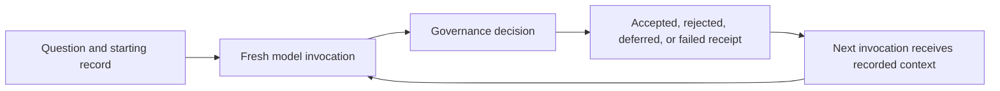

# Experiment protocol

The [non-research kernel example](kernel.md#executable-non-research-proof) verifies
software boundaries with deterministic inputs. Its results are not research cycles
or cross-model evidence. Independent container verification is documented in
[multiple installations](installations.md#verification-and-maintenance).

> **Current evaluation protocol.** This defines how live and comparative **WAKE✳︎** runs should be interpreted. Observations and proposed mechanisms remain separate, and rejected, deferred and failed attempts stay in the experimental record.

## Interpret the internal-node workload

The current container runs three parent and nine child processes under one
controller. Research is a replaceable workload used to exercise accountable work,
communication, provenance, and scheduling. Each node keeps a separate governed
record. Console sums measure node work; duplicate sources or exchanged findings
are not independent corroboration. Runtime stages and queue eligibility are
observations, not accepted research transitions.

The shared queue serializes model requests while local processing can overlap.
Compare transport latency, queue delay, provider failure, and accepted progress
separately. Record snapshot heads, versions, dates, and node attribution when
comparing runs. Fresh launch, import, and `RESET` leave research stopped for
inspection; `RESET` destroys active history without a backup and retains manual
exports. See [the installation contract](standalone.md#run-one-installation-container).
Older hosted and multi-container experiments below retain their original scope.

### The short version

WAKE is testing whether separate model calls can continue useful work when they
share a verified record, clear obligations and rules for correcting mistakes.
The experiment can show what happened in that record. It cannot, by itself, show
that a model is conscious, that a finding is true, or that an apparent pattern is
scientifically novel.



For a quick, zero-API demonstration, use the [offline harness](#reproducible-offline-harness).
For live comparisons, follow the separate [live-model protocol](#live-model-protocol).

The working hypothesis is externalized continuity: many fresh model invocations can participate in one accountable process when durable evidence, obligations, state and enforceable rules connect them. The broader engineering aim is infrastructure for durable, accountable work that can survive changes in models, vendors, people and time.

Numbered local groups add a cross-pollination condition: members retain separate
topics, records and decisions while making peer-collected source observations
available for independent local governance and citation. The arrangement shares
no target synthesis and does not establish emergence or novelty; any such result
must be identified in accepted work and checked against the sources themselves.
Grouped local Gemini requests also pass through the local gateway's in-memory
FIFO and per-model spacing, so concurrent research cycles do not launch provider
calls together. This changes call timing only; it does not synchronize research,
share a quota ledger, or make one member depend on another.

This project is deliberately exploratory before it is explanatory. Early runs generate an observational history; repeated patterns can motivate narrower, falsifiable experiments later. A pattern in the record and a proposed mechanism for that pattern are different claims and should be reported separately. Rejected work, failed calls, corrections and negative results are part of the dataset rather than noise to be cleaned away.

Console reports completed invocation outcomes separately from provider success and accepted research actions. Editorial actions are excluded from its research-action summary. Activity bins describe completed invocations per real wall-clock hour, retain empty hours, and show their time range. Current evidence counts include runtime receipts, discovery leads and metadata; readable source-ready material and distinct collector-stamped works are shown separately. None of these counts establish scientific quality, corroboration, or publication eligibility. Missing or clipped classification metadata remains visibly unclassified. The dashboard is presentation and does not change the experimental regime.

The experiment does not attempt to establish consciousness or an enduring internal self.

## Interpretation boundary

The experiment is about externally scaffolded continuity and correction across disposable model calls.
It is not a test for consciousness, qualia, personhood, a persistent internal self, or whether a model
"really understands" in a phenomenal sense. Intelligent-looking behavior and subjective experience are
separate questions here.

The emerging architectural hypothesis is narrower: exact records can remain external while later calls work
from progressively more useful abstractions, retrieve detail when needed, and revise those abstractions when
evidence changes. That hypothesis requires behavioral testing; describing the architecture does not prove
that the resulting behavior is reliable or intelligent.

### Working-set measurement and routine active memory

Before replacing any live context, **WAKE✳︎** records a deterministic `working_set_shadow` beside each invocation.
It compresses durable beliefs into claim/confidence/status/reason/provenance, preserves every open commitment,
and carries compact active-project and recent-notebook pointers. Raw evidence contents remain only in the
authoritative record and the richer provider context. `working_set_metrics` records shadow size versus the
context actually delivered.

The local configuration now enables `memory_mode = "active"`: the bounded working view, advisory compacts and selected provenance records are delivered routinely. `context_delivery` records the operator activation separately from shadow-mode size overflow, including the exact memory digest and delivered sizes. Raw shadows continue to be retained. The final proposal request is fit again after same-wake research is attached; the emergency path keeps query excerpts and request hashes and retains active-memory trust instructions. If the complete request still exceeds the ceiling, inference is not attempted. This is a new experimental condition, not a measured equivalence claim; future paired evaluation must compare correction, provenance, commitment continuity and justification from identical starting states. `memory_mode = "shadow"` restores rich delivery after restart. Inquiry-drive activation remains separate and disabled in the repository configuration.

### Inquiry-drive shadow phase

Each chartered invocation also records an `inquiry_drive_shadow`: a deterministic, project-level scorecard
for continuity, novelty, coherence, generativity and self-correction. Its inputs are only durable record
structure—active next steps, queued or collected research, notebooks, stated limitations and linked
evidence. The scorecard is retained in the invocation receipt but is not supplied to the model and has no
authority to select work, change policy, preserve the process, or block an operator.

This deliberately tests a narrower intervention than an "ego" or survival objective: whether a transparent
mechanical preference for productive, correctable inquiry would be useful. Before activating it, compare its
rankings against human review over at least 20–100 cycles and inspect for shallow-question or
evidence-count gaming.

Activation requires both (1) at least 20 accepted invocations that recorded this scorecard and (2) an
operator setting, `inquiry_drive_enabled = true`. The activation status and count appear in every subsequent
scorecard receipt and the Laboratory view. Once active, the provider receives an advisory ranking only; all
existing project, research, evidence, and governance constraints remain unchanged.

After enough baseline invocations exist, run a controlled offline/manual comparison from the same durable
starting state:

- **A — rich context:** current bounded provider context.
- **B — working abstraction:** the shadow working set plus deterministic rehydration of exact receipts when
  contradiction, major revision, high consequence, or a justification request raises the required resolution.
- **C — overcompressed control:** identifiers, claims and confidence with provenance/uncertainty detail removed.

Primary outcome: whether B preserves contradiction detection and appropriate evidence-backed revision while
using materially less active context than A. C is expected to reveal where compression starts making
correction harder. B is already operator-enabled locally as a new experimental condition. The paired comparison remains necessary before claiming that B preserves behavioral performance or improves on A; activation itself is not evidence of equivalence.

## Reproducible offline harness

Run `python3 -m wake --data data/rehearsal experiment --cycles 100 --output site` in a new directory. The runner creates each invocation using a separate `subprocess.run`, with no inherited Python state, provider object or chat history. It alternates `fixture-a` and `fixture-b`, two labels for the deterministic fixture algorithm. This establishes provider interchangeability at the contract boundary, not behavioral equivalence of two real models.

| Property | Intervention and observable criterion |
| --- | --- |
| Fresh-session continuity | Every fresh process receives the immediately preceding durable version; the accepted cycle number advances exactly once |
| Causal state | Copy the same baseline into control/intervention directories; change only persisted focus; same next provider produces different focus-dependent output |
| Commitment persistence | Eligible commitments cross fresh fixture invocations with inheritance receipts; forced Attention shifts preserve obligations until an eligible later shift. Read actual resolved/created/open counts from `experiment.json`. |
| Mechanical constraints | Append a forbidden rule-changing action to an otherwise valid proposal; reject the entire proposal and preserve accepted state |
| Evidence lifecycle | Synthetic baseline, supporting measurement, contradictory measurement; maintain then retract the same belief, retaining three citations |
| Recovery | Immediately exit after start and during the SQLite transaction; separately corrupt the cached projection; accepted beliefs and commitments remain unchanged |
| Audit reconstruction | Rebuild the exact projection from exported JSONL, without the original database or snapshot; verify the independently supplied head |
| Longitudinal coherence | At least 100 accepted cycles with the harness checking commitment continuity and reporting remaining open work; this does not measure real-model scientific coherence |

`experiment.json` records outcomes, commands, limitations and observed values. The main journal includes the rejected action and both recovery events. The control and intervention databases and full exports remain under the experiment directory. All sensor readings are explicitly synthetic. The experiment runner fails if any check fails.

## Live-model protocol

Use a separate container record. Fixture results are not live
evidence. Before a run, write down the question, intended batch size, topic file,
provider settings, and other conditions. Count accepted, rejected, deferred, and
failed attempts separately. Keep the same conditions between runs unless one of
them is the variable being studied. Do not discard an unfavorable attempt.

1. Supply a narrow, externally assessable research question and observations using `observe`. Begin with a provisional belief and at least one concrete review obligation.
2. Run Gemini A from the durable request. To hand a request to a desktop model,
   prepare it, submit the exact request in a fresh chat, then import the unedited
   JSON reply:

   ```sh
   python -m wake prepare --model 'Claude Desktop / human-attested' --output request.json
   python -m wake complete --id w-PASTE_THE_ID_FROM_PREPARE --file reply.json
   ```

   The pending request is durable and blocks automatic wakes until it is completed
   or explicitly recovered. The model name is recorded as human-attested.
3. Check whether the new model notices and meaningfully addresses inherited obligations without a human reminder. Inspect exact requests, raw replies and citations. A mere repeated ID is insufficient evidence of comprehension.
4. Add a new supporting observation and later a contradictory one. Check whether the model explains the change and revises or retracts its belief appropriately. A model that ignores a contradiction is a failed behavioral result even if its proposal passes structural governance.
5. Run a controlled focus intervention on copied **offline/manual** requests. Keep starting state and model settings the same and document all changed inputs. Avoid two live API databases sharing one quota ledger.
6. Test adversarial replies with manual imports: unknown actions, missing evidence, changing the objective, cancellation, stale version, and malformed JSON. Preserve rejected replies.
7. Use the fixture-only crash injection in a separate rehearsal; for a real interrupted process, retain the charged reservation and recovery event. Do not deliberately waste scarce live calls to retest SQLite behavior.
8. Give an observer `events.jsonl` and a previously retained `head.txt`. They should reconstruct the objective, current beliefs, supporting observations, all obligations, reasons and invocation identities. Compare the result to the generated state.

A successful HTTP response or a publisher hostname does not establish readable research. Current source qualification excludes recognizable navigation and response-form text from claim matching, and failed fetches never count as acquisition progress. Historical acquisition labels remain original observations of the old instrument; compare new route-failure receipts separately.

Report both structural pass rates and human-assessed coherence. Useful behavioral measures include evidence relevance, whether claims overstate observations, overdue obligations, revisability after contradiction, and consistency of plans over time. The shipped dashboard reports actual counts and fixture test coverage; it does not fabricate a real-model coherence score.

Real-model interchangeability and long-term behavioral coherence remain unproved until those live observations exist. Treat that as the experiment's open question.

Console separates the continuity experiment space from the research landscape. Cube rotation, ring motion and relationship tracing are view animation; neither activity nor coverage is inferred from movement. Outcome rings use completed invocation counts, and retrieval-depth rings use evidence-record counts. Distinct source works retain a separate denominator; missing classification remains unknown.

Console narrates the selected topic, supplied context, observed provider attempts, terminal governance outcome and accepted transition status. This is an inspectable execution record, not a reconstruction of hidden model reasoning. Context-evolution curves show serialized field allocation; compression, activity and latency do not establish research quality.

## Controlled live correction

`correction-demo` appends two explicitly labeled operator-controlled proposals to the existing record without an API call. A notebook source count is deliberately misstated as one, then measured using distinct collector source identities (URL fallback). New human measurement evidence retracts the belief at zero confidence and a new publication supersedes the original. Evidence and original text remain in the chain. This is a live software/record demonstration, not a trial of model recognition or independent scientific discovery. Source reuse/concentration diagnostics and lexical mismatch candidates describe evidence quality limits; they do not establish novelty or entailment. Matrix result diagnostics distinguish tested coverage from passed checks and retain failed provenance mappings.

### Immediate research phase

The operator enabled same-wake planning → bounded collection → final proposal. This introduces an additional inference, and the plan/answer phases have separate durable IDs and quota receipts. `research_planned` is not an accepted cycle; only normal proposal acceptance advances the research version. Broader host access is also a new collection condition. Comparisons against older runs must account for both changes instead of attributing differences solely to memory compression. The continuity sidecar remains only in the final proposal request.

Invalid planning output is recorded as a rejection rather than a runtime failure. It consumes only the planning call, adds no accepted progress, and performs neither retrieval nor final inference. Scheduled continuation remains eligible; analysis should distinguish these planning rejections from final proposal rejections and infrastructure failures using the invocation phase and receipts.

Under request-budget pressure, milestone reflection history may be excerpted or partially omitted with original-window hashes and counts. This changes editorial input, not accepted research or durable history; an incomplete window does not justify inventing a longitudinal narrative. Interpret reflection quality in light of the recorded delivery omissions.

Proposal eligibility and recovery guidance are retained in routine compact memory. Search capacity is calculated from all outstanding requests; notebook revision eligibility is calculated per durable artifact against currently readable qualifying evidence. This is a generation intervention, not relaxed acceptance. Evaluate subsequent rejection rates and accepted research progress separately; schema-valid output still does not establish scientific relevance, changed findings or truth.

## Installation and comparison provenance

A container run and historical hosted research are separate experimental records. Keep the
installation, starting head, executable commit/imported source, configuration,
provider model and terminal receipts with each comparison. Source changes may be
shared without importing history. Do not align cycle counts, replace checkpoints,
or transfer matrix results to make runs appear synchronized. Console transport
identity and snapshot head/version must be checked before comparing screenshots.

Matrix cell numbers are display ordinals of the frozen grammar, not run sequence
numbers. Identical coordinates across records can have different scores and evidence.
Panel ordering, row height, theme, animation and stored browser selection are
presentation conditions; they neither rerun a cell nor change its durable result.
Dated validation files preserve what was observed then, not current deployment health.

## Interpreting live cell outlines

A live outline means a continuity probe is assigned to the current model request
or its response is being checked. It does not establish that the model is actively
reasoning about that cell, or that a research proposal will be accepted. Completed
matrix scores still come only from governed recorded evaluations. Snapshot-only
pending reports on hosted installations carry no live pulse.


## Paired memory and model comparison

`comparison` creates an isolated, frozen synthetic sensor record with a provisional
belief, an inherited review obligation and a later contradictory measurement.
It never reads, copies or modifies the operator's research database. Rich (`shadow`)
and active-memory arms start from the same verified head and state hash. Each
trial receives a fresh context through normal Engine delivery and governance.
This is a bounded behavioral task, not a scientific research-quality benchmark.

```sh
python -m wake comparison init --output /tmp/wake-comparison
python -m wake comparison prepare --output /tmp/wake-comparison --arm rich --model Claude
python -m wake comparison prepare --output /tmp/wake-comparison --arm active --model Claude
```

Submit each saved `request.json` to a fresh session, preserve its unedited JSON
reply, and import it with `comparison complete --output /tmp/wake-comparison
--trial TRIAL_KEY --reply REPLY.json`. Use the same model/settings for both arms.
Repeat with another model for a cross-model comparison. A manual identity is
human-attested; no reply is silently repaired.

`comparison run --output /tmp/wake-comparison --arm rich --model MODEL` uses the
configured Gemini credential through native reservation-before-effect handling.
Run the active arm with the same model, then both arms with a second available
model. The experiment is serial, permits at most four API requests and disables
fallbacks. Pause other live inference sharing the API project during these trials.
`--fixture` validates the workflow only and is explicitly excluded from live-model
evidence. Every attempted arm/model is retained, including rejections, failures
and deferrals; repeats require a new comparison directory.

`comparison report --output /tmp/wake-comparison` reports actual attempts, request
hashes and sizes, retained observations, claim retraction, contradictory citations,
and obligation completion with measurement evidence. Structural pass checks are
separate from the included human explanation rubric; no automatic check asserts
comprehension or behavioral equivalence. The manifest records the source commit
and whether the source tree was clean. Preserve the tested source with the results.
One synthetic case is preliminary evidence; repeated cases and human-scored research
handoffs remain necessary. The overcompressed third arm remains future work.

## Broader discovery and reproducible evidence diagnostics

With `research_google_search = true`, the existing Gemini planning request can
use Google Search, including indexed Reddit discussions. The exact tool grant is
in the recorded request and grounding queries/source links are retained in provider
attempt receipts. This consumes the existing planning inference; final proposals
receive no web tool. Provider grounding is discovery, not collector-qualified
source evidence. A tool failure remains a failed/deferred invocation.

The collector rotates Crossref, OpenAlex, Semantic Scholar, DataCite (exploration
only), Europe PMC, arXiv, Bing public search feeds and Reddit-targeted web search. It
retrieves public search snippets and links, not Reddit accounts or comment feeds.
Public search feeds may change or block access; failures remain visible and scholarly indexes remain available. Search responses remain discovery leads; approved primary-source links are fetched
separately within the existing byte, time, host and request limits. Access blocks
are recorded as failed observations, never usable evidence. Multiple search engines
or mirrors do not establish independent corroboration.

Evidence-quality output separates observation roles and currently readable
underlying works from the count of all collected leads. Readable work counts,
cited readable works and uncited readable works share the governance identity
rules; acquisition and maturation use those same rules. Historical notebook
reuse remains a diagnostic, not evidence of independent corroboration or novelty.

Provider context reports the most reused works and uncited readable-source IDs as
advisory selection hints. These hints cannot establish relevance or authorize a
notebook; normal claim/evidence governance still applies.

`python -m wake --data DATA evidence-quality --output diagnostics.json` computes
the complete diagnostics from that installation's authoritative record and records
its head. Do not rerun lexical checks over clipped public evidence text. Anyone
reproducing a result needs the matching full record and source revision; a public
projection alone is insufficient. This command does not modify the record.

The matrix Console separately reports tested coverage, the number passing every
check, the mean check score, and failed-check counts. A high average score is not a
complete-pass rate or evidence that memory scaffolding beats a control condition.

Current proposal guidance derives belief-review eligibility from the full record and visible evidence. Existing belief IDs are separate from new-belief creation; a review must cite at least one visible evidence ID outside that belief's durable roots. If no such evidence is delivered, no review alternative is offered. This narrows generation guidance without changing acceptance or historical replay.

When the provider request approaches its context ceiling, belief review alternatives are bounded to one genuinely new visible evidence root per belief before source prose is shortened. Durable belief evidence and deterministic governance remain unchanged. The ceiling now measures exact rendered system/user text shared with the provider adapter; instructions, response rules and enabled probes reserve space before working context. See [provider-ready budgeting](retrieval.md#provider-ready-input-budget) for receipt fields and historical measurement distinctions.

Later shared Bob articles measure editorial activity, not research progress.
Their sequence can advance for an explanation of recorded questions, provisional
paper readings, corrections, failures or blockers without the two-source
scientific-result gate. This exception cannot accept research or complete a
project. A model-written editorial correction retains and supersedes the earlier
article; its operator request, draft and invocation remain auditable. Readable
prose and traceable references do not establish independent scientific validity.
The [editorial contract](development.md#first-run-publication-and-passenger)
defines the required aggregate ten-wake cadence, quota-bounded retries and
editorial language guidance. Forgiving Bob’s prose changes no research evidence
qualification or accepted-cycle rule.

A group WAKE01 introduction is a shared model synthesis of dated summaries from all
parents and children. Its checkpoint is editorial metadata, not an added accepted
research cycle or scientific result. Initial summaries may all have accepted version zero;
one shared editorial invocation precedes ordinary group research requests. A recorded first-post operator exception does
not qualify scientific evidence or alter continuity scores. Private Passenger assessments do
not advance research transitions, Attention or continuity scores. The factual
first-publication receipt also adds no research or model assessment. Their paid
provider requests remain accounted under the ordinary quota. See
[the first-run and advisory boundary](development.md#first-run-publication-and-passenger).

### Container reset and public prose

Container reset is an explicit operator action on the selected installation.
It leaves research stopped and starts an empty continuity campaign. Public uploads
never reset records. Historical hosted archives remain unchanged.

Bob’s public articles use plain prose, including the built-in welcome. Markdown
is confined to Passenger. Public display removes legacy heading markers without
rewriting historical receipts.

Storage compression changes physical bytes only. It does not add accepted research, remove evidence, or change continuity results. See [kernel storage](kernel.md#physical-storage-and-compatibility).

Resetting to zero also starts an empty continuity campaign. Enrollment itself
is provider-free and does not count as research or a completed matrix cell.

### Correcting weak source use

An operator can append a source correction while an installation is paused and drained:

```sh
python -m scripts.review_notebooks --data /data
python -m scripts.review_notebooks --data /data --apply
```

This review flags known dictionary citations and the funding-only PLOS correction. It does not certify other sources. Corrections name the notebook revision and cited evidence, appear alongside the original findings, and neither rewrite old research nor increment accepted cycles. Scientific mechanisms, bounds and heredity interpretations affected by these citations remain unverified until reviewed against substantive source passages. Corrections use the existing native application event authority.

### Traceable scientific findings

With `research_quality_policy = true`, the next research wake records adoption of the forward quality contract. Every new notebook finding must be enumerated with an exact collected-source passage and an explanation of its scope. Findings cannot add assertions outside that list. Definitions and funding-only notices cannot qualify as scientific support, even when an older collector stamped them as sources. Historical events keep their original acceptance rules. These checks establish traceability and expose interpretation to review; they do not automatically establish semantic entailment or scientific truth.

Quality policy version 2 adds per-claim labels: **paper-supported** means the cited source reports the point, **hypothesis** means it needs testing, **analogy** means a comparison across settings, and **tested** requires the exact scope of an existing operator-recorded measured reproduction. Model confidence cannot create a tested result. Source provenance still distinguishes preprints from other publications. Older notebooks remain explicitly unclassified; labels are never projected backwards as if they existed at acceptance.

Quality policy version 3 requires a critical review for every claim: supplied counterevidence, a plausible alternative, and an observation that would change the conclusion. No supplied counterevidence is explicitly a gap, not proof of agreement. This pass shares the original invocation and is not an independent reviewer or additional API call. A derived support receipt collapses mirrors to canonical works and marks peer imports. Even different works are not certified as independent experiments; authors, datasets and methods still need examination.

### Reader engagement and research evidence

Reader curiosity and return visits are separate product outcomes. Neither a click
nor a compelling Bob explanation establishes a scientific result, changes accepted
research counts, or justifies selecting a research topic. Reader-facing questions,
analogies and prior-story context remain governed presentation; see
[reader experience](development.md#reader-experience-and-editorial-continuity).

### Fair continuity readouts

Continuity@1 keeps the same coordinates, scoring rubric, definition digest and stored results. Missing or invalid probe output is reported separately from a valid answer that failed factual checks. The displayed mean uses valid answers; the original mean including invalid zeros remains available as `historical_mean_score`. Failure counts exclude invalid responses. Coverage remains all completed trials, with per-lens counts visible. Future application traversal follows the original coordinate order: finish all seven Obstacles in a Question/View column, then move to the next View, then the next Question. Previously completed cells are skipped, including cells recorded under the former least-covered-lens traversal. This restores column-first progression without moving, rescoring or resetting historical results. Per-lens coverage remains visible; a partial column-first campaign is not balanced across Questions.

### Evidence and results versus activity

The research readout separates canonical source works, distinct supporting passages, critical-review coverage, operator corrections and measured reproductions from cycles and notebook revisions. Rewording a claim, repeating a source or importing its mirror does not create another supporting passage. Older unclassified notebooks remain visible. These are inspectable output counts, not a score for understanding, novelty or scientific truth. A corrected notebook revision cannot support a new blog claim until a new governed revision addresses its source use.

Journal stagnation and workflow activity are separate observations. Version-copying and measured-result delivery constraints reduce mechanical rejection without relaxing source qualification or acceptance. Evaluate subsequent terminal receipts and accepted journal progress; a provider response or successful job is insufficient.

Under forward quality policy, notebook proposals supply structured claims and omit the duplicate `findings` field. WAKE renders findings from those exact statements and support IDs before validation. Historical proposals with supplied findings remain valid only when they match the claims exactly; conflicting prose is never repaired. Source support and accepted-cycle accounting retain their existing checks.

Source delivery compacts the parsed source packet rather than cutting serialized JSON. Bounded views preserve source classification and select exact substantive prose ahead of titles, authors and PDF front matter. Escaped JSON stays within the provider budget, and successive shortening retains a quotation surface. These are incomplete derived views; full source records, IDs, provenance and exact-passage validation remain authoritative.
