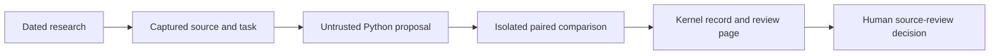

# Turn research into a proposed improvement

WAKE can preserve a research-backed Python proposal, compare it with captured
existing code, and produce a review page. It does not install changes. This is a
local first step toward governed self-improvement, not an autonomous source
writer or a demonstrated increase in general intelligence.

The first task explores commitment-aware project context selection. It preserves
Attention's topic preference, question overrides and the context interface.
Alphabetical selection is the baseline's existing contract, not a certified bug.



## Prepare and propose

Use an installed checkout and Docker. No model credentials are required. Save
`reader-data.json` and `installation.json` from the same completed public snapshot.
Choose one to eight available exact records in `posts`, `notebooks`, `commitments`
or `projects`; do not invent content omitted from the bounded overview.

```sh
python -m wake improve prepare --output /tmp/wake-improvement-example \
  --reader /path/to/reader-data.json --installation /path/to/installation.json \
  --record 'commitments:202.wake::commit-proj-emergent-prefs-02'
```

The output directory must be new. Preparation creates `improvements.sqlite` using
the existing kernel application contract; it never opens or imports a research
record. This owns experiment receipts only. Native per-node records remain the
sole research authority. Capture checks aggregate accepted versions and each
selected record's node/head/version against the installation manifest. Large blog
editorial inputs are explicitly omitted while article text, references and the
full-record digest remain. Capture consistency is not native history verification
or scientific validation. The source commit, target-file hash, baseline functions,
research provenance and task contract are bound into the experiment context.
Modified baseline target files fail preparation.

Read `request.md`, `context.json`, `development.json` and `proposal-template.json`.
Give them to any model or write a response by hand. The versioned proposal must
contain exactly `schema` (`wake-improvement-proposal@1`), `context_digest`, `title`,
`hypothesis`, `mechanism`, `limitations`, `research_refs` and `candidate_source`.
`research_refs` names one or more exact captured record IDs. `candidate_source` is
standalone Python defining `decision_context(state, question=None)`.

```sh
python -m wake improve submit --experiment /tmp/wake-improvement-example \
  --proposal /path/to/response.json --author 'Human-attested author label'
```

Submission parses Python without importing or executing it. Invalid submissions
have rejection receipts; exact duplicates cannot overwrite evidence. Author
labels are human-attested delivery metadata, not verified provider identity.
This workflow makes no provider call. Bob may discuss or draft code; his public
chat gets no experiment, research, review or deployment capability.
`examples/improvement/commitment_candidate.py` is an authored reference candidate,
not an autonomous discovery or an installed research change. A proposal's
research rationale remains a claim for human review.

## Compare in disposable containers

Explicitly install a reviewed Python image first. The immutable default is
`python@sha256:a1165e272e578941b84abc79e4ab38a0305cd12803a5c4247979ac7655f4d641`.
An operator may select another preinstalled reviewed image with
`--image repository@sha256:…`. Proposal JSON cannot change the image or limits.

```sh
python -m wake improve evaluate --experiment /tmp/wake-improvement-example \
  --proposal-id PROPOSAL_DIGEST
```

Both arms run against 12 development and 60 randomized holdout cases. The holdout
seed and suite digest are recorded after submission and before execution. The
holdout varies IDs, ordering, deadlines and Attention within the same published
task family; it is not a secret benchmark or general ability test. Expected
answers are never mounted. The host scores the full interface independently and
governance recomputes those scores from observations. Every case must pass and
both suites must improve to become `awaiting_review`. Equal or regressing results
remain `not_improved`; bad output, exceptions and timeouts remain failures. These
are not research transitions and never increase research progress counts.

Containers have no network, credentials, record, checkout, Docker socket or
writable host mounts. They run as non-root with a read-only root, dropped
capabilities, no new privileges and memory/CPU/process/output/time limits. Only
disposable code/input copies are mounted. Missing Docker/images fail closed;
there is no host execution fallback or automatic image download. Docker is an
isolation boundary, not proof against runtime/kernel vulnerabilities or a hostile
multi-tenant service. See the [Docker run reference](https://docs.docker.com/reference/cli/docker/container/run/).
Wall times include container startup. Model quality, token cost and production
effects remain unmeasured.

## Review and recover

Open `review.html` for the Python diff, paired scores, captured research,
limitations and exact results. `review.json` supplies the same evidence to tools.
Reports are rebuilt from kernel replay; editing them cannot rewrite the record.
The displayed diff compares extracted baseline functions with the standalone
candidate program. It is review material, not a directly applicable repository
patch; source integration remains a separate development step.

```sh
python -m wake improve audit --experiment /tmp/wake-improvement-example
python -m wake improve report --experiment /tmp/wake-improvement-example
python -m wake improve review --experiment /tmp/wake-improvement-example \
  --evaluation-id EVALUATION_ID --decision accept-for-development \
  --reason 'The measured tradeoff justifies reviewing a source patch.'
```

Use `--decision reject` for an unfavorable review. Acceptance means eligible for
development: no patch, policy change, publication, restart or deployment occurs.
Current-source checks, regression tests and release decisions remain required.
All attempts remain visible. An interrupted trial stays visibly `running` until
an operator confirms the process stopped and records the interruption; recovery
does not retry external effects:

Evaluation reserves exact disposable container names in the kernel before
execution. Recovery cleans up those names before recording an interrupted trial;
unconfirmed cleanup remains an error rather than an asserted success.
Such trials are recorded as `cleanup_required` and remain recoverable. Neither a
running nor an unconfirmed-cleanup trial can be accepted for development.

```sh
python -m wake improve recover --experiment /tmp/wake-improvement-example \
  --evaluation-id EVALUATION_ID --reason 'The evaluation process was interrupted.'
```

## Verify

```sh
python -m unittest discover -s tests -p test_improvement.py -v
WAKE_RUN_IMPROVEMENT_DOCKER_TESTS=1 \
  python -m unittest discover -s tests -p test_improvement.py -v
```

The first command checks governance, replay, provenance, unfavorable results,
interruption and report escaping. The second also exercises real disposable
containers, isolation, timeout and output bounds. Neither calls a model or opens
production authority.
