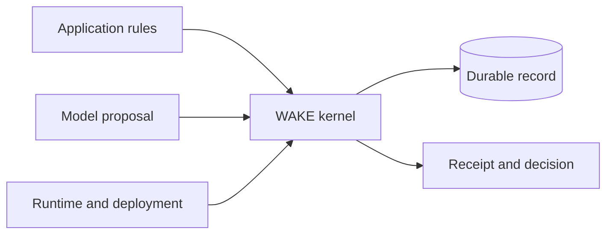

# Reusable kernel boundary

The kernel remains in `wake/kernel/` in this repository. Research remains the
operational application. A future repository/package split is a separate release
and compatibility decision; moving files alone is not the acceptance criterion.

**In plain language:** the kernel is the reusable record-and-rules layer. The
research application supplies research-specific rules. The runtime supplies the
model and where the record is stored.



The boundary matters: adding another application should not require putting its
rules into the kernel, and changing the model should not change record authority.

## Ownership

| Part | Owns |
| --- | --- |
| Kernel | Record format, deterministic decisions, replay and provider-call receipts |
| Application | Domain meaning and the rules for accepting a proposal |
| Runtime/deployment | Installed code, credentials, process lifecycle and selected record |

The kernel owns Record → Context → Proposal → Governance → Transition → Receipt,
serialized durable submission, verified replay, generic invocation accounting,
and storage contracts. Application definitions own deterministic domain policy.
Deployment owns installed application versions, permissions, provider credentials,
process lifecycle, and the selected record. A model proposes; it cannot grant its
own permissions or bypass governance.

For the name's conceptual meaning, see [why WAKE](why-wake.md). That metaphor
adds no API, computational function or guarantee to this technical contract.

`wake/application.py` is the research bridge, not the generic extension interface.
New applications use `wake.kernel.applications`: `ApplicationDefinition`, actions
returning `ApplicationDecision`, an `ApplicationRegistry`, and `ApplicationHost`.
The host exposes application state and revision rather than a database connection.
The trusted runtime constructs the kernel with a record and registry-backed
`Governance`; the evaluator receives only state and JSON input. Importing the
kernel must not import research, GitHub tooling, or another project's package.

## Executable non-research proof

From the checkout, with Python 3.11 or later:

```sh
python -m examples.task_list.run --data /tmp/wake-task-example
```

The example adds a task, rejects completion of a nonexistent task, completes the
real task, and verifies audit replay against current state. All three decisions
produce receipts; only the two accepted transitions advance the revision. Reusing
an already recorded proposal ID raises an error without appending another receipt.
Stale-revision requests are governed rejections. No AI or network is needed.

The example writes `task-list.sqlite`, never the research record `wake.sqlite`.
Use a dedicated directory anyway. This is a contract example, not a replacement
research Console, a task service, or a new commercial product.

`tests/test_kernel_boundary.py` runs the example in a temporary tree containing
only the kernel and example, with site packages disabled. It also exercises
stale requests, duplicate IDs, domain rejections, separate application state,
version mismatch, and generic replay after application removal. An import-boundary
check protects the standard-library-only dependency seam. This proves execution
without the research package; a separately distributed wheel remains future work.

## Durable application contract

Keep application IDs, versions, action names, and historical JSON meaning stable.
An existing application's version cannot be renamed or replaced as a cosmetic
cleanup. A changed interpretation needs an explicit, tested migration. Deterministic
evaluation must not depend on network, wall clock, random values, or side effects;
put such observations in the untrusted input before governed evaluation.

An action may supply a deterministic `replay` reducer for committed event-log
entries when current eligibility is stricter than historical acceptance. Live
intents always use `evaluate`; callers cannot request historical permission.
Replay still checks every recorded result digest. WAKE's historical event reducer
uses this seam to preserve accepted work through evidence-policy hardening.

Two supported persistence modes have different guarantees:

| Mode | Recorded meaning | Reconstructing domain state |
| --- | --- | --- |
| `snapshot` | Verified resulting state | Generic replay needs no application code |
| `event_log` | Action input and result digest | Matching evaluator version required; generic replay preserves envelopes |

Research uses event-log storage and verified derived projections to avoid repeated
full domain reconstruction during normal operation. Missing application code must
never be treated as an empty or guessed research state. A generic history audit
and a domain replay check are distinct guarantees.

Applications may coexist in one kernel record, but their state keys are separate
and the record revision is shared. This is not multi-tenant security: trusted
host code can access the kernel. Separate independent installations must have
separate records and volumes, not merely separate application IDs.

Effect requests declare intent only. Installed capabilities and deployment grants
both limit them; declaring a capability is not permission to execute it. Retain the
existing durability-before-effect runtime boundary when adding effects or providers.

## Deployment independence

Use [standalone](standalone.md) for container operation and
[multiple installations](installations.md) for independent records and optional
hostname routing. The kernel and research application run without GitHub. GitHub
transport, public Pages projection, and operator Actions belong to their hosted
adapter, not application authority. See [development](development.md) for source,
image, process, volume, and publication custody.

## Physical storage and compatibility

SQLite storage version 13 encodes large event JSON payloads as versioned zlib
BLOBs when compression saves space; small or incompressible payloads remain TEXT.
The projection cache uses a versioned binary wrapper rather than Base64 text.
For JSON at least 128 KiB, the codec can store repeated long string tokens once
in a stream-local dictionary before zlib compression. This shares repeated
provider text across the historical events represented in a cache, and within
large event payloads, without removing any logical event or cache field. Tokens
preserve exact UTF-8 bytes and JSON escapes. The scanner consumes ordinary text
in spans to reduce CPU cost for long strings while retaining the same token
grammar and encoded bytes. No external blobs, dictionary files
or application-specific imports are required. Each value uses this encoding only
when it is smaller than the original zlib format (and plain event text).
Both version-12 binary wrappers remain readable.
The reader still accepts legacy event TEXT and legacy plain or `zlib:` projection
text. Use record history/export APIs rather than parsing physical columns directly.

Opening an older writable record verifies the event chain and operational journals,
then atomically reencodes original UTF-8 JSON bytes and verifies the same chain and
journals before committing the format marker. It neither canonicalizes historical
payload text nor changes receipt IDs, timestamps, provenance, hashes, or revisions.
A failed migration rolls back the rows, cache and version together. One subsequent
verified compaction reclaims old pages; interruption there leaves a valid upgraded
record. Reopening the current format does not repeat the migration.

Cached reads verify the projection digest and its history anchor; they are not a
full scan of every historical event. Full kernel replay verifies the complete chain
and reconstructs recorded envelopes. Event-log application reevaluation additionally
requires the matching historical policy semantics, as described above. Compression
cannot repair policy drift or certify application reevaluation. Unknown, malformed,
truncated or trailing compressed streams fail closed; decoded events still undergo
ordinary hash verification. `tests/test_storage_compression.py` exercises migration,
rollback, mixed formats, corruption, exact Unicode, exports and reader compatibility.

Older runtimes reject storage version 13. Keep an immutable pre-upgrade backup,
and upgrade each installation against its own record. Never restore that backup
over work appended after the upgrade merely to roll back executable code.
