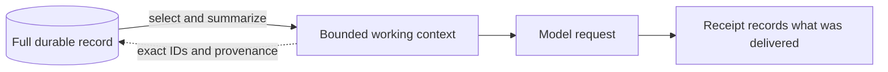

# Routine memory and retrieval: making forgetting observable

## Optional decision-relevant recall

Decision memory asks which recorded information might change the next decision.
It is a deterministic, experimental aid; it does not decide what is true. An
explicit [autonomous context grant](autonomous-context.md) can adapt one installed
project selector after fixed-task and native-state measurement; the recall ranking,
source qualification, budgets and governance remain outside that change allowance.
Without that grant, selection remains fixed. Exact history remains authoritative. A current belief
or notebook is a revisable interpretation of that history. A selected memory is
an estimate of relevance, not evidence that remembering it helped.

Experimental questions use these same retrieval rules, source qualifications and
context budgets. Cross-topic recall does not qualify an unseen source for citation.
A deliberately fresh installation has no memories from discarded records; no
autobiographical narrative or substitute summary is injected during its reset.

The feature defaults to **off**, independently of the existing `memory_mode`:

```toml
# Independent of memory_mode; this controls optional historical recall.
decision_memory_mode = "off" # off, shadow, active
```

Use `shadow` to compute a hypothetical request and record selection without
changing the actual provider request. It makes no additional API call. Use
`active` only through an explicit operator configuration change after reviewing
the [offline comparison](experiment.md#decision-memory-evaluation). No installation
is automatically activated, restarted, reset or migrated by a source change.
Disabling the feature affects future invocations; previous receipts remain intact.

### Make room without losing the record

Active working memory compacts the request before it reaches the character ceiling.
Its established compact core and trust instructions are normalized before optional
space is allocated, so recovered room is available for useful record detail and recall.
Identical fields in retrieved records use their existing `content_location` pointer
rather than repeating supplied prose, IDs and source roots. Collector prose
always follows the source-delivery owner in `context.evidence`; active retrieval
never adds a second clipped copy of the raw collector JSON. Each pointer retains its
exact record hash and retrieval reasons. Missing targets and conflicting source/root
sets remain explicit; a reference never reconciles different records or supplies
missing text. A decision capsule also reuses an identical supplied excerpt.

A retrieval-planning request asks only which sources to collect. It retains the
question, source excerpts, beliefs, open obligations, corrections and Attention,
but omits proposal eligibility diagnostics and publication views. The subsequent
proposal rebuilds its own constraints from the authoritative record. Planning is
fitted against its actual plan schema before any proposal-specific emergency fit.
Instructions for a due Bob checkpoint are included when that checkpoint is offered;
notebook quality instructions follow the finalized notebook action choices. Existing
trust, citation, uncertainty and governance boundaries remain in every relevant phase.

Seed questions disappear once any durable project owns their topic, including parked
or completed projects. Rich and bounded views share this rule; the configured seed
and its provenance remain recorded. Unstarted topics retain their seed.

The default 48,000-character ceiling still covers the exact complete system and user
text, including the response contract. Optional decision memory gets the room left
after mandatory context, never authority to displace obligations or evidence gates.
If optional source expansion would leave no room for recall, the engine also tries
an existing-context-only capsule. Its source-root availability labels remain explicit;
its response contract and scientific-source allowlists stay byte-for-byte unchanged.
A remembered notebook does not qualify its unseen sources for citation. The private
receipt distinguishes expanded-source delivery from this bounded fallback. Neither
path makes an extra provider call.

Planning and proposal receipts separately report explicit memory-ID mentions. A
validated retrieval plan is recorded as `research_planned`, not accepted research.
Smaller requests and identifier mentions do not establish better decisions.

### Candidate identification and contextual assessment

`wake/decision_memory.py` reuses `build_retrieval_shadow` and
`active_retrieval_plan`. Existing project-source handoffs and unincorporated
evidence stay with their existing owner. Additional candidates come from bounded
windows of the already verified application projection, not another database or
an autonomous historical search. These windows cover beliefs, notebooks,
commitments, projects, observations, invocation failures, collection failures,
operator source reviews and measured reproductions. Editorial invocations and
runtime/private/advisory observations are excluded from research recall.

The current decision consists of the operator question, or the active project's
question and next step, with current Attention and focus. Association with that
project/topic or shared question terms makes an ordinary candidate relevant;
all open commitments remain protected in the existing context. Token overlap is
only a retrieval lead. It never establishes a contradiction, scientific surprise,
source independence or cross-topic validity.

Categories, in default priority order, are:

1. Retractions, revised notebooks and explicitly recorded belief revisions.
2. Operator source reviews or claim reviews with explicit counterevidence.
3. Open commitments, which are already delivered through mandatory memory.
4. Failed approaches, labeled separately as governance rejection, provider
   failure or collection failure; none is scientific disconfirmation.
5. Measured reproductions that failed their recorded predeclared acceptance test.
6. Project decisions with a recorded representation/reframing history.
7. Recorded notebook limitations.
8. Existing source handoffs and unincorporated evidence.
9. Other question-relevant leads, including explicitly labeled cross-topic hypotheses.

Within a category the selector prefers current project association, then the
Attention topic, then smaller exact records, with kind and ID as stable final
tie-breakers. It does not reward confidence, citations, repetition or recency.
Root works use the existing source-identity resolver: repeated node observations
of one work do not become independent corroboration. Node attribution is retained.

Policy is explicit, versioned and bounded. These optional settings show the
defaults; changing priority requires listing all nine categories exactly once.

```toml
[decision_memory_policy]
version = 1
scan_records = 256
max_candidates = 64
max_memories = 6
capsule_chars = 6000
# priority = ["correction", "explicit_review", "open_commitment", "failed_approach",
#   "unexpected_outcome", "lasting_decision", "recorded_limitation", "source_handoff",
#   "contextual_lead"]
```

These are application/operator settings, never model-proposed actions. Unsupported
modes, versions or settings fail closed. No ranking weights update automatically.

### Dormant records and bounded cost

Projection keys are sorted deterministically. Each kind receives an equal payload
inspection window, rotated by accepted version and decision-context identity.
With defaults, at most 252 window payloads plus 64 existing retrieval references
are considered; 64 ranked candidates reach the selection manifest. Sorting keys
still costs work proportional to projection key count. This is not a constant-cost
semantic index, and does not read or scan SQLite event history again.

There is no age cutoff. Direct retrieval references can immediately recover an old
source; other dormant projected records can return as the window advances or the
decision changes. This is bounded reconsideration, not guaranteed immediate recall
of every old item. Coverage, unvisited retrieval candidates, overflow count/digest
and exclusions are recorded. Unscanned records are explicitly outside measured
coverage. A low assessment never deletes or permanently disables a record.

### Decision State Capsule and delivery

After the ordinary request has fit, the engine tries a disposable
`decision-capsule@1` retained in the invocation receipt. It binds the current
application version and exact pre-invocation head, decision identity and policy
digest to selected record hashes, provenance roots, source-work identities,
selection reasons, statuses, uncertainties and omission evidence. The head includes
the existing continuity observation and precedes `invocation_started`; it is an
intended snapshot anchor, not a claim that the database stops advancing.

The model receives this capsule under `context.decision_state_capsule`, or a
`decision-capsule-view@1` when the smaller view saves characters including its
extra instructions. The view's `audit_capsule_hash` binds the complete capsule.
It shares repeated uncertainty and omits audit-only verification/scan digests,
while retaining selected record hashes, root IDs, underlying work identities,
node attribution, availability, corrections and caveats. Omitted audit details
are unavailable in that invocation, never implied evidence. View validation
requires the complete audit capsule and verifies exact projection equality before
the existing snapshot and source checks. Both formats remain untrusted advice.

Identical prose already in context is replaced with a content-location pointer.
Open commitments stay in mandatory context rather than consuming optional slots.
Collector prose is materialized only through `rehydrate_retrieval_context`, with
the existing readability, repository-source budget and project allowlists. A
human measurement stays a human observation, never a scientific source. Missing
roots and roots not delivered as qualifying scientific sources remain visible.
A notebook's current operator correction accompanies its interpretation.

The engine builds the prospective delivery on a copy, rebuilds the appropriate
proposal/planning schema, removes unselected optional source additions, verifies
record/root hashes and snapshot freshness, then measures the exact final provider
renderer. Optional selections shrink or disappear when they do not fit. Mandatory
context, evidence roots, source rules, commitments and the original fail-closed
ceiling remain intact. If the bounded attempt cannot fit or stabilize, the original
request is delivered unchanged and the failed hypothetical fit is recorded.

New observed belief revisions retain their previous exact interpretation and hash
in the existing terminal invocation metadata. A later capsule can show a bounded,
explicitly superseded excerpt beside the current belief and revision invocation.
Older records without that instrumentation retain exact history and revision
invocation pointers; this prototype does not reconstruct all prior belief prose
or discover semantic contradictions by scanning their event archive.

### Observations are separate from benefits

`context_delivery.decision_memory` records the candidate manifest, exclusions,
capsule, coverage, computation time, baseline/hypothetical request hashes and
provider character counts. Existing `request_hash`, invocation identity, provider
lifecycle and terminal receipts bind the actual request to its governed proposal.
Shadow capsules stay in receipts, outside model input.
The public export filter omits the new capsule/selection/use namespaces, including
copies nested in event metadata. Operators inspect native receipts or isolated
comparison artifacts; private request telemetry does not become a public feature.

Terminal metadata reports explicit selected-ID references and the normalized
proposal hash separately from delivery and governance outcome. This metadata is
also reconstructed in the invocation projection. An ID mention is not proof that
the model understood or used a memory. Both `decision_changed` and
`outcome_improved` remain unknown without controlled evaluation. Acceptance is
not a scientific-quality score. Bob's writing and private advisory assessments
gain no research authority from this mechanism.
Here delivery means inclusion in the prepared request at the existing provider
boundary. Actual transport attempts have their own lifecycle receipts; neither
preparation nor successful transport proves that a model read or understood it.

The existing richer retrieval mechanisms below remain unchanged when the feature
is off. See the [evaluation protocol](experiment.md#decision-memory-evaluation)
for reproducible checks and limits.

The [kernel contract](kernel.md) distinguishes generic envelope replay from
application state reconstruction. Application IDs share a record revision when
installed together; independent installations must select separate records.

[Ask Bob](ask-bob.md) separately uses an article-specific public passage guide,
capped at 96 KiB. The hosted conversation API verifies the displayed article hash
and source heads, selects up to 18,000 characters from at most 24 passages, and
passes these with recent conversation to Gemini. The browser keeps at most six
recent turns for this path, clipping each submitted question to 1,000 characters
and each prior answer to 2,000; the current question allows 2,000. The server never
accepts client-selected source URLs, system prompts, tools or models. Unbound
exports search the same guide locally. Every Bob mode is advisory and excluded
from research retrieval, governance and accepted scientific memory.

The separate [inspection reading path](inspection.md) offers a compact orientation,
manifest and progressively deeper static evidence. It requires no model-specific
protocol or JavaScript and never reads public presentation back as runtime truth.

## Internal nodes and Console aggregation

In the current one-container installation, three parents and nine children each
own a record and receive bounded context through the research application. Shared
notes and repeated source material retain their original attribution; another
node's use of the same source does not create independent evidence. The kernel
retrieval and authority boundaries are unchanged. The hosted Actions adapter uses
the same controller and bounded contexts, with encrypted native-record transport
between runners. Transport may wait for GitHub API quota while retaining the
same native history and pre-effect durability requirement. GitHub Pages remains a same-origin exported view; it never
becomes a retrieval authority or a provider gateway.

`installation.json` combines exported node projections for inspection. It cannot
replace a node's record or become operational truth. The Console selects a node's
complete view; the public mirror shows dated exports rather than live execution.
[Standalone setup](standalone.md#run-one-installation-container) owns that transport
and operator contract. Archives for import/export remain separate from public views.

## In plain language

The full record keeps exact history. A model receives a smaller working view so
the request stays useful and within a size limit. When detail is needed, the
request can point back to exact records. If required material still will not fit,
WAKE stops before calling the model rather than silently dropping obligations.



The shortened view is not a second database, and it is not semantic memory. It
does not reliably detect contradictions or decide what is true.

Project source handoffs exclude unreadable payloads and prefer a qualifying
underlying work not yet cited in a belief or notebook over a newer repeat or
mirror of incorporated material. The bounded unincorporated-source window uses
the same preference while preserving domain fairness. Repeated works remain
available when fresh works are absent. This orders delivery; it does not change
evidence eligibility, establish novelty or rewrite historical citations.

The configured `memory_mode = "active"` promotes derived working views into routine provider input. Every invocation carries compact belief state, all open commitments, active projects and recent notebook pointers, plus `context.memory` containing advisory compacts and selected durable records. Recent operator observations and retractions with their newest counterevidence take priority, followed by excerpt boundaries, due work, revisions and source handoffs. Up to eight retrieved records and eight compacts are delivered; fields are excerpted at 900 characters and compact rules at 320. Omission counts/digests, missing references, exact record hashes and retained evidence roots expose the limits. This is a deterministic bounded retrieval policy, not semantic contradiction detection.

Collected source prose follows the existing qualifying-source rehydration budget (up to three records at 1,800 characters in active mode and four distinct repository URLs in total). Collector records outside visible source delivery carry pointers without content. Human falsifiers keep their provenance and can support belief review without becoming scientific notebook sources. Recent notebook evidence roots are included in the active retrieval plan so synthesis and publication allowlists remain usable.

The complete request is checked again after same-wake research links and final proposal instructions are added. Under pressure, source excerpts shorten first to 900 and then to 400 characters. Duplicate retrieved belief prose points to the mandatory belief working set; prose may shorten to 80 characters. Optional advisory compacts shorten and then reduce in number, with omission counts and a digest, retaining challenged hints first. Visible evidence IDs, mandatory belief provenance roots and open commitments remain present. If that request still exceeds the ceiling, emergency compaction shortens planned queries to readable excerpts, replaces their URLs with request hashes, and keeps the active-memory trust instructions and final proposal instructions. If the exact request still cannot fit, no model call is made. The standalone scheduler keeps its website available with a `blocked` runtime status until an operator reviews the budget and restarts it.

Numbered containers created by the local `wake_runner` exchange a bounded set of
readable source observations and one concise, attributed notebook finding per peer
over their private group bridge. A source packet carries the source URL and
collected content plus its originating instance, evidence ID, application head,
version and content hash. The receiving WAKE appends each valid item to its own
record as a peer-origin source observation, then applies its usual source
qualification and claim-support rules before allowing citation. The notebook
finding is an attributed lead, never a local claim or citation ID; full notebooks,
topic lists, projects and record authority are not shared. The normal research
context includes peer notes and selected peer sources alongside local sources,
without instructing the model to seek a particular connection. Fetching and
importing peer material makes no provider call. The local bridge trusts its
operator-created members and is not cryptographic remote attestation. Solo,
Codespace and hosted installations do not participate.

Grouped local Gemini model requests also use the local gateway as a best-effort
FIFO call coordinator. It serializes provider requests and applies per-model
spacing, but it carries no research data or durable state. If the gateway is
unreachable, a member proceeds without coordination; leases expire if a member
stops during a request. This scheduling layer does not join solo, Codespace or
hosted installations.

The active-memory fit also bounds milestone editorial history, including when final research links arrive after its initial fit. It clips editorial prose to 80 characters, omits auxiliary editorial project/notebook/search windows, and retains as many of the latest four, two or one accepted wakes as fit; zero is permitted when necessary. Previous-reflection identity and milestone remain, alongside the original history hash, original window counts and omitted counts. Repeated fits preserve that original hash. These omissions affect only disposable editorial context, not the durable record or the current research working set. The existing hard ceiling still fails closed if protected context cannot fit.

`memory_mode = "shadow"` restores rich delivery with the established size-triggered fallback after runtime restart. The raw shadow builders remain unchanged in both modes. Derived memory neither rewrites history nor changes governance; the authoritative database remains the single source of truth. Active requests receive a final emergency fit after same-wake plan details and proposal instructions are attached. That fit preserves compact trust instructions and request identities; requests still above the exact provider ceiling stop before inference.

Console’s browser overview is a separate disposable presentation projection. Its bounded graph and record excerpts are never read back into provider context or retrieval decisions. IDs, explicit relationship pointers and record-head provenance support deeper inspection through Console’s complete record workspace; missing overview records do not imply missing authoritative records.

Current source eligibility requires nonempty readable collected material. Publisher menus and response forms cannot make a source synthesis-ready or supply claim-support tokens. Historical raw observations remain available for exact inspection; stricter current qualification does not invalidate historical replay. Derived evidence-quality diagnostics include unreadable cited-source IDs.

### Browser views and exact detail

Research transport always reads same-origin exported files. An explicitly bound
hosted header light separately reads public GitHub Actions metadata; batch execution
is not research progress or a live per-node capability. See
[hosted status](cloud.md#read-the-hosted-status-light) for freshness and failure behavior.

Open the homepage, Blog or journal normally. Reader pages download a recent
overview of at most 256 KiB. Select a story, source, notebook or invocation to fetch
its exact exported detail. Use **Load older** below a list to fetch another page.
Recent-overview limits are labelled; complete history and state exports remain
available through their explicit archive links. An overview does not count as the
complete record and is never used to reconstruct authority.

Generic application observability also separates complete-history counts from
bounded recent lists; zero or negative recent limits omit those lists. Its failure
diagnostics are derived evidence, never provider context or recovery authority.
See [operational indicators](resilience.md#use-separate-indicators).

Console and its process view share `research-overview.json`; opening a wake's
context or response fetches its detail under `research-details/`. The complete
`research-data.json` export remains available separately. Detail errors are visible
and retryable. A record-detail packet that belongs to a different reader snapshot
is rejected with a reload instruction. Ordinary refreshes check the small export
head rather than downloading the accumulated archive again.

These files are produced together in a disposable website generation. HTTP
serving reads completed exports and bounded observations, never a record database
or provider. Stopped, stale or missing workers therefore cannot gate access to
completed pages. Missing exports remain visibly missing; no replacement research
or synthetic progress is inferred.

## Why this exists

Progressive abstraction only stays epistemically safe if compression remains correctable.

A useful architecture therefore needs two deterministic questions:

1. What can leave active context?
2. What conditions should cause exact resolution to return?

The retrieval shadow answers the second question without pretending that a deterministic rule can understand semantic contradiction.

## Current deterministic signals

The planner records bounded candidates for:

- **excerpt boundary** — a belief claim or retention reason was clipped in the working abstraction;
- **belief retracted** — the current durable state says a belief was retracted;
- **notebook revised** — a research notebook has been materially revised under newer evidence;
- **commitment near due** — an open commitment is within two cycles of its due cycle;
- **unincorporated evidence** — recent durable non-runtime evidence is not yet represented by a belief or notebook.

Each candidate records IDs and provenance pointers only. Evidence contents remain in the authoritative durable record.

## What it does *not* claim

The deterministic planner does **not** claim to detect contradiction, importance, truth, consciousness, intent, or subjective uncertainty.

“New contradiction or counterevidence” remains a semantic judgment. A later controlled design may let a model request exact rehydration for that reason, but the request must itself become a receipt.

## Invocation receipt

Each invocation should now retain:

- `working_set_shadow`
- `retrieval_shadow`
- working-set size versus delivered-context size
- retrieval candidate count
- number of exact evidence IDs the planner would rehydrate
- counts by deterministic trigger
- `trust_compacts_shadow`: candidate operational rules, their evidence roots, and their deterministic reopen hooks.

`retrieval_shadow` and `trust_compacts_shadow` remain receipt-side measurements. Active mode derives provider memory from them without making either authoritative. `context_delivery` records `memory_mode`, `activation_reason`, `memory_digest`, retrieved-record count and measured request sizes; `request_hash` identifies the exact full request. No extra model call is made.

## Evaluation boundary

Routine active delivery is operator-enabled, and the size-triggered fallback remains an operational safeguard. Neither proves behavioral equivalence to rich context. Paired evaluation remains necessary to score whether the representation preserves:

- evidence-backed belief revision,
- contradiction/counterevidence handling,
- commitment continuity,
- research provenance,
- justification quality,
- and recovery from abstraction mistakes.

The comparison remains:

**A — rich context**  
Delivery in shadow mode when it fits.

**B — working abstraction + recoverable provenance**  
Routine active delivery and the controlled overflow fallback, distinguished by receipt activation reason.

**C — overcompressed control**  
A deliberately weakened condition that removes provenance or uncertainty cues.

The primary question is whether B preserves correction while reducing active context.
The executable [paired comparison](experiment.md#paired-memory-and-model-comparison)
implements A and B from one frozen synthetic record, with native context/receipt
handling and separate structural checks and human explanation scoring. C and repeated
human-scored research handoffs remain future work.

> Exact underneath. Approximate on purpose. Correctable always.

Console wake inspection includes bounded delivered-context field names, the full observed system instructions and recorded request, request identity, provider-attempt metadata and terminal receipt identity. It does not reconstruct absent start events or treat context receipt presence as proof that a proposal was accepted. Source-depth drilldowns show cited records in the bounded graph; overall evidence counts may exceed that displayed population.

Console carries recorded context-delivery measurements alongside complete observed requests. Compression plots use the reported retained-request ratio. Allocation plots group selected delivered fields as objectives, constraints, frontier and results; excluded fields and the bounded event population are explicitly described.

Console also exposes the exact provider-response text retained by terminal events. Rejected responses remain unaccepted output; parsed proposal summaries are views of that output and never replayed as accepted actions. The UI labels missing response events and any recording-time bounding.

## Verified replay seeds

Signed checkpoints materialize the WAKE application projection once instead of replaying its entire event-log prefix on every checkpoint resume. `replay-checkpoint` verifies the independently retained signature and boundary, then incrementally applies later semantic events and checks their recorded application result digests. It exports derived state without changing the database or ordinary startup. `verify-checkpoint` performs the slower genesis audit, including complete provider/access journals. The signed-prefix trust boundary is explicit: fast replay cannot prove untouched interior prefix bytes or later provider/access events. Complete original history is always retained for audit. Compact source concentration counters in normal provider context help expose repeated material without conflating diversity with truth.

Active delivery avoids copying evidence prose twice: retrieved records use `content_location` to identify the corresponding readable entry in `context.evidence`. If the request still exceeds the ceiling, extended recovery prose is replaced with explicit omission markers, hashes and retained project/frame/observation pointers. All belief identities, evidence roots and open commitments remain intact. If this bounded request still does not fit, the provider is not called.

Same-wake research plans are recorded before fetching. The collector can follow bounded metadata routes immediately instead of requiring another scheduled cycle. The final request prioritizes newly collected source IDs, including when no active project exists yet, then rebuilds scientific-source allowlists. Retrieval failures remain observations with `scope = failed`; discovery/metadata cannot become notebook evidence merely because they arrived in the same wake. Further pressure reduction excerpts source/working prose explicitly while preserving visible identities, evidence roots and request hashes anchoring shortened retrieval instructions.

An attached planning project must be active, delivered in context and in the requested topic. A question with no eligible project uses an empty project ID without implicitly reopening historical work. Invalid plans remain rejected receipts and stop that wake before retrieval; the scheduler may continue with a fresh planning invocation.

Routine and emergency views retain full-record queue counts, exact visible project identities, notebook-specific new-evidence IDs and the last two rejection/failure reasons with targeted recovery guidance. The contract is refreshed after evidence rehydration, so new same-wake sources may enable a revision without losing prior notebook identity. Omitted notebook prose cannot make an existing artifact appear new. This guidance is operational context rather than research evidence, and the original append-only record remains unchanged.

When Attention selects a parked topic while all three project slots are occupied, the provider contract offers one exact parking transition first. A due editorial checkpoint remains separate. This temporary generation restriction avoids unrelated commitments or synthesis attempts before capacity recovery; governance still decides whether the proposed transition is valid.

## Inspecting delivery across installations

Memory receipts describe the record that produced them. A local Console reads its
installation's same-origin `research-data.json`; public mirrors read their uploaded
public projection. Confirm the displayed head/version and export mode before using
a screenshot to assess retrieval or memory behavior. Shared code and shared topics
do not make histories interchangeable. Missing context events in a bounded overview
are a presentation gap, not proof that invocation evidence has been lost. Use the
matching installation's complete record tools to resolve it. See [development](development.md).

## Inspection metadata

`recorded_activity` is a dated view of pending invocation/cell identity. It is not
retrieved as operational context and does not authorize continuing a pending wake.
The optional container activity channel is ephemeral and is never replayed into
research memory, matrix results or history. Its live pulse is not a score.

Retrieved projects, notebooks, search records and commitments already delivered in
working fields use explicit `content_location` pointers instead of duplicate prose.
Their exact retrieval hashes, status and evidence roots remain in memory receipts;
records outside the visible working set retain their delivered value. This fit is
idempotent and changes only the provider view. The final ceiling remains mandatory,
and an impossible protected context still fails before any provider call.

Current proposal guidance derives belief-review eligibility from the full record and visible evidence. Existing belief IDs are separate from new-belief creation; a review must cite at least one visible evidence ID outside that belief's durable roots. If no such evidence is delivered, no review alternative is offered. This narrows generation guidance without changing acceptance or historical replay.

When the provider request approaches its context ceiling, belief review alternatives are bounded to one genuinely new visible evidence root per belief before source prose is shortened. Where eligibility overlaps, reviews share a root so equivalent schema branches merge; all offered belief IDs and their new-evidence requirement remain. This prevents repeated schema alternatives from crowding out an enabled continuity sidecar. Durable belief evidence and deterministic governance remain unchanged.

Under final context pressure, the engine can replace verbose core instructions with
a concise equivalent before reducing source text. Active-memory instructions may
also use concise wording preserving trust, correction, omission and citation rules.
Application, probe and operator-question instructions and the response schema
remain intact. The delivery
receipt records the compaction; durable evidence roots, obligations and governance
are unchanged. Requests that still cannot fit fail before inference.

Under extreme final-envelope pressure, omission explanations use concise,
human-readable labels. Every category remains represented; unknown labels stay
verbatim. This reduces delivery metadata rather than omitting a test, evidence
identity, provenance root or obligation. Exact delivered requests remain recorded.

A retrieved record with a full-record `content_location` pointer may omit fields
that exactly duplicate that supplied working record. Retrieval hashes and the
pointer remain; every omitted field stays in the named working record. Different
source provenance or evidence roots remain explicit instead of being merged or
discarded. Records outside the supplied working view retain their values.


## Provider-ready input budget

`max_context_chars` bounds the exact model-visible **system plus user text**, in
characters. It is WAKE's application safety budget, not a vendor token-window
limit and not the size of an escaped HTTP JSON body. The engine and Gemini adapter
share `provider_input_text`: compact JSON is rendered identically without expanding
Unicode or inserting display whitespace into the context or response contract.
The adapter refuses an oversized request before any network call, including when
called outside the engine. Fallback models receive the same rendered text.

Every fit includes the complete instruction/response contract and enabled
continuity packet before calculating the remaining working-context allowance.
That allowance covers all other context fields, including retrieved memory,
working beliefs, source handoffs and omission metadata. There is no separate
unaccounted schema or final-link surcharge. The final fit runs again after planning
links and allowlists have been refreshed. Protected provenance and obligations
remain governed by the existing retention rules; impossible requests still fail
closed. An optional probe that cannot fit remains untested rather than receiving
a fabricated result.

New invocation receipts carry `context_delivery.provider_input_budget`, with a
versioned measurement basis, exact rendered-input hash and size, reserved
instruction/probe sizes, working-context allowance and usage, and remaining room.
Provider-attempt receipts record the matching rendered-input hash/size. These
receipts let inspection distinguish compaction from transport formatting and
prove which text was attempted. Historical `delivered_request_chars`,
`rich_context_chars` and `request_compression_ratio` retain their compact internal
JSON-envelope meaning; use the new `provider_input_compression_ratio` to compare
rich and delivered model-visible text. Transport bytes and vendor-reported token
usage remain separate provider measurements. No extra provider call is required.

Group Bob requests carry bounded attributed excerpts from every member, with
record heads and versions identifying their dated origins. Excerpting must not drop
a member or let the model infer missing facts. These summaries are editorial
context rather than imported qualifying evidence. Native invocation receipts retain
the exact delivered public request and model response. Inputs include notebook
and revision identifiers, dates, claim labels, limitations and source/record links.
Whole older stories and prose may be omitted to fit; remaining identifiers are
retained, and an oversized source URL is omitted rather than truncated into a
false link. Recent attempts are selected by recorded time. Articles cite supplied
story IDs; operator correction feedback and a bounded prior-draft excerpt reserve
room inside the same provider input ceiling. See the
[editorial contract](development.md#first-run-publication).

Later group requests also compare current supplied story packets with the last
accepted article's captured inputs and include bounded excerpts of that article.
These differences describe the delivered records, not semantic novelty or verified
scientific progress. Optional prior prose is shortened or omitted before current
member summaries and citation identities. Earlier Bob prose remains presentation,
never qualifying evidence. See [reader continuity](development.md#reader-experience-and-editorial-continuity).

Model-context summaries do not replace exact durable requests or responses. Storage-version 13 dictionaries compress repeated text losslessly; this changes storage, not delivered context or retrieval policy. See [kernel storage](kernel.md#physical-storage-and-compatibility).

The final proposal schema is rebuilt after quality-policy and measured-result context are attached, even when queue constraints have not changed. Non-tested claim results are empty strings; tested eligibility comes only from visible measured reproductions. Both rich and compact instructions require copying the current version without incrementing it, and recovery guidance retains these specific rejection remedies.

Under forward quality policy, notebook proposals supply structured claims and omit the duplicate `findings` field. WAKE renders findings from those exact statements and support IDs before validation. Historical proposals with supplied findings remain valid only when they match the claims exactly; conflicting prose is never repaired. Source support and accepted-cycle accounting retain their existing checks.

Source delivery compacts the parsed source packet rather than cutting serialized JSON. Bounded views preserve source classification and select exact substantive prose ahead of titles, authors and PDF front matter. Escaped JSON stays within the provider budget, and successive shortening retains a quotation surface. These are incomplete derived views; full source records, IDs, provenance and exact-passage validation remain authoritative.

An explicit hosted activity binding can additionally observe the owning native
runtime through the [expiring relay](cloud.md#watch-live-hosted-node-activity).
This channel carries current stages, not research records or provider content;
research still loads same-origin exports. It never updates accepted counts.
Context tail queries reuse verified history for one read-only context build only;
the next build checks the record again.
